# LAPORAN PRAKTIKUM BAB 6
## Centralized Logging dengan Fluent Bit dan PostgreSQL

**Nama**: Ale Perdana Putra Darmawan  
**NIM**: 3126640016  
**Kelas**: STr LJ Teknik Informatika A  
**Tanggal pelaksanaan**: 27–29 Oktober 2026

> **Disclaimer penggunaan AI.** Laporan praktikum ini disusun dengan bantuan kecerdasan buatan (AI) yang difungsikan sebagai alat dokumentasi. AI digunakan untuk merapikan catatan praktikum, menyusun struktur dan alur penulisan laporan, serta menyunting tata bahasa. Seluruh pelaksanaan praktikum, pengambilan bukti berupa screenshot, verifikasi keluaran perintah, dan pengambilan kesimpulan tetap dilakukan secara mandiri oleh saya.

## 1. Tujuan Praktikum

1. Menjelaskan kebutuhan centralized logging pada lingkungan container yang bersifat *ephemeral* dan mudah dibuat ulang.
2. Mengirim log `stdout`/`stderr` container ke Fluent Bit menggunakan Docker `fluentd` logging driver melalui protokol Forward.
3. Menyimpan log ke PostgreSQL dalam kolom `JSONB` dan membuat view analisis untuk kebutuhan pencarian.
4. Membuat tiga log generator yang mensimulasikan event `INFO`, `WARN`, dan `ERROR` dari service berbeda.
5. Menerapkan query pencarian log, agregasi per tag, dan retention sederhana.
6. Membuktikan perilaku buffering Fluent Bit ketika PostgreSQL tidak tersedia sementara, lalu pulih kembali.
7. Menjalankan aplikasi PMB multi-service dari workspace `pmb-devsecops-lab` dan mengirim `stdout` ketiga service aplikasinya ke pipeline Fluent Bit yang sama.
8. Mengorelasikan event lintas service menggunakan `request_id`, lalu merekonstruksi kronologi insiden timeout hanya dari centralized log.
9. Membuktikan recovery transaksi baru serta keterbatasan *at-least-once delivery*, sekaligus memverifikasi tidak ada credential maupun data pribadi yang masuk ke tabel log.

## 2. Dasar Teori Singkat

### 2.1 Centralized Logging dan Observability

Log adalah rekaman diskret mengenai peristiwa yang terjadi pada aplikasi, container, host, maupun kontrol keamanan. Pada lingkungan container, proses idealnya menulis log ke `stdout` dan `stderr`, lalu runtime atau collector meneruskannya. Pola ini memisahkan aplikasi dari detail backend logging, tetapi konsekuensinya log tidak lagi tinggal di dalam container setelah container dihapus. Centralized logging mengumpulkan rekaman tersebut ke satu lokasi yang dapat dicari, dianalisis, dan diaudit lintas service.

Tujuan centralized logging bukan sekadar memindahkan teks dari `stdout`. Sistem harus mempertahankan konteks, urutan waktu, integritas field, serta kemampuan menghubungkan satu request dengan komponen lain. Fluent Bit berperan sebagai agen atau *router* telemetry yang membaca input, melakukan parsing dan filtering, lalu mengirimkan record ke output yang ditetapkan. Pada bab ini Fluent Bit menerima protokol Forward dari Docker logging driver dan meneruskannya ke PostgreSQL.

### 2.2 Struktur Event dan Kualitas Data

Structured logging menggunakan field yang konsisten, misalnya timestamp, severity, service, environment, event type, request ID, trace ID, principal, status, durasi, dan outcome. JSON sering digunakan karena mudah diparse, tetapi JSON yang valid belum menjamin semantik yang konsisten. Nama field, satuan durasi, zona waktu, dan kategori error harus distandardisasi. Timestamp sebaiknya memakai UTC dan format yang tidak ambigu agar korelasi lintas komponen tidak menyesatkan.

Correlation ID memungkinkan penelusuran satu transaksi melalui reverse proxy, API, database, dan pipeline asynchronous. Nilai dari client tidak boleh langsung dianggap tepercaya untuk kebutuhan audit tanpa validasi. Log juga perlu membedakan kejadian bisnis, kejadian operasional, dan kejadian keamanan. Error stack membantu debugging, tetapi security event memerlukan konteks keputusan seperti subject, resource, policy, action, dan alasan penolakan.

### 2.3 Pipeline Input, Parser, Filter, dan Output

Pipeline Fluent Bit terdiri atas input, parser, filter, buffer, dan output. Input menentukan sumber record; parser mengubah representasi teks menjadi field; filter menambah, menghapus, atau mentransformasi field; output mengirim data ke PostgreSQL atau sistem observability lain. Kegagalan parsing tidak boleh diam-diam menghasilkan data tanpa struktur. Record yang gagal perlu diberi tag, dikirim ke *dead-letter destination*, atau dihitung sebagai metric agar penurunan kualitas data terdeteksi.

Filter dapat menambah metadata container dan environment, tetapi enrichment mempunyai biaya CPU, memori, dan lookup. Metadata dengan cardinality tinggi meningkatkan storage dan memperlambat query. Prinsip minimisasi data berlaku: hanya field yang diperlukan untuk operasi, keamanan, kepatuhan, atau analisis yang disimpan. Secret, access token, password, session identifier, dan data pribadi tidak boleh dicatat secara default. Redaction sebaiknya dilakukan sedekat mungkin dengan producer, kemudian diverifikasi kembali pada collector.

### 2.4 PostgreSQL sebagai Backend Laboratorium

PostgreSQL memudahkan mahasiswa mempelajari schema, query, indeks, retensi, dan akses terkontrol. Walaupun demikian, database relasional bukan selalu backend log skala besar yang paling efisien. Volume event tinggi, ingest kontinu, retensi panjang, serta pencarian teks dapat memerlukan sistem khusus seperti Loki, OpenSearch, atau ClickHouse. Dalam laboratorium, tabel perlu membatasi panjang message, menetapkan tipe timestamp, menggunakan indeks pada waktu, service, severity, dan correlation ID, serta memisahkan credential writer dari credential analyst.

Menyimpan log sebagai `JSONB` memungkinkan query fleksibel terhadap field terstruktur dan penggunaan indeks GIN. Kolom `data` menyimpan objek record penuh, sedangkan `tag` dan `time` menjadi kolom terpisah yang diindeks. Dengan demikian pencarian berdasarkan waktu dan sumber tetap murah, sementara pencarian di dalam isi record dapat memakai operator JSONB.

### 2.5 Reliability, Backpressure, dan Pengujian

Backpressure terjadi ketika kecepatan output lebih rendah daripada input. Buffer memori cepat tetapi hilang ketika proses berhenti; buffer disk lebih tahan tetapi dapat memenuhi filesystem. Batas retry tanpa kebijakan dapat menghasilkan loop tak berujung. Desain harus mendokumentasikan kapasitas buffer, retry, timeout, dan perilaku drop. Metric collector seperti jumlah record masuk, record gagal parse, retry, dropped record, penggunaan buffer, dan latency output diperlukan untuk membuktikan pipeline logging sehat.

Pengujian tidak cukup dengan menemukan satu baris log pada database. Skenario harus mencakup event normal, error aplikasi, data multiline, karakter khusus, output sementara tidak tersedia, dan record yang mengandung nilai sensitif. PASS berarti field penting dapat dicari, waktu konsisten, secret tidak muncul, serta kegagalan delivery terlihat melalui metric atau log internal. Centralized logging yang aman adalah pipeline data terkelola, bukan sekadar koleksi pesan.

### 2.6 Log sebagai Evidence dan Produk Data

Log perlu mempunyai pemilik dan kontrak data. Tim aplikasi bertanggung jawab atas makna event, tim platform menjaga delivery, sedangkan tim keamanan menetapkan event yang diperlukan untuk deteksi dan investigasi. Perubahan schema log dapat merusak parser, dashboard, atau alert; karena itu perubahan field perlu diuji seperti perubahan API. Versi schema atau mekanisme *backward compatibility* membantu consumer beradaptasi.

Evidence dari logging harus dapat menjawab siapa melakukan apa, pada resource mana, kapan, dari konteks apa, dan dengan hasil apa, tanpa mengumpulkan data berlebihan. Akses analyst dibuat *read-only* dan query administratif diaudit. Saat insiden, ekspor log disertai rentang waktu, query, zona waktu, dan checksum agar analisis dapat diulang. Pendekatan ini menempatkan centralized logging sebagai produk data yang memiliki kualitas, keamanan, retensi, dan service level.

### 2.7 Field dan Variabel yang Dipakai

Struktur record yang dihasilkan plugin PostgreSQL Fluent Bit pada praktikum ini adalah sebagai berikut.

| Field | Makna |
| --- | --- |
| `tag` | Klasifikasi sumber log, misalnya `docker.bab-6-generator-auth-1` |
| `time` | Timestamp log diterima collector |
| `data` | Record log penuh dalam format `JSONB` |
| `data.container_name` | Nama container yang menghasilkan log |
| `data.source` | `stdout` atau `stderr` |
| `data.log` | Pesan log aplikasi, masih berupa string JSON pada praktikum ini |

Variabel lingkungan yang dipakai:

| Variabel | Fungsi |
| --- | --- |
| `POSTGRES_DB` | Nama database laboratorium (`labdb`) |
| `POSTGRES_USER` | Akun superuser awal PostgreSQL (`labadmin`) |
| `POSTGRES_PASSWORD` | Password akun superuser untuk inisialisasi volume |
| `FLUENTBIT_DB_USER` | Akun ingest khusus Fluent Bit (`fluentbit_user`) |
| `FLUENTBIT_DB_PASSWORD` | Password akun ingest Fluent Bit |

### 2.8 Kontrak Event dan Korelasi pada Aplikasi PMB

Aplikasi PMB pada workspace `pmb-devsecops-lab` menambahkan satu lapisan yang tidak dimiliki generator praktikum dasar: kejadian bisnis. Setiap service menulis satu objek JSON per baris ke `stdout` dengan field yang sama, yaitu `timestamp`, `service`, `severity`, `event`, dan `request_id`, lalu melengkapinya dengan field kontekstual seperti `registration_id`, `attempt`, `dependency`, `error_code`, `method`, `path`, dan `status`. Karena fieldnya konsisten, event dapat difilter dan diagregasi tanpa parsing teks, dan karena `request_id` dibawa dari `registration-api` ke `auth-service` melalui header `X-Request-ID` lalu disimpan pada tabel transaksi, satu permintaan dapat ditelusuri lintas service, lintas database, dan lintas tabel log.

Korelasi semacam ini menuntut kejelasan tentang tiga waktu yang berbeda: waktu event dibuat aplikasi (`data.log.timestamp`), waktu record diterima collector (kolom `time`), dan waktu row tersimpan di PostgreSQL. Ketiganya tidak identik karena ada antrean buffer dan interval flush, sehingga urutan event pada laporan harus dibaca dari waktu yang konsisten dan zona waktunya diketahui. Aplikasi PMB juga menetapkan batas data yang boleh dicatat: `full_name` dan `email` hanya hidup di database transaksi, sementara log hanya memuat `user_ref`, `registration_id`, dan `program`. Pemisahan database transaksi (`app-db`) dan database log (`log-db`) membuat kegagalan penyimpanan log tidak membatalkan transaksi bisnis, tetapi sekaligus berarti keberhasilan bisnis tidak dapat disimpulkan dari keberadaan log.

## 3. Alat dan Lingkungan

| Komponen | Hasil identifikasi |
| --- | --- |
| Host | Linux (Debian) pada VM laboratorium (VirtualBox); seluruh praktikum dijalankan di dalam VM yang sama |
| Runtime dan orkestrasi | Docker Engine dan Docker Compose (plugin v2) |
| Image praktikum | `postgres:16-alpine`, `fluent/fluent-bit:4.2.8`, `alpine:3.20` |
| Volume | Named volume `pg-data` (data PostgreSQL) dan `flb-storage` (buffer filesystem Fluent Bit) |
| Berkas konfigurasi | `.env.example`, `.env`, `.gitignore`, `compose.yaml` |
| Berkas inisialisasi | `init/01-init-logging.sh` |
| Berkas collector | `fluent-bit/fluent-bit.conf` |
| Berkas query | `queries/analysis.sql` |
| Script pendukung | `scripts/generate-logs.sh`, `scripts/test-buffering.sh` |
| Network | `logging-net` (bridge) menghubungkan `postgres-db`, `fluent-bit`, dan generator |
| Publikasi port | `127.0.0.1:24224` (Forward) dan `127.0.0.1:2020` (HTTP monitoring) |
| Alat verifikasi | `docker compose`, `curl`, `psql`, `bash -n`, dan browser |
| Direktori kerja | `~/docker-lab/bab-6` |

Lingkungan tambahan untuk praktikum aplikasi PMB (bagian 5):

| Komponen | Hasil identifikasi |
| --- | --- |
| Paket lab | Workspace `pmb-devsecops-lab` dari dosen, versi `1.0.0` |
| Image aplikasi | Build lokal `python:3.12-slim` dengan Flask 3.1.3, Gunicorn 26.2.0, Psycopg 3.3.6, Requests 2.34.2 |
| Image pendukung | `postgres:16-alpine` (dua instance) dan `fluent/fluent-bit:4.2.8` |
| Service | `registration-api`, `auth-service`, `verification-worker`, `app-db`, `log-db`, `fluent-bit` |
| Volume | `app-db-data`, `log-db-data`, `fluent-bit-buffer` |
| Network | `app-net` dan `logging-net` sebagai dua bridge terpisah; atribut `internal: true` pada paket asli dihapus pada 5.6 agar port dapat dipublikasikan ke host |
| Publikasi port | `127.0.0.1:8080` (portal), `127.0.0.1:24224` (Forward), `127.0.0.1:2020` (monitoring) |
| Akun sintetis | `student` / `StudentLab!2026` (hanya untuk laboratorium lokal) |
| Berkas utama | `compose.yaml`, `Makefile`, `init-app/01-init-app.sh`, `init-log/01-init-log.sh`, `fluent-bit/fluent-bit.conf`, `queries/incident-analysis.sql` |
| Script pendukung | `setup.sh`, `validate.sh`, `lib.sh`, `demo-normal.sh`, `demo-incident.sh`, `set-incident.sh`, `verify.sh`, `collect-evidence.sh` |
| Target praktikum | `make setup`, `validate`, `up`, `normal`, `incident`, `recover`, `test`, `verify`, `evidence`, `down`, `clean` |
| Integritas paket | `MANIFEST.sha256` (34 berkas) dan `VERSION` |
| Alat verifikasi | `docker compose`, `make`, `curl`, `psql`, `sha256sum`, `python3` beserta modul `PyYAML`, `bash -n` |
| Direktori kerja | `~/docker-lab/pmb-devsecops-lab` |

## 4. Langkah Praktikum

Seluruh langkah pada bagian ini mengikuti urutan cheatsheet Bab 6. Setiap langkah diakhiri dengan placeholder gambar yang menjelaskan bukti yang perlu didokumentasikan.

### 4.1 Menyiapkan Direktori Kerja

Langkah ini membuat struktur direktori `bab-6` yang memisahkan konfigurasi collector, inisialisasi database, query analisis, dan script. Pemisahan ini penting agar bind mount mudah ditelusuri dan setiap berkas memiliki tanggung jawab yang jelas.

```bash
mkdir -p ~/docker-lab/bab-6/{init,fluent-bit,queries,scripts}
cd ~/docker-lab/bab-6
tree
```

Struktur yang diharapkan:

```text
bab-6/
├── .env.example
├── .env
├── .gitignore
├── compose.yaml
├── fluent-bit/
│   └── fluent-bit.conf
├── init/
│   └── 01-init-logging.sh
├── queries/
│   └── analysis.sql
└── scripts/
    ├── generate-logs.sh
    └── test-buffering.sh
```


*Gambar 1. Struktur direktori `bab-6` yang memisahkan `init`, `fluent-bit`, `queries`, dan `scripts`.*

### 4.2 File `.env.example`

Berkas ini memusatkan parameter laboratorium sehingga credential tidak ditulis langsung di `compose.yaml`. Nilai di dalamnya hanya credential sintetis untuk laptop laboratorium. Setelah disalin menjadi `.env`, izin berkas dibatasi dengan `chmod 600` agar hanya pemilik yang dapat membacanya.

```dotenv
POSTGRES_DB=labdb
POSTGRES_USER=labadmin
POSTGRES_PASSWORD=labadminpass123
FLUENTBIT_DB_USER=fluentbit_user
FLUENTBIT_DB_PASSWORD=fluentbitpass123
```

```bash
nano .env.example
cp .env.example .env
chmod 600 .env
```


*Gambar 2. Pembuatan `.env.example`, penyalinan menjadi `.env`, penerapan `chmod 600`, serta isi `.env` dengan lima variabel laboratorium.*

### 4.3 File `.gitignore`

Berkas ini mencegah `.env`, berkas log, dan direktori laporan masuk ke repository. Tanpa `.gitignore`, credential laboratorium dan artefak lokal berpotensi ter-commit dan bocor melalui riwayat Git.

```gitignore
.env
*.log
reports/
```


*Gambar 3. Isi `.gitignore` yang mengecualikan `.env`, `*.log`, dan `reports/`.*

### 4.4 File `compose.yaml`

Berkas ini mendefinisikan lima service: `postgres-db`, `fluent-bit`, dan tiga generator (`generator-auth`, `generator-api`, `generator-worker`). PostgreSQL tidak dipublikasikan ke host; Fluent Bit mengaksesnya melalui jaringan internal `logging-net`. Hanya port Forward `24224` dan monitoring `2020` yang dibuka, dan keduanya diikat ke loopback.

```yaml
services:
  postgres-db:
    image: postgres:16-alpine
    environment:
      POSTGRES_DB: ${POSTGRES_DB}
      POSTGRES_USER: ${POSTGRES_USER}
      POSTGRES_PASSWORD: ${POSTGRES_PASSWORD}
      FLUENTBIT_DB_USER: ${FLUENTBIT_DB_USER}
      FLUENTBIT_DB_PASSWORD: ${FLUENTBIT_DB_PASSWORD}
    volumes:
      - pg-data:/var/lib/postgresql/data
      - ./init:/docker-entrypoint-initdb.d:ro
    networks:
      - logging-net
    healthcheck:
      test:
        - CMD-SHELL
        - "pg_isready -U $${POSTGRES_USER} -d $${POSTGRES_DB}"
      interval: 5s
      timeout: 5s
      retries: 12
      start_period: 10s
    restart: unless-stopped

  fluent-bit:
    image: fluent/fluent-bit:4.2.8
    environment:
      POSTGRES_DB: ${POSTGRES_DB}
      FLUENTBIT_DB_USER: ${FLUENTBIT_DB_USER}
      FLUENTBIT_DB_PASSWORD: ${FLUENTBIT_DB_PASSWORD}
    volumes:
      - ./fluent-bit/fluent-bit.conf:/fluent-bit/etc/fluent-bit.conf:ro
      - flb-storage:/var/log/flb-storage
    ports:
      - "127.0.0.1:24224:24224"
      - "127.0.0.1:2020:2020"
    networks:
      - logging-net
    depends_on:
      postgres-db:
        condition: service_healthy
    security_opt:
      - no-new-privileges:true
    restart: unless-stopped

  generator-auth:
    image: alpine:3.20
    command:
      - /bin/sh
      - -c
      - |
        i=1
        while [ "$$i" -le 20 ]; do
          printf '{"service":"auth","severity":"INFO","event":"login_test","sequence":%s}\n' "$$i"
          i=$$((i + 1))
          sleep 1
        done
    logging:
      driver: fluentd
      options:
        fluentd-address: "127.0.0.1:24224"
        fluentd-async: "true"
        tag: "docker.{{.Name}}"
    depends_on:
      - fluent-bit

  generator-api:
    image: alpine:3.20
    command:
      - /bin/sh
      - -c
      - |
        i=1
        while [ "$$i" -le 20 ]; do
          printf '{"service":"api","severity":"WARN","event":"latency_test","duration_ms":%s}\n' "$$((i * 10))"
          i=$$((i + 1))
          sleep 1
        done
    logging:
      driver: fluentd
      options:
        fluentd-address: "127.0.0.1:24224"
        fluentd-async: "true"
        tag: "docker.{{.Name}}"
    depends_on:
      - fluent-bit

  generator-worker:
    image: alpine:3.20
    command:
      - /bin/sh
      - -c
      - |
        i=1
        while [ "$$i" -le 20 ]; do
          printf '{"service":"worker","severity":"ERROR","event":"retry_test","attempt":%s}\n' "$$i"
          i=$$((i + 1))
          sleep 1
        done
    logging:
      driver: fluentd
      options:
        fluentd-address: "127.0.0.1:24224"
        fluentd-async: "true"
        tag: "docker.{{.Name}}"
    depends_on:
      - fluent-bit

volumes:
  pg-data:
  flb-storage:

networks:
  logging-net:
    driver: bridge
```

Nilai `fluentd-address` menunjuk `127.0.0.1:24224`, bukan nama service Compose. Alasannya, Docker Engine yang menjalankan logging driver berada di host, sehingga alamat collector harus berupa alamat yang dipublikasikan host. Opsi `fluentd-async: "true"` membuat Docker mencoba tersambung di latar belakang sehingga kegagalan collector tidak langsung menggagalkan startup container.


*Gambar 4. Penulisan `compose.yaml` yang mendefinisikan `postgres-db`, `fluent-bit`, dan tiga generator beserta blok `logging`.*

### 4.5 File `init/01-init-logging.sh`

Berkas ini dijalankan otomatis oleh entrypoint PostgreSQL ketika volume data masih kosong. Fungsinya membuat role ingest Fluent Bit, schema `logs`, tabel `logs.fluentbit`, tiga indeks, view `logs.recent_logs`, serta privilege yang diperlukan. Nama dan tipe kolom harus sesuai kontrak plugin PostgreSQL Fluent Bit, yaitu `tag`, `time`, dan `data`.

```bash
#!/usr/bin/env bash
set -Eeuo pipefail

: "${POSTGRES_USER:?POSTGRES_USER belum diatur}"
: "${POSTGRES_DB:?POSTGRES_DB belum diatur}"
: "${FLUENTBIT_DB_USER:?FLUENTBIT_DB_USER belum diatur}"
: "${FLUENTBIT_DB_PASSWORD:?FLUENTBIT_DB_PASSWORD belum diatur}"

psql \
  --set=ON_ERROR_STOP=1 \
  --username "$POSTGRES_USER" \
  --dbname "$POSTGRES_DB" \
  --set=fb_user="$FLUENTBIT_DB_USER" \
  --set=fb_password="$FLUENTBIT_DB_PASSWORD" <<'SQL'
SELECT format(
    'CREATE ROLE %I LOGIN PASSWORD %L',
    :'fb_user',
    :'fb_password'
)
WHERE NOT EXISTS (
    SELECT 1 FROM pg_roles WHERE rolname = :'fb_user'
)
\gexec

CREATE SCHEMA IF NOT EXISTS logs;

CREATE TABLE IF NOT EXISTS logs.fluentbit (
    tag  TEXT NOT NULL,
    time TIMESTAMP WITHOUT TIME ZONE NOT NULL,
    data JSONB NOT NULL
);

CREATE INDEX IF NOT EXISTS idx_fluentbit_time
    ON logs.fluentbit (time DESC);

CREATE INDEX IF NOT EXISTS idx_fluentbit_tag
    ON logs.fluentbit (tag);

CREATE INDEX IF NOT EXISTS idx_fluentbit_data_gin
    ON logs.fluentbit USING GIN (data);

CREATE OR REPLACE VIEW logs.recent_logs AS
SELECT
    time,
    tag,
    replace(data ->> 'container_name', '/', '') AS container_name,
    data ->> 'source' AS source,
    left(data ->> 'log', 200) AS log_preview
FROM logs.fluentbit
ORDER BY time DESC
LIMIT 100;

SELECT format(
    'ALTER ROLE %I IN DATABASE %I SET search_path TO logs, public',
    :'fb_user',
    current_database()
)
\gexec

SELECT format('GRANT USAGE, CREATE ON SCHEMA logs TO %I', :'fb_user')
\gexec

SELECT format(
    'GRANT SELECT, INSERT ON TABLE logs.fluentbit TO %I',
    :'fb_user'
)
\gexec

SELECT format('GRANT SELECT ON TABLE logs.recent_logs TO %I', :'fb_user')
\gexec
SQL
```

Hak `CREATE` pada schema diperlukan karena plugin PostgreSQL dapat melakukan bootstrap tabel. Untuk produksi, proses bootstrap sebaiknya dipisahkan dari akun ingest; setelah schema stabil, evaluasi pencabutan hak DDL dan uji kembali kompatibilitas plugin.


*Gambar 5. Penulisan `init/01-init-logging.sh` yang memuat pembuatan role, schema `logs`, tabel `fluentbit`, indeks, dan view `recent_logs`.*

### 4.6 File `fluent-bit/fluent-bit.conf`

Berkas ini mengatur input Forward pada port `24224`, buffer filesystem pada volume `flb-storage`, HTTP server untuk monitoring, serta dua output: PostgreSQL dan `stdout`. Output `stdout` berfungsi sebagai jalur observasi tambahan selama praktikum, sedangkan output `pgsql` menyimpan record ke tabel `fluentbit` melalui `search_path` role ingest.

```ini
[SERVICE]
    Flush                     1
    Daemon                    Off
    Log_Level                 info
    storage.path              /var/log/flb-storage
    storage.sync              normal
    storage.checksum          on
    storage.backlog.mem_limit 10M
    HTTP_Server               On
    HTTP_Listen               0.0.0.0
    HTTP_Port                 2020

[INPUT]
    Name          forward
    Listen        0.0.0.0
    Port          24224
    Mem_Buf_Limit 10M
    storage.type  filesystem

[OUTPUT]
    Name                     pgsql
    Match                    *
    Host                     postgres-db
    Port                     5432
    User                     ${FLUENTBIT_DB_USER}
    Password                 ${FLUENTBIT_DB_PASSWORD}
    Database                 ${POSTGRES_DB}
    Table                    fluentbit
    storage.total_limit_size 256M

[OUTPUT]
    Name   stdout
    Match  *
    Format json_lines
```

Konfigurasi ini tidak memakai opsi `Schema` maupun `Timestamp_Key` karena plugin PostgreSQL Fluent Bit menyimpan record pada kolom `tag`, `time`, dan `data`. Schema `logs` dipilih melalui `search_path` akun PostgreSQL, bukan melalui opsi output.


*Gambar 6. Penulisan `fluent-bit/fluent-bit.conf` yang menampilkan blok `[SERVICE]`, `[INPUT]`, dan dua `[OUTPUT]`.*

### 4.7 File `queries/analysis.sql`

Berkas ini menyediakan query verifikasi dan analisis: jumlah event, distribusi per tag, metadata record, pencarian severity, agregasi per menit, dan contoh retention. Query retention sengaja dikomentari agar tidak menghapus data secara tidak sengaja.

```sql
\pset pager off
\timing on

-- 1. Jumlah event dan rentang waktu.
SELECT
    count(*) AS total_event,
    min(time) AS event_pertama,
    max(time) AS event_terakhir
FROM logs.fluentbit;

-- 2. Distribusi berdasarkan tag Docker.
SELECT
    tag,
    count(*) AS total
FROM logs.fluentbit
GROUP BY tag
ORDER BY total DESC, tag;

-- 3. Metadata terstruktur dari Docker logging driver.
SELECT
    time,
    tag,
    replace(data ->> 'container_name', '/', '') AS container_name,
    data ->> 'source' AS source,
    left(data ->> 'log', 160) AS log_preview
FROM logs.fluentbit
ORDER BY time DESC
LIMIT 15;

-- 4. Pencarian severity pada JSON yang masih berada di field log.
SELECT
    time,
    tag,
    data ->> 'log' AS log_message
FROM logs.fluentbit
WHERE data ->> 'log' ILIKE '%"severity":"ERROR"%'
ORDER BY time DESC;

-- 5. Ringkasan per menit untuk mengamati laju ingest.
SELECT
    date_trunc('minute', time) AS minute_bucket,
    count(*) AS total
FROM logs.fluentbit
GROUP BY minute_bucket
ORDER BY minute_bucket DESC
LIMIT 10;

-- Contoh retensi; tinjau dahulu sebelum menghapus data.
-- DELETE FROM logs.fluentbit
-- WHERE time < CURRENT_TIMESTAMP - INTERVAL '7 days';
```

Pesan aplikasi berbentuk JSON masih disimpan sebagai string pada `data.log`, sedangkan metadata Docker berada pada objek `data`. Praktikum lanjutan dapat menambahkan parser Fluent Bit agar isi `data.log` diangkat menjadi field terstruktur tersendiri.


*Gambar 7. Penulisan `queries/analysis.sql` yang memuat lima query analisis dan contoh retention.*

### 4.8 File `scripts/generate-logs.sh`

Script ini menyalakan PostgreSQL dan Fluent Bit terlebih dahulu, menunggu endpoint kesehatan collector siap, lalu membuat ulang tiga generator. Pemisahan urutan ini mencegah generator berjalan sebelum collector dapat menerima log.

```bash
#!/usr/bin/env bash
set -Eeuo pipefail

cd "$(dirname "$0")/.."

if [[ ! -f .env ]]; then
    echo "[FAIL] File .env tidak ditemukan." >&2
    exit 1
fi

docker compose up -d postgres-db fluent-bit

for attempt in {1..30}; do
    if curl -fsS http://127.0.0.1:2020/api/v1/health >/dev/null; then
        break
    fi

    if [[ "$attempt" -eq 30 ]]; then
        echo "[FAIL] Endpoint kesehatan Fluent Bit belum siap." >&2
        exit 1
    fi
    sleep 2
done

docker compose up -d --force-recreate \
    generator-auth \
    generator-api \
    generator-worker

echo "[PASS] Tiga generator telah dijalankan. Tunggu sekitar 25 detik."
echo "[INFO] Pantau dengan: docker compose ps"
```


*Gambar 8. Penulisan `scripts/generate-logs.sh` yang menunggu health collector sebelum menjalankan tiga generator.*

### 4.9 File `scripts/test-buffering.sh`

Script ini membuktikan bahwa Fluent Bit menahan event ketika PostgreSQL dihentikan sementara, lalu mengirimkannya setelah backend pulih. Script menghitung jumlah row sebelum dan sesudah gangguan, kemudian menunggu hingga terjadi kenaikan jumlah record.

```bash
#!/usr/bin/env bash
set -Eeuo pipefail

cd "$(dirname "$0")/.."

if [[ ! -f .env ]]; then
    echo "[FAIL] File .env tidak ditemukan." >&2
    exit 1
fi

set -a
source .env
set +a

count_rows() {
    docker compose exec -T postgres-db \
        psql \
        --username "$POSTGRES_USER" \
        --dbname "$POSTGRES_DB" \
        --tuples-only \
        --no-align \
        --command 'SELECT count(*) FROM logs.fluentbit;'
}

before="$(count_rows)"
echo "[INFO] Jumlah awal: $before"

docker compose stop postgres-db

docker compose up -d --force-recreate \
    generator-auth \
    generator-api \
    generator-worker

echo "[INFO] PostgreSQL berhenti; generator berjalan selama 25 detik."
sleep 25

docker compose start postgres-db

for attempt in {1..30}; do
    if docker compose exec -T postgres-db \
        pg_isready -U "$POSTGRES_USER" -d "$POSTGRES_DB" >/dev/null 2>&1; then
        break
    fi

    if [[ "$attempt" -eq 30 ]]; then
        echo "[FAIL] PostgreSQL tidak kembali sehat." >&2
        exit 1
    fi
    sleep 2
done

for attempt in {1..60}; do
    after="$(count_rows)"
    if (( after > before )); then
        echo "[PASS] Jumlah sesudah pemulihan: $after"
        echo "[INFO] Kenaikan record: $((after - before))"
        exit 0
    fi
    sleep 2
done

echo "[FAIL] Tidak ada record baru setelah PostgreSQL pulih." >&2
echo "[INFO] Periksa: docker compose logs --tail 200 fluent-bit" >&2
exit 1
```

Pengujian ini membuktikan pemulihan pada skala lab, bukan jaminan *exactly-once*. Retry dapat menghasilkan duplikasi, sedangkan buffer penuh, disk gagal, atau proses dihentikan secara paksa tetap dapat menyebabkan kehilangan event.


*Gambar 9. Penulisan `scripts/test-buffering.sh` yang memuat fungsi `count_rows`, penghentian PostgreSQL, dan verifikasi kenaikan record.*

### 4.10 Permission dan Validasi

Memberikan izin eksekusi pada script, memeriksa sintaks Bash, dan memvalidasi model Compose. Langkah ini menangkap kesalahan ketik atau interpolasi sebelum stack dijalankan, sehingga kegagalan tidak baru terlihat saat runtime.

```bash
chmod +x init/01-init-logging.sh
chmod +x scripts/generate-logs.sh scripts/test-buffering.sh

bash -n init/01-init-logging.sh
bash -n scripts/generate-logs.sh
bash -n scripts/test-buffering.sh
docker compose config --quiet
```

Validasi konfigurasi Fluent Bit tanpa menjalankan seluruh stack:

```bash
docker compose run --rm --no-deps fluent-bit \
  --dry-run \
  --config=/fluent-bit/etc/fluent-bit.conf
```

Jika versi image tidak mengenali `--dry-run`, validasi dilakukan dengan menjalankan service dan memeriksa log startup:

```bash
docker compose up -d postgres-db fluent-bit
docker compose logs --tail 100 fluent-bit
```

| | |
| --- | --- |
|  |  |
| *Gambar 10a. Pemberian izin eksekusi, pemeriksaan sintaks Bash, dan validasi `compose.yaml` dengan `docker compose config --quiet`.* | *Gambar 10b. Validasi konfigurasi Fluent Bit melalui `--dry-run` atau pemeriksaan log startup service.* |

### 4.11 Menjalankan Pipeline dan Menghasilkan Log

Script generator dijalankan untuk membuat tiga container yang masing-masing menghasilkan 20 event. Setelah sekitar 25 detik, ketiga generator akan berstatus `Exited (0)` karena prosesnya memang selesai, sedangkan PostgreSQL dan Fluent Bit harus tetap `Up`.

```bash
./scripts/generate-logs.sh
sleep 25
docker compose ps --all
```


*Gambar 11. Keluaran `./scripts/generate-logs.sh` dan `docker compose ps --all` yang menunjukkan PostgreSQL serta Fluent Bit `Up`, sedangkan tiga generator `Exited (0)`.*

### 4.12 Monitoring Fluent Bit

Fluent Bit mengekspos HTTP server pada port `2020`. Endpoint `/api/v1/health` menunjukkan collector siap, sedangkan `/api/v1/metrics` memperlihatkan jumlah record masuk, retry, dan kondisi buffer. Endpoint ini hanya diikat ke `127.0.0.1` dan tidak boleh dibuka ke jaringan publik tanpa autentikasi.

```bash
curl -fsS http://127.0.0.1:2020/api/v1/health
curl -fsS http://127.0.0.1:2020/api/v1/metrics
```


*Gambar 12. Respons endpoint `/api/v1/health` dan cuplikan `/api/v1/metrics` yang menunjukkan aktivitas input serta output.*

### 4.13 Verifikasi Record PostgreSQL

Query analisis dijalankan langsung di dalam container PostgreSQL menggunakan berkas SQL yang di-mount dari host. Verifikasi dilengkapi dengan pemeriksaan view `logs.recent_logs` untuk memastikan metadata Docker benar-benar tersimpan.

```bash
set -a
source .env
set +a

docker compose exec -T postgres-db \
  psql \
  --username "$POSTGRES_USER" \
  --dbname "$POSTGRES_DB" \
  --file /dev/stdin \
  < queries/analysis.sql
```

```bash
docker compose exec -T postgres-db \
  psql \
  --username "$POSTGRES_USER" \
  --dbname "$POSTGRES_DB" \
  --command 'TABLE logs.recent_logs;'
```

Selain itu, tipe kolom `data` diverifikasi secara eksplisit:

```bash
docker compose exec -T postgres-db \
  psql \
  --username "$POSTGRES_USER" \
  --dbname "$POSTGRES_DB" \
  --command 'SELECT pg_typeof(data), count(*) FROM logs.fluentbit GROUP BY pg_typeof(data);'
```


*Gambar 13. Hasil eksekusi `analysis.sql` serta verifikasi record dan tipe kolom `data` pada tabel `logs.fluentbit`.*

### 4.14 Uji Buffering dan Pemulihan

Pengujian ini menghentikan PostgreSQL sementara generator berjalan, lalu menyalakannya kembali. Kriteria utama bukan tidak adanya pesan galat, melainkan bahwa kegagalan output terlihat dan jumlah record bertambah setelah backend pulih.

```bash
./scripts/test-buffering.sh
```

Selama PostgreSQL berhenti, retry dan kondisi buffer dapat diamati melalui log collector serta daftar volume:

```bash
docker compose logs --tail 200 fluent-bit
docker volume ls
```

| | |
| --- | --- |
|  |  |
| *Gambar 14a. Keluaran `test-buffering.sh` yang berakhir dengan `[PASS]` dan menunjukkan kenaikan jumlah record.* | *Gambar 14b. Kondisi log Fluent Bit dan buffer selama PostgreSQL tidak tersedia.* |

### 4.15 Cleanup

Menghentikan container tanpa menghapus data, lalu menghapus seluruh container dan volume lab. Perintah kedua bersifat destruktif terhadap data praktikum dan hanya dijalankan setelah evidence yang diperlukan disimpan.

```bash
docker compose down --remove-orphans
docker compose down --volumes --remove-orphans
```

## 5. Praktikum Tambahan — Skenario Logging Aplikasi PMB

Praktikum ini menerapkan pipeline Fluent Bit dan PostgreSQL pada aplikasi PMB multi-service. Pengguna login ke portal, mengirim formulir pendaftaran, lalu `registration-api`, `auth-service`, dan `verification-worker` menulis event terstruktur ke `stdout`; Docker `fluentd` logging driver mengirimkannya ke Fluent Bit, dan collector menyimpannya ke `logs.fluentbit` pada database log terpisah. Skenario yang diuji adalah alur normal, kegagalan dependency yang membuat transaksi berhenti pada status `PROCESSING`, recovery transaksi baru, serta penghentian database log untuk melihat retry dan buffer collector. Seluruh diagnosis dilakukan dari database transaksi dan centralized log, bukan dari status container.

Langkah 5.1 sampai 5.14 dijalankan berurutan dari direktori `~/docker-lab/pmb-devsecops-lab` pada VM Debian; analisis hasilnya dibahas pada bagian 7.2 dan 7.6. Prinsip pelaksanaannya sederhana: semua pekerjaan yang sudah disediakan sebagai target `Makefile` dijalankan lewat script, bukan diketik ulang secara manual. Perintah manual hanya dipakai bila paket memang tidak menyediakan target, yaitu query SQL untuk kronologi/evidence dan Tahap D.

| Tahap `docs/SCENARIO.md` | Perintah utama | Langkah |
| --- | --- | --- |
| Persiapan | `make setup`, `make validate`, `make up` | 5.4–5.6 |
| A — Baseline | `make normal` | 5.7 |
| B — *Failure injection* | `make incident` | 5.8 |
| C — Recovery | `make recover`, `make normal` | 5.9 |
| D — *Resilience logging* | `docker compose stop/start log-db` (tanpa target) | 5.10 |
| Verifikasi dan evidence | `make test`, `make verify`, `make evidence` | 5.11–5.12 |

Dengan pemetaan ini, konfigurasi `.env`, login dan pengiriman pendaftaran, pengaturan mode insiden, verifikasi, serta pengumpulan evidence seluruhnya ditangani script di `scripts/`; mahasiswa hanya menjalankan target dan membaca keluarannya.

Urutan eksekusi lengkapnya:

```bash
cd ~/docker-lab/pmb-devsecops-lab

make setup                       # 5.4 — membuat .env otomatis
make validate                    # 5.5 — validasi statis
# 5.6 — sunting blok networks pada compose.yaml: hapus atribut `internal: true`
make up                          # 5.6 — menyalakan enam service dengan port terpublikasi

make normal                      # 5.7 — Tahap A baseline
make incident                    # 5.8 — Tahap B failure injection
make recover && make normal      # 5.9 — Tahap C recovery
# Tahap D (5.10) dijalankan manual karena tidak ada targetnya

make test                        # 5.11 — unit test redaction
make verify                      # 5.11 — pemeriksaan service, log, secret
make evidence                    # 5.12 — mengisi reports/
```

`make normal` dan `make incident` sudah menunggu portal siap sebelum mengirim transaksi, sehingga tidak perlu menunggu container secara manual setelah `make up`. Perintah SQL pada 5.7–5.11 hanya untuk membaca kronologi dan status, bukan untuk mengonfigurasi ulang sistem.

### 5.1 Objek Uji dan Arsitektur

Aplikasi PMB memakai dua jaringan yang terpisah. `app-net` menghubungkan portal, auth service, worker, dan database transaksi; `logging-net` menghubungkan Fluent Bit dengan database log. Pada paket asli keduanya bertanda `internal: true`, sehingga container tidak memiliki rute keluar; namun tanda yang sama juga membuat Docker tidak memasang aturan publikasi port, sehingga portal dan endpoint collector tidak dapat dijangkau dari host dan log tidak pernah sampai ke collector. Sesuai temuan pada 5.6, atribut tersebut dihapus dan kedua jaringan menjadi bridge biasa, sementara isolasi tetap dijaga dengan tidak mempublikasikan port database dan mengikat portal pada `127.0.0.1:8080` serta endpoint collector `24224` dan `2020` ke loopback. Konsekuensi hilangnya isolasi keluar dibahas pada 7.3.

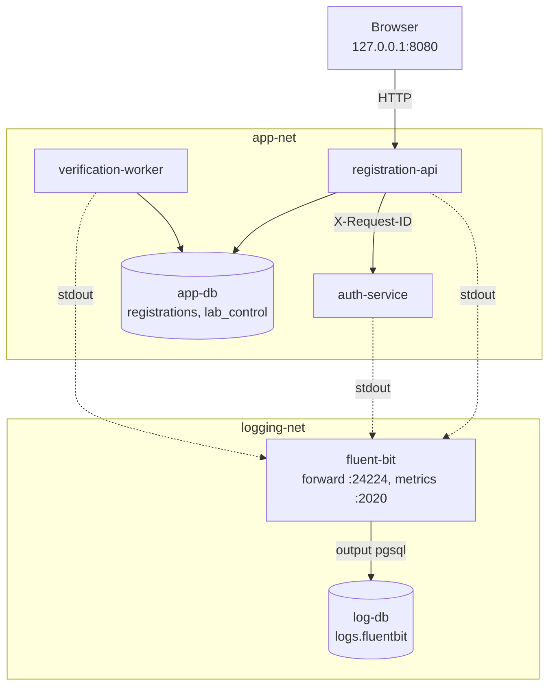

Garis putus-putus adalah jalur log: Docker `fluentd` logging driver mengambil `stdout` ketiga service aplikasi dan mengirimkannya ke `127.0.0.1:24224` dengan tag `pmb.*`. Garis penuh adalah jalur bisnis di dalam `app-net`, yang tidak melewati collector maupun database log.

| Service | Peran | Akses dari host |
| --- | --- | --- |
| `registration-api` | UI, sesi, validasi, penulisan transaksi | `127.0.0.1:8080` |
| `auth-service` | Autentikasi internal akun laboratorium | Tidak dipublikasikan |
| `verification-worker` | Verifikasi asinkron dan simulasi retry | Tidak dipublikasikan |
| `app-db` | Data transaksi `registrations` dan `lab_control` | Tidak dipublikasikan |
| `log-db` | Penyimpanan log `tag`, `time`, `data JSONB` | Tidak dipublikasikan |
| `fluent-bit` | Collector, buffer, dan routing log | `127.0.0.1:24224`, `127.0.0.1:2020` |

Pemisahan ini penting secara operasional. Ketika `log-db` berhenti, transaksi pendaftaran tetap dapat diselesaikan karena jalur bisnis tidak melewati database log. Konsekuensinya, keberhasilan transaksi tidak boleh disimpulkan dari keberadaan log, dan keberadaan log tidak boleh dianggap sebagai jaminan transaksi berhasil. Kedua sumber evidence ini harus dibaca bersama.

Perbedaan objek uji dengan praktikum dasar:

| Aspek | Praktikum dasar (bagian 4) | Praktikum tambahan (bagian 5) |
| --- | --- | --- |
| Sumber log | Tiga container `alpine` dengan loop `printf` | Tiga service Python: `registration-api`, `auth-service`, `verification-worker` |
| Isi log | JSON sintetis minimal (`service`, `severity`, `event`) | JSON terstruktur lengkap dengan `timestamp`, `request_id`, `registration_id`, `attempt`, `error_code` |
| Database | Satu PostgreSQL (`postgres-db`) | `app-db` untuk transaksi dan `log-db` untuk log |
| Tag | `docker.*` | `pmb.*` |
| Tujuan | Membuktikan pengiriman, penyimpanan, buffering | Membuktikan korelasi, diagnosis insiden, recovery, dan confidentiality |
| Skenario | Generator selesai sendiri setelah 20 event | Transaksi berjalan lewat UI, worker, dan dependency yang bisa dibuat gagal |

### 5.2 Menyiapkan Workspace dan Memverifikasi Integritas Paket

Seluruh praktikum dijalankan di dalam satu VM laboratorium yang sama, sehingga paket aplikasi PMB dari dosen ditempatkan bersebelahan dengan direktori `bab-6` pada praktikum sebelumnya. Paket diterima sebagai arsip ZIP, diekstrak di direktori unduhan, lalu dipindahkan ke `~/docker-lab` agar path pada laporan tidak bergantung pada path host.

```bash
cd ~/Downloads
unzip -q PMB_DevSecOps_Lab_Bab06_v1.0.0_*.zip
mv pmb-devsecops-lab ~/docker-lab/

cd ~/docker-lab/pmb-devsecops-lab
cat VERSION
sha256sum -c MANIFEST.sha256
tree -L 2 -a -I '.git'
```

Struktur direktori kerja setelah paket dipindahkan:

```text
~/docker-lab/
├── bab-6/                  # praktikum utama (bagian 4)
│   ├── compose.yaml
│   ├── fluent-bit/
│   ├── init/
│   ├── queries/
│   └── scripts/
├── pmb-devsecops-lab/      # praktikum tambahan (bagian 5)
│   ├── .env.example
│   ├── .gitignore
│   ├── Makefile            # target setup, validate, up, normal, incident, recover, test, verify, evidence
│   ├── MANIFEST.sha256     # 34 checksum berkas
│   ├── README.md
│   ├── VERSION             # 1.0.0
│   ├── app/                # Flask: registration_api.py, auth_service.py, worker.py, common.py, tests/
│   ├── compose.yaml        # enam service, dua network terpisah
│   ├── docs/               # SCENARIO.md, SOURCES.md
│   ├── fluent-bit/         # konfigurasi collector
│   ├── init-app/           # schema database transaksi
│   ├── init-log/           # schema database log
│   ├── queries/            # incident-analysis.sql
│   └── scripts/            # setup, validate, lib, demo, set-incident, verify, evidence
└── (direktori praktikum lain)
```

Keluaran yang diharapkan: `cat VERSION` mencetak `1.0.0`, `sha256sum -c MANIFEST.sha256` mencetak 34 baris yang seluruhnya berakhiran `OK`, dan `tree` menampilkan struktur seperti di atas. Verifikasi ini memastikan berkas yang dieksekusi sama dengan berkas yang dimaksudkan oleh penyusun paket. Bila satu baris pun berstatus `FAILED`, praktikum dihentikan dan paket diminta ulang, karena script yang tidak cocok dengan manifest tidak boleh dijalankan. Pemeriksaan dilakukan pada paket yang masih utuh, yaitu sebelum `compose.yaml` diubah pada 5.6; perubahan itu membuat satu entri manifest menyimpang dan diperlakukan secara eksplisit pada 5.12. Hasil pemeriksaan checksum ditampilkan kembali bersama evidence pada Gambar 24b.

| | |
| --- | --- |
| 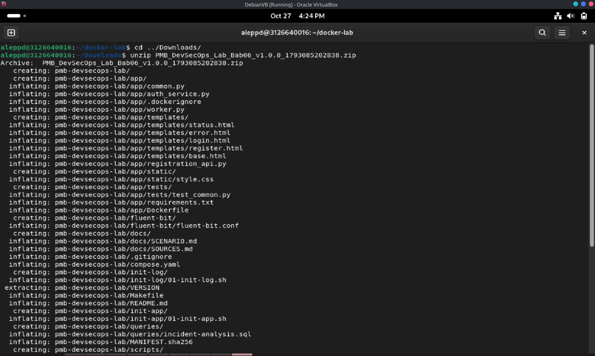 | 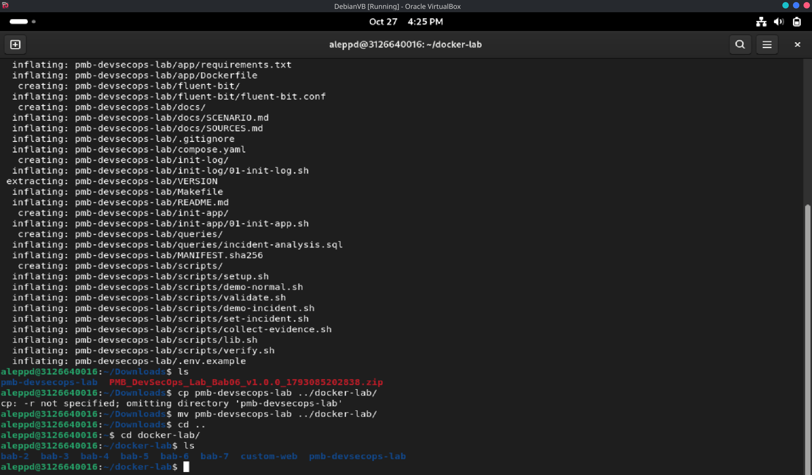 |
| *Gambar 15a. Ekstraksi arsip `PMB_DevSecOps_Lab_Bab06_v1.0.0_*.zip` pada VM laboratorium.* | *Gambar 15b. Pemindahan folder `pmb-devsecops-lab` ke `~/docker-lab` sehingga bersebelahan dengan direktori praktikum sebelumnya.* |

### 5.3 Meninjau Konfigurasi Pipeline pada Aplikasi

Berbeda dengan bagian 4 yang menulis setiap berkas dari awal, langkah ini hanya membaca konfigurasi yang sudah tersedia di paket. Pipeline PMB dipakai apa adanya dengan berkas `compose.yaml`, `fluent-bit/fluent-bit.conf`, `init-app/01-init-app.sh`, dan `init-log/01-init-log.sh` miliknya sendiri, sehingga tidak ada berkas milik praktikum sebelumnya yang disentuh. Pada tahap ini belum ada berkas paket yang diubah; satu-satunya perubahan baru diperlukan pada 5.6, yaitu penghapusan atribut `internal: true` pada blok `networks`. Karena `MANIFEST.sha256` memuat `compose.yaml`, perubahan tersebut harus dijelaskan dan dicatat checksum barunya pada 5.12.

```bash
sed -n '1,25p' compose.yaml
cat fluent-bit/fluent-bit.conf
cat init-app/01-init-app.sh
cat init-log/01-init-log.sh
cat Makefile
```

Pipeline-nya sama dengan praktikum dasar, tetapi sumber dan cakupannya berbeda. Docker logging driver dipasang sekali melalui anchor YAML lalu dipakai ketiga service aplikasi:

```yaml
x-fluentd-logging: &fluentd-logging
  driver: fluentd
  options:
    fluentd-address: "127.0.0.1:24224"
    fluentd-async: "true"
    fluentd-buffer-limit: "4096"
    tag: "pmb.{{.Name}}"
```

Tag memakai prefiks `pmb.` sehingga collector hanya memproses log aplikasi laboratorium. Output Fluent Bit disesuaikan dengan prefiks tersebut, dan tetap memakai tabel `tag`, `time`, `data` yang sama seperti bab ini:

```ini
[OUTPUT]
    Name                     pgsql
    Match                    pmb.*
    Host                     log-db
    Port                     5432
    User                     ${FLUENTBIT_DB_USER}
    Password                 ${FLUENTBIT_DB_PASSWORD}
    Database                 ${LOG_DB_NAME}
    Table                    fluentbit
    storage.total_limit_size 256M
```

| Perbedaan konfigurasi | Praktikum dasar | Aplikasi PMB | Konsekuensi |
| --- | --- | --- | --- |
| Tag | `docker.{{.Name}}` | `pmb.{{.Name}}` | Klasifikasi sumber lebih sempit dan eksplisit |
| `Match` output | `*` | `pmb.*` | Log container lain tidak ikut tersimpan; kegagalan `Match` berarti kehilangan data tanpa error |
| Batas buffer driver | Tidak diatur | `fluentd-buffer-limit: "4096"` | Antrean di sisi container dibatasi, sehingga event dapat dibuang saat collector macet |
| Jumlah database | Satu | Dua (`app-db`, `log-db`) | Kegagalan log tidak memblokir transaksi |
| Jaringan | Satu bridge | Dua bridge terpisah (`app-net`, `logging-net`) setelah `internal: true` dihapus | Port dapat dipublikasikan; hanya port aplikasi yang diikat ke loopback |
| Container aplikasi | Generator `alpine` | Python, `read_only: true`, `tmpfs` `/tmp` | Mengurangi permukaan tulis di filesystem container |

Berkas `init-app/01-init-app.sh` membuat tabel `registrations` beserta `lab_control` yang menyimpan `incident_mode`, lalu memberi akun aplikasi hak minimal: `SELECT`, `INSERT`, `UPDATE` pada `registrations`, `SELECT` pada `lab_control`, dan `USAGE` serta `SELECT` pada sequence `registrations_id_seq`. `init-log/01-init-log.sh` membuat role ingest, schema `logs`, tabel `logs.fluentbit`, tiga indeks, serta view `logs.recent_logs` dengan `log_preview` 500 karakter. Dengan demikian batas tanggung jawab antar database terlihat pada konfigurasi, bukan hanya pada dokumentasi.

Perintah praktikum dibungkus sebagai target `Makefile`, sehingga urutan langkah tidak perlu dihafal dan setiap target dapat diulang tanpa mengetik ulang blok perintah yang panjang.

| Target | Perintah yang dijalankan | Fungsi pada praktikum |
| --- | --- | --- |
| `make setup` | `scripts/setup.sh` | Membuat `.env`, menetapkan izin `600`, dan memberi izin eksekusi script (5.4) |
| `make validate` | `scripts/validate.sh` | Validasi statis script, Python, YAML, dan unit test (5.5) |
| `make up` | `docker compose up -d --build` | Menyalakan enam service (5.6) |
| `make normal` | `scripts/demo-normal.sh` | Tahap A baseline (5.7) dan transaksi baru pada 5.9–5.10 |
| `make incident` | `scripts/demo-incident.sh` | Tahap B *failure injection* (5.8) |
| `make recover` | `scripts/set-incident.sh none` | Mengembalikan `incident_mode` menjadi `none` (5.9) |
| `make test` | `docker compose run --rm --no-deps registration-api python -m unittest discover -s tests -v` | Unit test redaction dan `request_id` (5.11) |
| `make verify` | `scripts/verify.sh` | Memeriksa service, transaksi, log, dan indikasi secret (5.11) |
| `make evidence` | `scripts/collect-evidence.sh` | Mengisi direktori `reports/` (5.12) |
| `make down` | `docker compose down --remove-orphans` | Menghentikan service tanpa menghapus data (5.14) |
| `make clean` | `docker compose down --volumes --remove-orphans` | Menghapus database dan buffer (5.14) |

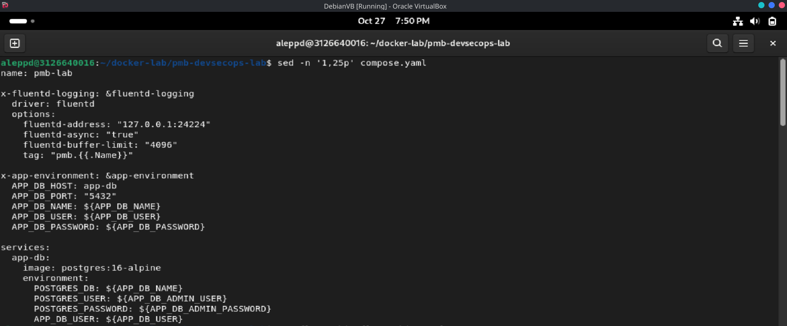

*Gambar 16a. `sed -n '1,25p' compose.yaml` menampilkan anchor `x-fluentd-logging` dengan `fluentd-address: "127.0.0.1:24224"` dan tag `pmb.{{.Name}}`, serta anchor `x-app-environment`.*

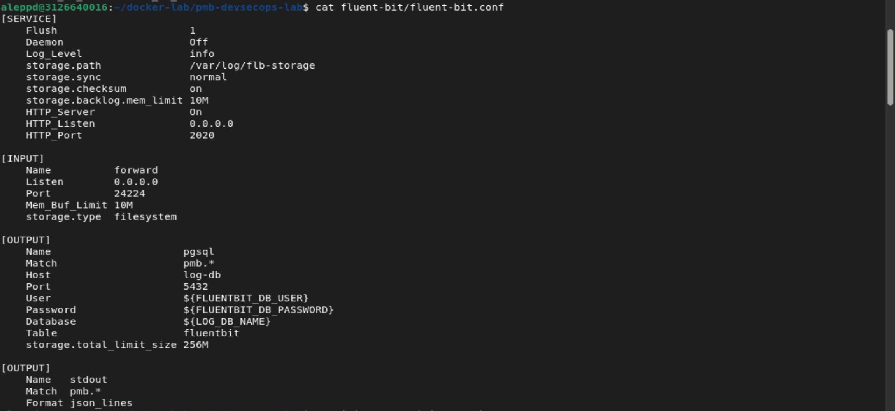

*Gambar 16b. `cat fluent-bit/fluent-bit.conf`: HTTP server pada `2020`, input `forward` pada `24224`, output `pgsql` dengan `Match pmb.*` dan batas buffer 256 MB, serta output `stdout`.*

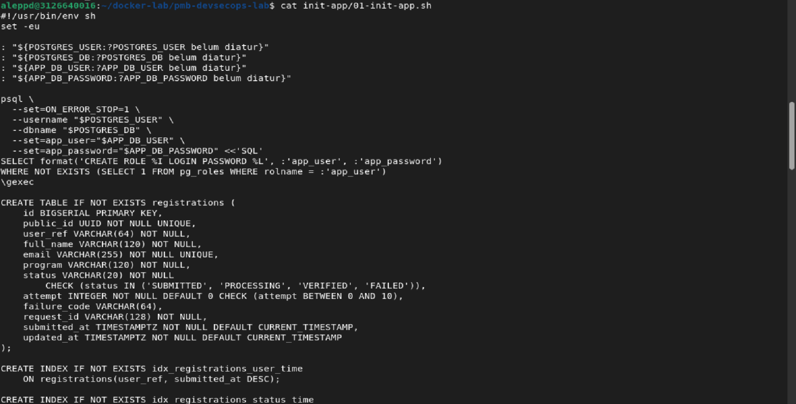

*Gambar 16c. `cat init-app/01-init-app.sh`: pembuatan role aplikasi, tabel `registrations`, dan tiga indeks pada `(user_ref, submitted_at)`, `(status, submitted_at)`, serta `request_id`.*

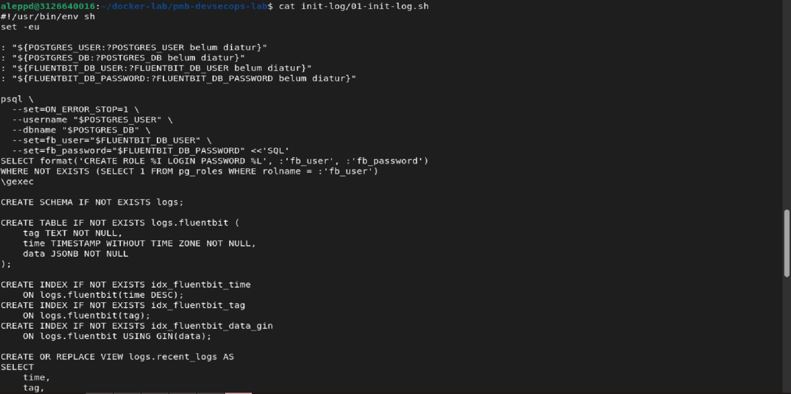

*Gambar 16d. `cat init-log/01-init-log.sh`: pembuatan role ingest, tabel `logs.fluentbit`, tiga indeks termasuk GIN pada `data`, dan view `logs.recent_logs`.*

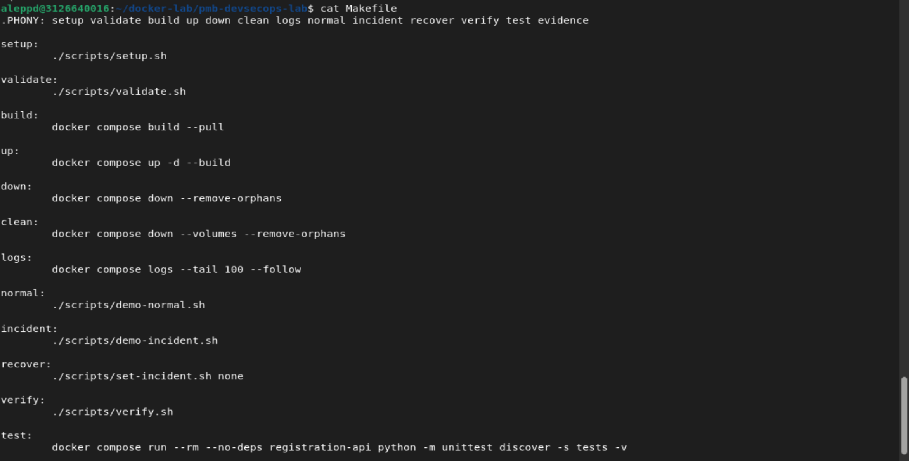

*Gambar 16e. `cat Makefile`: seluruh target dari `setup` sampai `test`, termasuk `normal`, `incident`, `recover`, `verify`, dan `evidence`.*

### 5.4 Menyiapkan Berkas `.env`

Setup pertama tidak memerlukan konfigurasi manual. Satu-satunya pekerjaan di luar paket adalah memasang prasyarat host Debian sekali saja; setelah itu seluruh pembuatan `.env` ditangani script.

```bash
sudo apt update
sudo apt install -y make curl python3 python3-yaml openssl
docker --version && docker compose version
```

Docker Engine dan plugin Compose v2 dipasang mengikuti dokumentasi resmi Docker untuk Debian, lalu langkah berikut dijalankan dari root direktori paket:

```bash
make setup          # setara: ./scripts/setup.sh
```

`setup.sh` menyalin `.env.example` menjadi `.env`, menerapkan `chmod 600`, mengganti lima nilai `change-me-*` dengan hasil `openssl rand -hex 24` (atau `secrets.token_hex` bila OpenSSL tidak tersedia), dan memberi izin eksekusi pada `init-app/01-init-app.sh`, `init-log/01-init-log.sh`, serta seluruh `scripts/*.sh`. Tidak ada nilai yang perlu diisi atau diedit manual, sehingga kesalahan pengetikan credential dapat dihindari.

Pemeriksaan berikut hanya membaca berkas dan dipakai sebagai bukti pada laporan:

```bash
ls -l .env
grep -c 'change-me' .env || true
```

`setup.sh` hanya membuat `.env` bila berkas tersebut belum ada. Pada eksekusi pertama script berakhir dengan `[PASS] .env dibuat dengan credential acak.`; bila `.env` sudah ada dari eksekusi sebelumnya, script mencetak `[INFO] .env sudah ada; konfigurasi dipertahankan.` dan nilai lama dipakai kembali. Hasil yang diharapkan: izin berkas `-rw-------` dan `grep -c` mencetak `0` karena tidak ada placeholder yang tersisa. Untuk mengulang dari awal, `.env` dihapus secara sadar lebih dahulu. Nilai credential tidak perlu ditampilkan pada laporan.

| | |
| --- | --- |
| 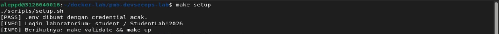 | 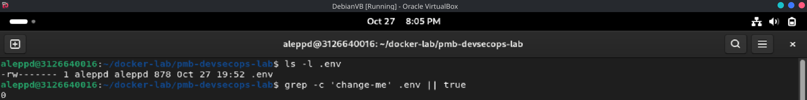 |
| *Gambar 17a. `make setup` membuat `.env` dengan credential acak dan mencetak akun laboratorium.* | *Gambar 17b. `ls -l .env` menunjukkan izin `-rw-------` dan `grep -c 'change-me' .env` mencetak `0`.* |

### 5.5 Memvalidasi Konfigurasi dan Unit Test

Validasi dijalankan sebelum stack dinyalakan agar kesalahan sintaks script, modul Python, atau YAML tidak baru terlihat saat runtime.

```bash
make validate       # setara: ./scripts/validate.sh
```

`validate.sh` menjalankan enam pemeriksaan: sintaks seluruh `scripts/*.sh` dengan `bash -n`, sintaks kedua script inisialisasi dengan `sh -n`, kompilasi modul Python melalui `compileall`, pemarsaan `compose.yaml` dengan `PyYAML` sekaligus memastikan tepat enam service ditemukan, unit test `app/tests/test_common.py`, dan `docker compose config --quiet` bila CLI Docker tersedia.

Dua prasyarat harus dipenuhi: `.env` sudah dibuat pada 5.4, dan modul `PyYAML` sudah terpasang melalui `python3-yaml` pada 5.4. Validasi YAML sengaja dilakukan pada host, bukan di dalam container, sehingga kegagalan modul tersebut adalah kegagalan alat verifikasi, bukan kegagalan pipeline. Bila CLI Docker tidak tersedia, script mencetak `[SKIP]` dan validasi runtime diserahkan ke laptop laboratorium.

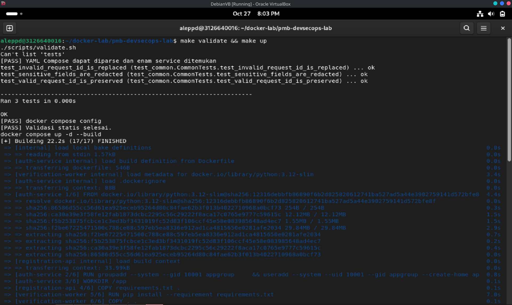

*Gambar 18a. `make validate` mencetak `[PASS] YAML Compose dapat diparse dan enam service ditemukan`, tiga unit test `ok`, dan `[PASS] docker compose config`. Baris `Can't list 'tests'` berasal dari percobaan `compileall` pada direktori `tests` di root proyek yang tidak ada; script otomatis beralih ke `app` sehingga validasi tetap selesai.*

### 5.6 Menjalankan Stack dan Memverifikasi Kesiapan

Port `24224` dan `2020` dipakai bersama dengan praktikum dasar, sehingga stack bab 6 harus sudah dihentikan melalui langkah 4.15 sebelum stack PMB dinyalakan. Konflik port saya periksa lebih dahulu agar kegagalan bind tidak tertukar dengan masalah konfigurasi:

```bash
ss -ltnp | grep -E '8080|24224|2020' || echo "[INFO] Tidak ada listener pada port praktikum"

make up             # setara: docker compose up -d --build
docker compose ps
```

**Temuan: port host tidak pernah terpasang.** Pada eksekusi pertama keenam container berjalan, tetapi tidak satu pun port dapat dijangkau dari host. `docker compose ps` hanya menampilkan port hasil `EXPOSE` image, yaitu `5432/tcp`, `8080-8081/tcp`, dan `2020/tcp, 24224/tcp`, tanpa bentuk `127.0.0.1:...->.../tcp` (Gambar 18b). `curl` ke collector gagal dengan `Failed to connect to 127.0.0.1 port 2020 after 0 ms: Could not connect to server`, dan `make verify` tidak lolos karena `wait_http` mencoba 60 kali dengan jeda dua detik sebelum mencetak `[FAIL] Fluent Bit tidak siap`.

Tiga kemungkinan saya pisahkan sebelum mengubah apa pun: jaringan VM, konflik port, dan konfigurasi. VirtualBox bukan penyebabnya karena Docker berjalan native di dalam VM, sehingga `127.0.0.1` pada shell adalah loopback host Docker itu sendiri. Konflik port juga dapat disingkirkan karena Docker akan gagal saat membuat container bila port host sudah dipakai, sedangkan di sini keenam container berjalan tanpa error. Yang tersisa adalah konfigurasi, dan pemeriksaan yang menentukan adalah membandingkan permintaan konfigurasi dengan kondisi runtime:

```bash
docker compose port fluent-bit 2020                 # keluaran: :0
docker compose port registration-api 8080           # keluaran: :0

docker inspect pmb-lab-fluent-bit-1 --format '{{json .HostConfig.PortBindings}}'
```

`HostConfig.PortBindings` berisi pemetaan yang diminta, `{"2020/tcp":[{"HostIp":"127.0.0.1","HostPort":"2020"}],"24224/tcp":[{"HostIp":"127.0.0.1","HostPort":"24224"}]}`, tetapi `docker compose port` mengembalikan `:0` dan `curl` ditolak seketika (`after 0 ms`), tanda tidak ada listener pada port tersebut. Artinya binding tercatat pada konfigurasi container namun tidak pernah dipasang oleh daemon. Penyebabnya blok `networks` pada `compose.yaml`:

```yaml
networks:
  app-net:
    internal: true
  logging-net:
    internal: true
```

Docker sengaja melewati aturan port pada network bertanda `internal`: `modPorts` pada firewalldriver nftables dan `setPerPortIptables` pada firewalldriver iptables tidak dijalankan untuk network seperti ini, sehingga tidak terbentuk `docker-proxy` maupun aturan DNAT. Kegagalannya senyap, tanpa error pada `docker compose up` maupun log daemon. Dampaknya lebih luas daripada satu `curl` yang gagal: logging driver `fluentd` berjalan di sisi daemon dan mengirim ke `127.0.0.1:24224`, sehingga selama port tidak terpublikasi tidak ada satu pun event yang sampai ke Fluent Bit dan `logs.fluentbit` tetap kosong.

**Perbaikan: hapus atribut `internal: true`.** Isolasi database tetap terjaga karena hanya port aplikasi yang dipublikasikan dan ketiganya diikat ke `127.0.0.1`; tidak ada port `app-db` maupun `log-db` yang terbuka. Perubahan ini satu-satunya modifikasi berkas paket pada praktikum:

```yaml
networks:
  app-net:
  logging-net:
```

Stack dibuat ulang agar konfigurasi jaringan dan binding dibaca kembali:

```bash
docker compose down --remove-orphans
make up
```

Bila isolasi keluar harus dipertahankan, alternatifnya adalah membiarkan kedua network bertanda `internal` dan menambahkan network ketiga yang tidak internal khusus untuk `fluent-bit` dan `registration-api`; alternatif itu tidak dipakai di sini karena hasil pengujiannya sama dan perubahannya lebih besar.

**Verifikasi setelah perbaikan.** Binding harus terlihat pada level runtime, bukan hanya pada konfigurasi:

```bash
docker compose port fluent-bit 2020                 # 127.0.0.1:2020
docker compose port registration-api 8080           # 127.0.0.1:8080
ss -ltnp | grep -E ':2020|:24224|:8080'
docker compose ps

curl -fsS http://127.0.0.1:8080/healthz
curl -fsS http://127.0.0.1:2020/api/v1/health
```

Build pertama memerlukan unduhan `python:3.12-slim`, `postgres:16-alpine`, `fluent/fluent-bit:4.2.8`, serta dependensi Python dari `requirements.txt`. Enam service yang diharapkan muncul adalah `registration-api`, `auth-service`, `verification-worker`, `app-db`, `log-db`, dan `fluent-bit`. Segera setelah `up`, service aplikasi masih dapat tampil dengan `(health: starting)`; `docker compose ps` diulang sampai `app-db`, `log-db`, `registration-api`, dan `auth-service` berstatus `(healthy)`, sedangkan `fluent-bit` dan `verification-worker` tetap `Up` karena keduanya tidak memiliki healthcheck.

Portal merespons `{"service":"registration-api","status":"ok"}` dan collector merespons `{"status":"ok"}`. Tidak ada port database yang dipublikasikan ke host; hanya `8080`, `24224`, dan `2020`, ketiganya terikat pada `127.0.0.1` seperti terlihat pada keluaran `ss` dan pada kolom PORTS `docker compose ps` di Gambar 18c.

Di antara perintah di atas, hanya `make up` yang merupakan target paket. Pemeriksaan port, `docker compose ps`, dan dua `curl` diketik manual karena tidak ada target khusus untuk itu. Pemeriksaan otomatis yang setara dilakukan `make verify` pada 5.11, setelah baseline dan insiden menghasilkan transaksi serta log.

| | |
| --- | --- |
| 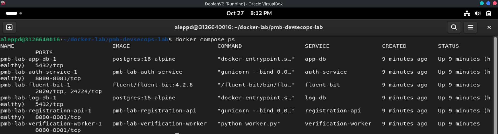 | 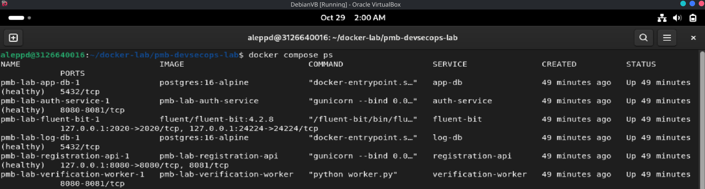 |
| *Gambar 18b. `docker compose ps` sebelum perbaikan: port hanya tampil sebagai `5432/tcp`, `8080-8081/tcp`, dan `2020/tcp, 24224/tcp`, tanda tidak ada pemetaan ke host.* | *Gambar 18c. `docker compose ps` setelah `internal: true` dihapus: `fluent-bit` menampilkan `127.0.0.1:2020->2020/tcp` dan `127.0.0.1:24224->24224/tcp`, `registration-api` menampilkan `127.0.0.1:8080->8080/tcp, 8081/tcp`, serta `app-db`, `auth-service`, `log-db`, dan `registration-api` berstatus `(healthy)` sementara `fluent-bit` dan `verification-worker` berstatus `Up`.* |

### 5.7 Tahap A — Baseline Alur Normal

Baseline dijalankan lebih dahulu agar urutan event yang sehat diketahui sebelum insiden disimulasikan. Script `demo-normal.sh` memaksa mode `none`, login memakai akun sintetis, mengirim satu pendaftaran, lalu mengambil `request_id` dari header `X-Request-ID` pada respons.

```bash
make normal         # setara: ./scripts/demo-normal.sh
```

Script melakukan empat hal berurutan: memastikan portal sehat melalui `/healthz`, memaksa `incident_mode = none` pada `lab_control`, login dengan akun sintetis lalu mengirim satu pendaftaran lewat HTTP beserta token CSRF, dan menunggu lima detik sebelum menanyakan transaksi berdasarkan `request_id` yang diambil dari header `X-Request-ID`. Baris `[INFO] Request ID: REQ-...` beserta tabel status adalah keluaran yang harus dicatat, karena ID tersebut dipakai pada seluruh tahap berikutnya. Rentang waktu tidak perlu dicatat manual; kolom `time` pada query kronologi di bawah menjadi rentang resminya.

Pembuatan dan pengiriman transaksi cukup memakai satu target. Query sesudahnya hanya membaca data untuk merekonstruksi kronologi dan tidak mengubah isi database.

Muat variabel lingkungan agar query dijalankan tanpa menuliskan credential, lalu simpan ID baseline pada variabel yang terpisah dari ID insiden:

```bash
set -a
source .env
set +a

BASELINE_ID='REQ-...'   # salin dari keluaran make normal
```

Status yang diharapkan adalah `VERIFIED` dengan `attempt = 1` dan `failure_code` kosong. Kronologi diambil dari database log dengan filter yang hanya memproses record berawalan `{`, agar baris akses Gunicorn yang berbentuk teks tidak ikut di-cast menjadi JSON:

```bash
docker compose exec -T log-db psql \
  --username "$LOG_DB_ADMIN_USER" --dbname "$LOG_DB_NAME" \
  --set=req="$BASELINE_ID" <<'SQL'
WITH events AS (
    SELECT time, tag, (data ->> 'log')::jsonb AS event
    FROM logs.fluentbit
    WHERE tag LIKE 'pmb.%'
      AND left(ltrim(data ->> 'log'), 1) = '{'
)
SELECT time,
       event ->> 'service'    AS service,
       event ->> 'event'      AS event_name,
       event ->> 'severity'   AS severity,
       event ->> 'attempt'    AS attempt,
       event ->> 'error_code' AS error_code
FROM events
WHERE event ->> 'request_id' = :'req'
ORDER BY time;
SQL
```

Urutan event pada baseline untuk satu `request_id` pendaftaran:

| Urutan | Service | Event | Severity | Catatan |
| --- | --- | --- | --- | --- |
| 1 | `registration-api` | `registration_submitted` | `INFO` | Membawa `registration_id` dan `program` |
| 2 | `registration-api` | `http_request` | `INFO` | `POST /register` yang menghasilkan transaksi tersebut |
| 3 | `verification-worker` | `verification_started` | `INFO` | Payload event memuat `mode = none` |
| 4 | `verification-worker` | `verification_completed` | `INFO` | `attempt = 1`, status transaksi menjadi `VERIFIED` |

Event `login_success` tidak muncul pada query ini karena login adalah HTTP request terpisah dengan `request_id` sendiri; event tersebut terlihat pada kronologi umum di Gambar 20b dengan ID yang berbeda dari transaksi pendaftaran.

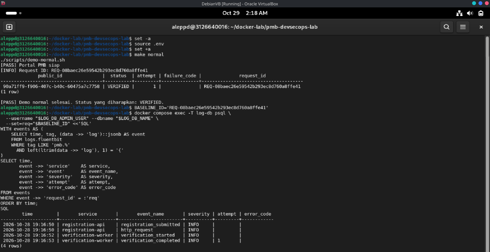

*Gambar 19. `make normal` menampilkan `[INFO] Request ID: REQ-08baec26e59542b293ec8d760a8ffe41` dan status transaksi `VERIFIED` dengan `attempt = 1`, lalu query kronologi untuk ID tersebut menampilkan `registration_submitted`, `http_request`, `verification_started`, dan `verification_completed`.*

### 5.8 Tahap B — Failure Injection dan Rekonstruksi Kronologi

Pada tahap ini mode timeout diaktifkan agar worker mensimulasikan dependency yang tidak merespons. Sesuai skenario laboratorium, diagnosis dilakukan tanpa membaca kode aplikasi terlebih dahulu; sumber kebenaran adalah database transaksi dan centralized log.

```bash
make incident       # setara: ./scripts/demo-incident.sh
```

`demo-incident.sh` mengaktifkan mode `timeout` secara otomatis, mengirim satu pendaftaran, menunggu delapan detik, lalu menampilkan baris transaksi untuk `request_id` tersebut. Status yang diharapkan adalah `FAILED` dengan `attempt = 3` dan `failure_code = VERIFY-TIMEOUT`. Nilai `[INFO] Request ID:` disimpan sebagai `INCIDENT_ID`. Seperti pada baseline, hanya `make incident` yang merupakan target paket; sisa langkah pada tahap ini adalah query baca-saja karena tidak ada target khusus untuk rekonstruksi kronologi.

Rekonstruksi kronologi memakai `queries/incident-analysis.sql`. Query keempat pada berkas tersebut memuat `\set investigated_request_id ...` sehingga nilai `--set` dari baris perintah akan ditimpa; placeholder harus diganti lebih dahulu. Penggantian dilakukan pada salinan sementara, bukan pada berkas aslinya, karena berkas itu tercatat pada `MANIFEST.sha256` dan ikut dihitung pada `reports/config-sha256.txt`:

```bash
INCIDENT_ID='REQ-...'   # salin dari keluaran make incident

sed "s/REQ-GANTI-DENGAN-NILAI-AKTUAL/$INCIDENT_ID/" \
    queries/incident-analysis.sql > "/tmp/incident-${INCIDENT_ID}.sql"

docker compose exec -T log-db psql \
  --username "$LOG_DB_ADMIN_USER" --dbname "$LOG_DB_NAME" \
  --file=/dev/stdin < "/tmp/incident-${INCIDENT_ID}.sql"
```

Menulis salinan ke `/tmp` menjaga integritas paket sekaligus tetap menghasilkan kronologi per `request_id`. Query lain pada berkas yang sama, yaitu distribusi tag, agregasi `WARN`/`ERROR` per service, laju ingest per menit, dan pemeriksaan indikasi secret, tetap dijalankan apa adanya.

| Urutan | Service | Event | Severity | Catatan |
| --- | --- | --- | --- | --- |
| 1 | `registration-api` | `registration_submitted` | `INFO` | Transaksi tersimpan dengan status `SUBMITTED` |
| 2 | `registration-api` | `http_request` | `INFO` | `POST /register` pada request yang sama |
| 3 | `verification-worker` | `verification_started` | `INFO` | Payload event memuat `mode = timeout` |
| 4–6 | `verification-worker` | `verification_retry` | `WARN` | `attempt` 1, 2, 3 dengan `dependency = document-verifier` |
| 7 | `verification-worker` | `dependency_timeout` | `ERROR` | `attempt = 3`, `error_code = VERIFY-TIMEOUT` |

Query per `request_id` menghasilkan tepat tujuh baris, berurutan dari `registration_submitted` sampai `dependency_timeout`. Pada kronologi umum, jumlah baris jauh lebih banyak karena query kedua mengambil 50 event terakhir dari seluruh request; di sanalah `login_success` milik request login tampak dengan `request_id` yang berbeda dari transaksi pendaftaran.

Dari tabel tersebut, service pertama yang menghasilkan `WARN` adalah `verification-worker`, bukan `registration-api` atau `auth-service`. Portal hanya mencatat penerimaan transaksi, sedangkan kegagalan terjadi pada tahap verifikasi asinkron. Ini menjelaskan keluhan pengguna: transaksi berhenti pada status `PROCESSING` walaupun seluruh container hidup.

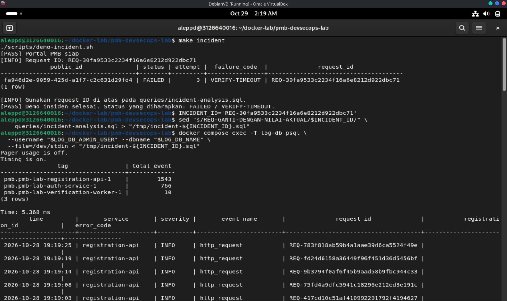

*Gambar 20a. `make incident` menampilkan `[INFO] Request ID: REQ-30fa9533c2234f16a6e8212d922dbc71` dan status transaksi `FAILED` dengan `attempt = 3` serta `failure_code = VERIFY-TIMEOUT`, dilanjutkan distribusi tag pada `logs.fluentbit`.*

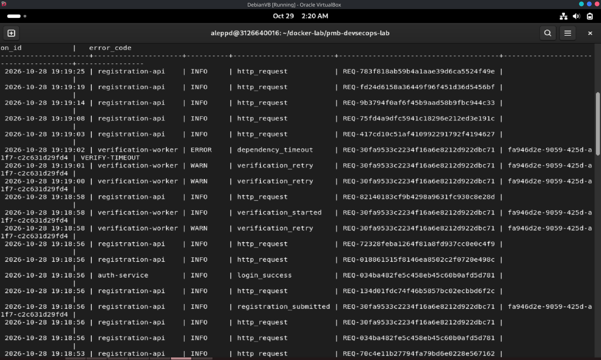

*Gambar 20b. Query kronologi umum (50 event terakhir) memperlihatkan `dependency_timeout` dan tiga `verification_retry` untuk `REQ-30fa9533...`, sementara `login_success` tercatat pada `REQ-034ba482...`, yaitu request login yang terpisah.*

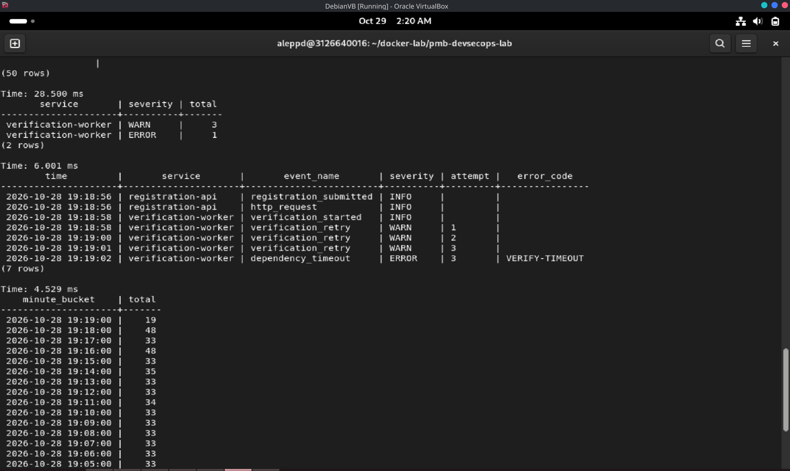

*Gambar 20c. Query agregasi `WARN`/`ERROR` menunjukkan `verification-worker` dengan 3 `WARN` dan 1 `ERROR`, query kronologi per `request_id` menampilkan tujuh event berurutan, dan query laju ingest menampilkan distribusi event per menit.*

### 5.9 Tahap C — Recovery dan Batas Retry

Recovery diuji dengan mengembalikan mode ke `none` lalu membuat transaksi baru. Transaksi lama sengaja tidak diubah, sehingga hasilnya dapat dibandingkan dalam satu tabel.

```bash
make recover        # setara: ./scripts/set-incident.sh none
make normal

docker compose exec -T app-db psql \
  --username "$APP_DB_ADMIN_USER" --dbname "$APP_DB_NAME" \
  --command "SELECT request_id, status, attempt, failure_code,
                    submitted_at, updated_at
             FROM registrations ORDER BY submitted_at;"
```

`make recover` mengubah `lab_control.incident_mode` menjadi `none` dan menampilkan isi tabel kontrol, sedangkan `make normal` membuat transaksi baru sekaligus memastikan mode tetap `none`. Urutan naik pada `ORDER BY` dipakai agar transaksi terbaca kronologis: baseline `VERIFIED`, transaksi insiden `FAILED`, lalu transaksi baru `VERIFIED`. Pada eksekusi ini tabel berisi empat baris karena `make normal` dijalankan lebih dari sekali; dua baris `VERIFIED` di awal adalah baseline, satu baris `FAILED` adalah transaksi insiden dengan `attempt = 3`, dan baris terakhir adalah transaksi baru setelah recovery.

Transaksi baru berakhir `VERIFIED` dengan `attempt = 1`, sedangkan transaksi insiden tetap `FAILED`. Penyebabnya terlihat pada mekanisme klaim worker: worker hanya mengambil baris berstatus `SUBMITTED` dengan `FOR UPDATE SKIP LOCKED`, lalu memindahkannya ke `PROCESSING`. Status `FAILED` bersifat terminal dan tidak pernah diklaim ulang, sehingga perbaikan dependency tidak otomatis memperbaiki transaksi yang sudah gagal. Untuk kebutuhan operasional, pola ini memerlukan retry terkontrol atau *dead-letter queue* dengan kebijakan batas percobaan, bukan pengulangan tanpa batas.

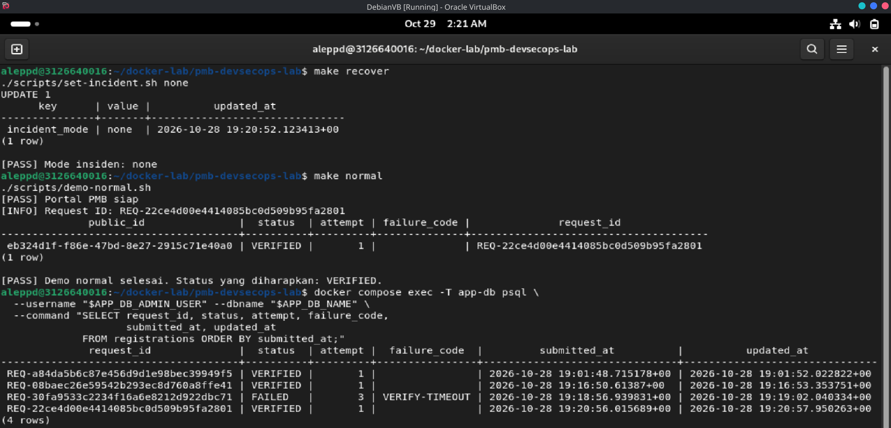

*Gambar 21. `make recover` mengembalikan `incident_mode` menjadi `none`, `make normal` menghasilkan transaksi baru yang `VERIFIED` dengan `attempt = 1`, sedangkan transaksi insiden tetap `FAILED` dengan `VERIFY-TIMEOUT` pada tabel `registrations`.*

### 5.10 Tahap D — Resilience Logging saat log-db Tidak Tersedia

Pengujian ini mengulang uji buffering praktikum dasar, tetapi dengan aplikasi sebagai produsen log. Jumlah record dihitung sebelum gangguan, `log-db` dihentikan, satu transaksi baru dijalankan, lalu backend dinyalakan kembali. Tahap D sengaja tidak dibungkus target `Makefile`, sehingga bagian ini adalah satu-satunya tahap yang terpaksa memakai perintah `docker compose` langsung; tidak ada berkas paket yang diubah.

```bash
log_count() {
  docker compose exec -T log-db psql \
    --username "$LOG_DB_ADMIN_USER" --dbname "$LOG_DB_NAME" \
    --tuples-only --no-align \
    --command 'SELECT count(*) FROM logs.fluentbit;'
}

log_count                    # jumlah record sebelum gangguan
docker compose stop log-db

make normal                  # transaksi baru dibuat saat database log mati

docker compose ps            # fluent-bit harus tetap Up
docker compose logs --tail 100 fluent-bit
curl -fsS http://127.0.0.1:2020/api/v1/metrics | python3 -c '
import json, sys

def walk(node):
    if isinstance(node, dict):
        if "retries" in node or "dropped_records" in node:
            print(node.get("name"), "retries=", node.get("retries"),
                  "retry_failed=", node.get("retry_failed"),
                  "dropped=", node.get("dropped_records"),
                  "errors=", node.get("errors"))
        for value in node.values():
            walk(value)
    elif isinstance(node, list):
        for item in node:
            walk(item)

walk(json.load(sys.stdin))
'

docker compose start log-db
sleep 15
log_count                    # harus lebih besar daripada nilai pertama
```

Struktur JSON pada `/api/v1/metrics` berbeda antar versi Fluent Bit, sehingga penelusuran rekursif dipakai agar metrik `retries`, `retry_failed`, `dropped_records`, dan `errors` tetap ditemukan tanpa bergantung pada nama kunci tingkat atas. Sementara `log-db` berhenti, `make normal` tetap mencetak `[PASS] Demo normal selesai` karena jalur transaksi hanya menyentuh `app-db`; inilah bukti langsung bahwa kesehatan bisnis dan kesehatan logging adalah dua hal berbeda. Bila jumlah record belum bertambah setelah `log-db` hidup, `log_count` diulang beberapa saat kemudian karena output `pgsql` memakai jeda antar percobaan sebelum backlog dikirim ulang.

Selama `log-db` berhenti, transaksi tetap selesai dan statusnya tetap `VERIFIED`, karena `registration-api` dan worker tidak bergantung pada database log. Fluent Bit menahan chunk pada buffer filesystem dan mengulang pengiriman; batas yang relevan adalah `fluentd-buffer-limit` 4096 event di sisi driver dan `storage.total_limit_size` 256 MB di sisi collector. Setelah `log-db` pulih, jumlah record harus bertambah dan backlog terkirim. Pengujian ini membuktikan pemulihan, bukan *exactly-once*: retry dapat menghasilkan duplikasi, dan buffer penuh, disk gagal, atau penghentian paksa tetap dapat menghilangkan event.

| | |
| --- | --- |
| 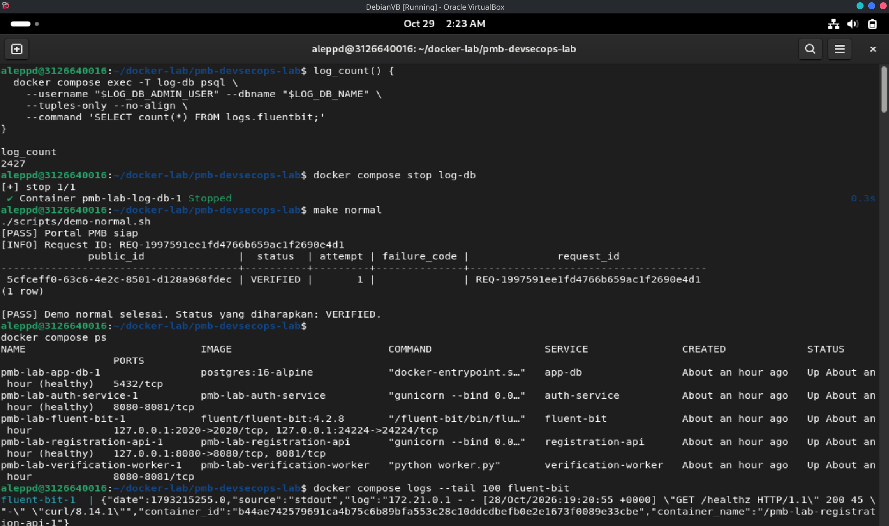 | 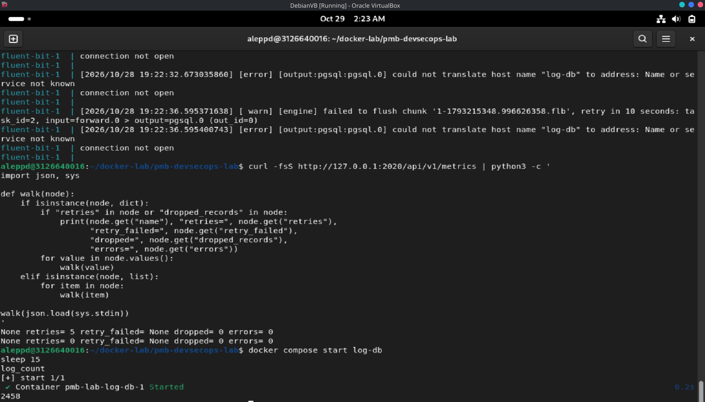 |
| *Gambar 22a. `log_count` mencatat 2427 record, `log-db` dihentikan, `make normal` tetap menghasilkan transaksi `VERIFIED`, `docker compose ps` memperlihatkan `fluent-bit` tetap `Up`, dan log collector mulai menampilkan kegagalan pengiriman.* | *Gambar 22b. Log Fluent Bit memuat `[error] [output:pgsql:pgsql.0] could not translate host name "log-db"` dan `failed to flush chunk ... retry in 10 seconds`; metrik menunjukkan `retries=5` dengan `dropped=0` dan `errors=0`; setelah `log-db` dinyalakan, `log_count` naik menjadi 2458.* |

### 5.11 Verifikasi Confidentiality dan Kualitas Data

Pemeriksaan ini memastikan data pribadi dan credential tidak ikut terkonsentrasi di database log. Unit test memverifikasi fungsi redaction pada level kode, `verify.sh` memeriksa pola sensitif pada tabel log, dan query tambahan mengecek nilai yang benar-benar dipakai pada skenario ini.

```bash
make test
make verify

docker compose exec -T log-db psql \
  --username "$LOG_DB_ADMIN_USER" --dbname "$LOG_DB_NAME" <<'SQL'
SELECT
    count(*) FILTER (WHERE data ->> 'log' ~* '@example\.test') AS email_terekspos,
    count(*) FILTER (WHERE data ->> 'log' ILIKE '%StudentLab!2026%') AS password_terekspos,
    count(*) FILTER (WHERE data ->> 'log' ~* '"password"') AS field_password,
    count(*) FILTER (WHERE data ->> 'log' ILIKE '%Mahasiswa NORMAL%'
                        OR data ->> 'log' ILIKE '%Mahasiswa INCIDENT%') AS nama_terekspos,
    count(*) FILTER (WHERE left(ltrim(data ->> 'log'), 1) <> '{') AS non_json,
    count(*) AS total_record
FROM logs.fluentbit
WHERE tag LIKE 'pmb.%';
SQL
```

`make test` menjalankan tiga unit test di dalam container sementara tanpa dependensi service lain: `request_id` valid dipertahankan, `request_id` tidak valid diganti nilai baru, dan field sensitif seperti `password` serta `authorization` pada objek bersarang diganti `[REDACTED]`. `make verify` memerlukan sedikitnya satu transaksi dan satu record log, sehingga baru dapat dijalankan setelah 5.7 sampai 5.10; bila urutannya dibalik, script berhenti dengan `[FAIL] Belum ada transaksi` atau `[FAIL] Belum ada log terpusat`.

Nilai yang diharapkan adalah nol pada empat kolom pertama. Kolom `non_json` sengaja tidak diharapkan nol karena Gunicorn menulis access log berupa teks ke `stdout`; keberadaan baris tersebut sekaligus membuktikan mengapa filter `left(ltrim(...), 1) = '{'` diperlukan sebelum cast JSONB. Pada eksekusi ini hasilnya `email_terekspos = 0`, `password_terekspos = 0`, `field_password = 0`, `nama_terekspos = 0`, `non_json = 1654`, dan `total_record = 2501`. Pemeriksaan ini juga menunjukkan batas deteksi: regex pada `verify.sh` mencari kata kunci, bukan nilai rahasia, sehingga hasil bersih berarti tidak ditemukan indikasi, bukan bukti matematis bahwa tidak ada kebocoran.

| | |
| --- | --- |
| 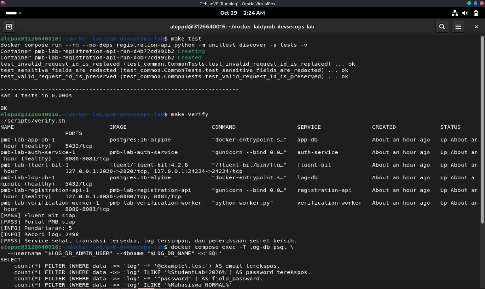 | 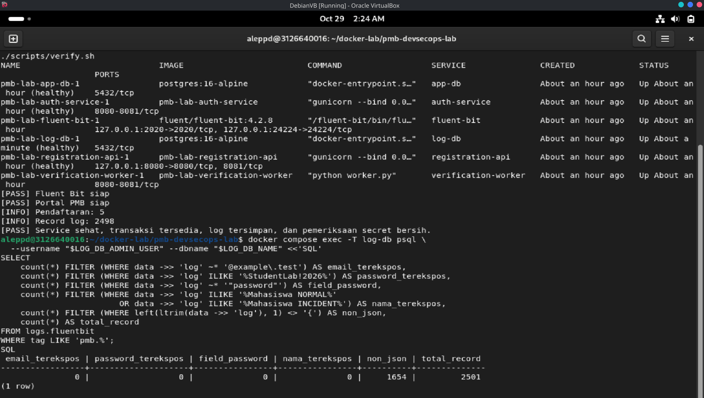 |
| *Gambar 23a. `make test` menjalankan tiga unit test redaction dan `request_id` dengan hasil `OK`, lalu `make verify` mencetak `[PASS] Fluent Bit siap`, `[PASS] Portal siap`, `[INFO] Pendaftaran: 5`, `[INFO] Record log: 2498`, dan `[PASS] Service sehat, transaksi tersedia, log tersimpan, dan pemeriksaan secret bersih`.* | *Gambar 23b. Query pemeriksaan data pribadi menghasilkan `email_terekspos = 0`, `password_terekspos = 0`, `field_password = 0`, `nama_terekspos = 0`, dengan `non_json = 1654` dari `total_record = 2501`.* |

### 5.12 Pengumpulan Evidence

Evidence dikumpulkan dalam satu perintah sehingga isi laporan dapat diverifikasi ulang. Berkas `.env` tidak disertakan; yang dicatat hanya status, metrik, hasil query, dan checksum konfigurasi.

```bash
make evidence
ls -l reports/
sha256sum -c reports/config-sha256.txt

sha256sum -c MANIFEST.sha256      # 33 baris OK, satu baris compose.yaml: FAILED (lihat 5.6)
sha256sum compose.yaml            # checksum pengganti untuk berkas yang diubah
```

`reports/` berisi `compose-ps.txt`, `fluent-bit-metrics.json`, `registration-status.txt`, `incident-analysis.txt`, dan `config-sha256.txt`. Berkas `.gitignore` paket mengecualikan `.env` serta isi `reports/`, sehingga credential dan evidence tidak ikut masuk repository. Checksum konfigurasi memungkinkan pembaca memastikan pipeline yang dianalisis sama dengan yang dijalankan, sedangkan `MANIFEST.sha256` memastikan paket laboratorium tidak berubah. Perintah `sha256sum -c reports/config-sha256.txt` harus dijalankan dari root direktori proyek karena path di dalam berkas tersebut bersifat relatif.

Satu baris pada `MANIFEST.sha256` sengaja menyimpang: `compose.yaml` diubah pada 5.6 untuk menghapus atribut `internal: true`. Hasil yang benar adalah 33 baris `OK` dan tepat satu baris `compose.yaml: FAILED`; checksum baru dari `sha256sum compose.yaml` dicatat bersama evidence agar penyimpangan tersebut dapat diaudit. Jika ada berkas lain yang `FAILED`, praktikum dihentikan karena berarti script atau konfigurasi pipeline berubah di luar rencana.

Satu keterbatasan perlu dicatat: `collect-evidence.sh` menjalankan `queries/incident-analysis.sql` apa adanya, sehingga query nomor 4 pada `reports/incident-analysis.txt` masih memakai placeholder `REQ-GANTI-DENGAN-NILAI-AKTUAL` dan tidak mengembalikan baris. Kronologi per `request_id` untuk baseline dan insiden dibuktikan oleh Gambar 19 dan Gambar 20c yang diambil dari salinan sementara pada 5.7 dan 5.8; bila ingin versi berkasnya, salinan `/tmp/incident-${INCIDENT_ID}.sql` dapat dijalankan ulang dan disimpan ke `reports/`.

| | |
| --- | --- |
| 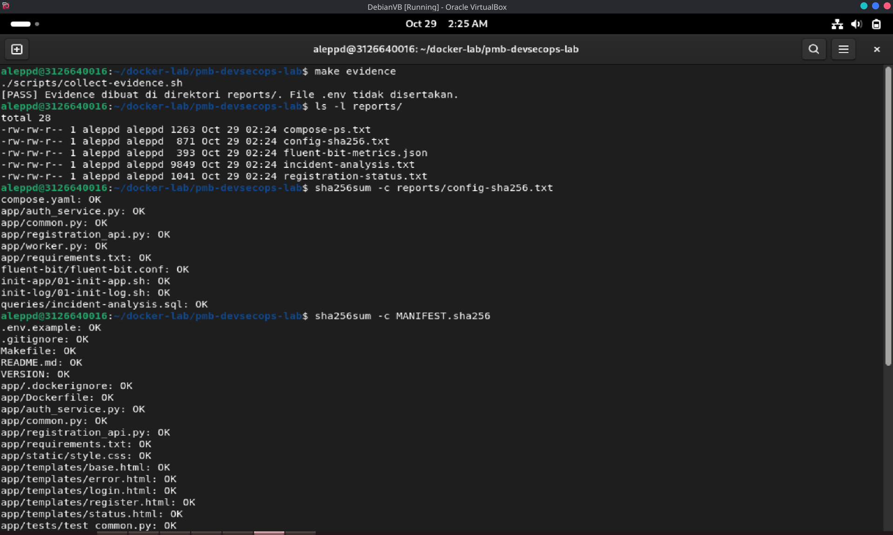 | 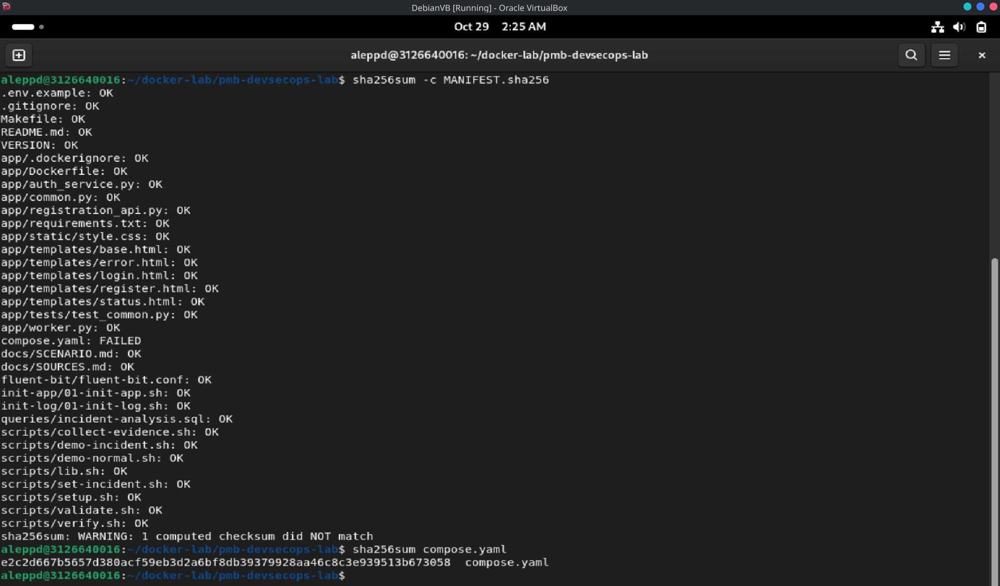 |
| *Gambar 24a. `make evidence` mencetak `[PASS] Evidence dibuat di direktori reports/`, `ls -l reports/` menampilkan lima berkas bukti, dan `sha256sum -c reports/config-sha256.txt` menyatakan seluruh berkas konfigurasi `OK`.* | *Gambar 24b. `sha256sum -c MANIFEST.sha256` menyatakan seluruh berkas `OK` kecuali `compose.yaml: FAILED`, diikuti peringatan `1 computed checksum did NOT match` dan checksum baru dari `sha256sum compose.yaml`.* |

### 5.13 Kriteria PASS/FAIL Praktikum Tambahan

| Pemeriksaan | PASS | FAIL |
| --- | --- | --- |
| Enam service | Seluruh service `Up`/`(healthy)`, dua database tidak dipublikasikan | Ada service gagal atau database terbuka ke host |
| Autentikasi | Login sintetis berhasil dan kegagalan tercatat tanpa password | Password atau cookie muncul pada log |
| Pendaftaran | Record `SUBMITTED` terbentuk dengan `request_id` | Data tidak tersimpan atau ID tidak dapat dikorelasikan |
| Worker normal | Status menjadi `VERIFIED` | Tetap `PROCESSING` tanpa event kegagalan |
| Mode timeout | Tiga `verification_retry` dan `dependency_timeout` terlihat | Status gagal tanpa event atau retry tidak dibatasi |
| Centralized log | Ketiga service muncul pada `logs.fluentbit` | Salah satu service tidak mengirim log |
| Recovery | Transaksi baru berhasil setelah mode kembali `none` | Kegagalan berlanjut tanpa diagnosis |
| Resilience logging | `log-db` berhenti: transaksi tetap `VERIFIED`, metrik menunjukkan retry, jumlah record bertambah setelah `log-db` hidup | Transaksi ikut gagal, atau log hilang tanpa jejak pada metrik |
| Confidentiality | Pemeriksaan secret dan data pribadi menghasilkan nol temuan | Credential atau data pribadi ditemukan |
| Integritas paket | 33 berkas `OK`; `compose.yaml` menyimpang karena perubahan terdokumentasi pada 5.6 dan checksum barunya dicatat | Ada berkas berubah tanpa penjelasan |
| Integritas evidence | Checksum konfigurasi seluruhnya `OK` dan penyimpangan manifest terdokumentasi | Berkas berubah tanpa penjelasan |

### 5.14 Cleanup

```bash
make down       # setara: docker compose down --remove-orphans
make clean      # setara: docker compose down --volumes --remove-orphans
```

`make clean` bersifat destruktif terhadap data transaksi, log, dan buffer laboratorium, sehingga hanya dijalankan setelah evidence tersimpan. Perintah ini juga menghapus volume `app-db-data`, `log-db-data`, dan `fluent-bit-buffer`, sehingga transaksi `FAILED` yang menjadi bukti recovery tidak dapat diperiksa lagi setelahnya. Setelah cleanup, port `8080`, `24224`, dan `2020` kembali bebas.

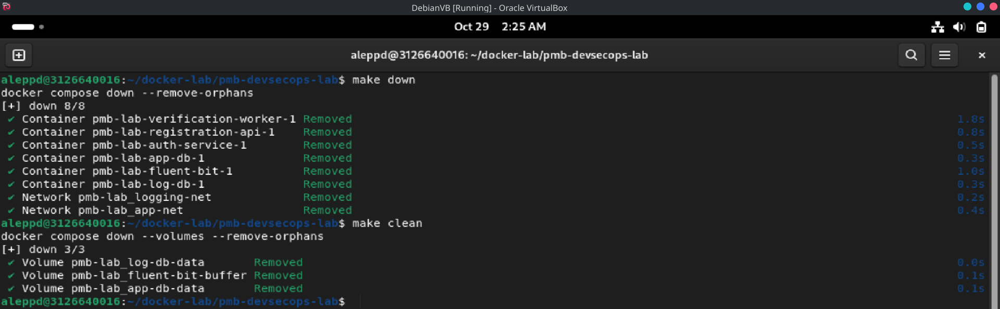

*Gambar 25. `make down` menghapus enam container beserta kedua network, lalu `make clean` menghapus volume `log-db-data`, `fluent-bit-buffer`, dan `app-db-data`.*

## 6. Threat Statement

### 6.1 Threat Statement Pipeline Logging Dasar

| Unsur | Isi |
| --- | --- |
| Aset | Record log pada tabel `logs.fluentbit` dan volume `pg-data`, buffer `flb-storage`, credential PostgreSQL pada `.env`, konfigurasi `fluent-bit.conf` dan `compose.yaml`, serta endpoint monitoring `:2020` |
| Aktor ancaman | Penyerang eksternal yang menjangkau port host, pengguna lokal tidak berwenang pada host atau repository, proses lain di host yang dapat menjangkau loopback, serta pihak yang memperoleh akses ke `.env` atau volume buffer |
| Jalur serangan | Protokol Forward tanpa TLS pada port `24224`; endpoint monitoring tanpa autentikasi; credential plaintext pada `.env`; log aplikasi yang mungkin memuat token, password, atau data pribadi; log injection melalui field bebas; retensi tanpa batas; serta koneksi Fluent Bit ke PostgreSQL tanpa TLS |
| Dampak | Kebocoran informasi sensitif melalui log, pemalsuan atau penyisipan event palsu yang mengacaukan audit, penyadapan trafik log, kehilangan evidence karena buffer penuh atau volume dihapus, pembengkakan storage dan biaya, serta sulitnya investigasi insiden |

**Threat statement:** Aset yang dilindungi adalah record log pada tabel `logs.fluentbit`, volume `pg-data`, buffer `flb-storage`, credential PostgreSQL pada `.env`, serta konfigurasi pipeline logging. Aktor ancaman dapat berupa penyerang eksternal yang menjangkau port host, pengguna lokal yang tidak berwenang, proses lain di host yang dapat menjangkau loopback, maupun pihak yang memperoleh akses ke berkas konfigurasi atau volume. Jalur serangan meliputi protokol Forward tanpa TLS pada port `24224`, endpoint monitoring tanpa autentikasi, credential plaintext, pencatatan data sensitif, log injection, retensi tanpa batas, dan koneksi ke PostgreSQL tanpa TLS. Dampak yang mungkin terjadi adalah kebocoran informasi sensitif, pemalsuan event audit, penyadapan trafik, kehilangan evidence, pembengkakan storage, serta buruknya ketelusuran insiden.

### 6.2 Threat Statement Aplikasi PMB

| Unsur | Isi |
| --- | --- |
| Aset | Data pribadi pada tabel `registrations` (`full_name`, `email`), integritas status transaksi, sesi pengguna dan `SESSION_SECRET`, hash akun sintetis, record log `logs.fluentbit`, lima nilai rahasia pada `.env`, volume `app-db-data`, `log-db-data`, dan `fluent-bit-buffer`, serta berkas evidence pada `reports/` |
| Aktor ancaman | Pengguna lokal tidak berwenang pada host, proses lain di host yang dapat menjangkau loopback, penyerang yang memperoleh `.env` atau berkas evidence, serta pihak yang dapat mengirim data ke formulir pendaftaran |
| Jalur serangan | HTTP tanpa TLS pada `127.0.0.1:8080` dengan cookie sesi tanpa atribut `Secure`; credential terbaca melalui `docker inspect` atau `.env`; `request_id` dari client diterima bila cocok dengan pola, sehingga korelasi dapat dipalsukan; input pengguna pada field formulir; log injection melalui nilai yang dicatat; `Match pmb.*` yang membuang log di luar prefiks; antrean driver 4096 event dan buffer 256 MB yang dapat penuh; penghapusan volume saat cleanup |
| Dampak | Kebocoran data pribadi bila kontrak log berubah, pemalsuan atribusi transaksi melalui `request_id` yang dikendalikan client, pengambilalihan sesi bila `SESSION_SECRET` bocor, kehilangan evidence saat buffer penuh atau `down --volumes`, serta kesimpulan operasional yang salah karena data log tidak lengkap |

**Threat statement:** Aset yang dilindungi adalah data pribadi pada database transaksi, integritas status pendaftaran, sesi pengguna beserta `SESSION_SECRET`, record log pada `logs.fluentbit`, dan credential laboratorium pada `.env`. Aktor ancaman dapat berupa pengguna lokal tidak berwenang, proses lain di host yang menjangkau loopback, pihak yang memperoleh berkas konfigurasi atau evidence, maupun pengirim data ke formulir pendaftaran. Jalur serangan meliputi HTTP tanpa TLS pada portal dengan cookie tanpa `Secure`, credential plaintext yang terbaca melalui inspeksi container, `request_id` dari client yang diterima bila sesuai pola sehingga atribusi dapat dipalsukan, input pengguna yang berpotensi menjadi log injection, cakupan `Match pmb.*` yang dapat membuang log di luar prefiks, buffer yang terbatas, serta cleanup yang menghapus volume. Dampak yang mungkin terjadi adalah kebocoran data pribadi, pemalsuan atribusi transaksi, pengambilalihan sesi, kehilangan evidence, dan keputusan operasional yang salah karena log tidak lengkap.

## 7. Analisis

### 7.1 Masalah yang Muncul pada Praktikum Bab 6 dan Cara Mendiagnosisnya

Selama praktikum Bab 6 tidak ada kendala yang menghambat proses. Pipeline berjalan sesuai rancangan sejak konfigurasi awal, sehingga tidak ada perbaikan darurat yang perlu dilakukan. Dua hal yang sempat saya perhatikan justru merupakan perilaku normal dan perlu dibedakan dari kegagalan.

Pertama, ketiga container generator berakhir dengan status `Exited (0)` setelah sekitar 20 detik. Status ini bukan indikasi crash, melainkan karena perintah generator berupa loop terbatas 20 iterasi yang memang selesai. Saya memastikannya melalui `docker compose ps --all` dan membaca log container: tidak ada pesan galat, serta service `postgres-db` dan `fluent-bit` tetap `Up`.

Kedua, record tidak langsung muncul tepat setelah generator selesai. Fluent Bit memakai interval flush dan buffer, sehingga ada jeda singkat sebelum data terlihat di PostgreSQL. Saya menunggu beberapa saat, lalu memverifikasi melalui `curl` ke `/api/v1/health` dan `/api/v1/metrics`, query `count(*)`, serta view `logs.recent_logs`. Pendekatan diagnosis yang saya pegang adalah status container hanya menunjukkan proses hidup; keberhasilan pipeline dibuktikan oleh record yang dapat di-query, metrik input/output, dan tipe `data` yang benar.

### 7.2 Masalah yang Muncul pada Praktikum Tambahan PMB dan Cara Mendiagnosisnya

Praktikum tambahan tidak selalu berjalan sekali jadi. Enam hal berikut muncul dan saya diagnosis tanpa menebak dari status container.

Pertama, stack PMB tidak dapat menyalakan collector karena port `24224` dan `2020` masih dipakai stack bab 6. Gejalanya adalah kegagalan bind port dan, bila container lama masih hidup, log aplikasi justru masuk ke collector lama. Saya memastikannya dengan `docker compose ps` pada kedua direktori kerja, lalu memeriksa pemakai port melalui `ss -ltnp | grep -E '24224|2020'`. Perbaikannya bukan menghapus container secara paksa, melainkan menghentikan stack sebelumnya sesuai urutan langkah 4.15 agar data praktikum dasar tetap dapat diperiksa.

Kedua, keenam container berjalan tetapi tidak ada port yang terbuka di host. Gejalanya adalah `curl: (7) Failed to connect to 127.0.0.1 port 2020 ... after 0 ms` dan `make verify` yang gagal setelah menunggu sekitar dua menit, sementara `docker compose ps` hanya menampilkan port sebagai `2020/tcp, 24224/tcp` tanpa panah pemetaan. Penyebabnya bukan VM, karena Docker berjalan native di dalam VM, dan bukan konflik port, karena Docker akan gagal membuat container bila port host sudah dipakai. Perbandingan antara `HostConfig.PortBindings` yang berisi pemetaan dan `docker compose port` yang mengembalikan `:0` menunjukkan binding tidak pernah dipasang. Sumbernya atribut `internal: true` pada `app-net` dan `logging-net`: Docker melewati aturan port pada network internal, sehingga `docker-proxy` dan aturan DNAT tidak dibuat dan kegagalannya senyap. Perbaikannya menghapus atribut tersebut, membuat ulang stack dengan `docker compose down --remove-orphans` lalu `make up`, dan memverifikasi dengan `docker compose port`. Karena `compose.yaml` tercatat pada manifest, checksum barunya dicatat pada 5.12.

Ketiga, query kronologi mengembalikan nol baris walaupun `request_id` sudah benar. Penyebabnya, berkas `queries/incident-analysis.sql` memuat `\set investigated_request_id ...` yang **menimpa** nilai `--set` dari baris perintah psql. Saya menemukannya dengan memeriksa isi berkas dan membandingkan nilai variabel sebelum query dijalankan. Perbaikannya adalah menyalin berkas ke `/tmp` dengan `sed` sebelum dieksekusi. Mengubah berkas aslinya memakai `sed -i` juga mengembalikan baris, tetapi merusak `MANIFEST.sha256` dan membuat `reports/config-sha256.txt` tidak lagi mewakili paket, sehingga cara itu saya hindari.

Keempat, cast `(data ->> 'log')::jsonb` berpotensi gagal karena Gunicorn menulis access log berbentuk teks biasa ke `stdout` dengan driver yang sama. Saya memverifikasinya melalui `SELECT left(data ->> 'log', 80) FROM logs.fluentbit WHERE tag LIKE 'pmb.%' LIMIT 10;` dan menemukan baris non-JSON. Perbaikannya adalah memfilter record yang diawali `{` pada subquery, sehingga cast hanya mengenai record buatan aplikasi.

Kelima, `validate.sh` bergantung pada modul `PyYAML` di host untuk memeriksa `compose.yaml`. Bila modul belum tersedia, script berhenti dengan `ModuleNotFoundError` sebelum unit test dijalankan. Saya membedakan dua hal ini: kegagalan validasi statis bukan kegagalan pipeline. Setelah dependensi tersebut tersedia, validasi berjalan penuh dan `docker compose config --quiet` tetap dapat dipakai sebagai pemeriksaan alternatif.

Keenam, status transaksi tidak langsung berubah setelah `make normal` atau `make incident`. Worker melakukan polling setiap dua detik dan menambahkan jeda pemrosesan, sehingga ada selang antara `SUBMITTED`, `PROCESSING`, dan status akhir. Query yang dijalankan terlalu cepat akan menampilkan `PROCESSING` dan tampak seperti kegagalan. Diagnosis yang benar adalah menunggu beberapa detik, mengulang query, lalu membandingkannya dengan event `verification_started` dan `verification_completed` pada log. Pola ini menegaskan kesimpulan yang sama seperti praktikum dasar: status `Up` hanya menunjukkan proses hidup, bukan fungsi bisnis yang sehat.

### 7.3 Risiko Keamanan atau Operasional yang Relevan

Pertama, protokol Forward pada port `24224` tidak menyediakan enkripsi maupun autentikasi. Walaupun port hanya diikat ke loopback, proses lokal mana pun di host dapat mengirim event palsu ke collector, sehingga integritas evidence tidak terjamin. Pada deployment lintas host, trafik ini harus melewati jaringan tepercaya atau TLS, dan endpoint collector sebaiknya dibatasi dengan firewall serta autentikasi.

Kedua, endpoint monitoring `:2020` tidak memiliki autentikasi. Endpoint ini membocorkan metric operasional dan berpotensi membantu penyerang memetakan beban serta kondisi pipeline. Membukanya ke jaringan publik tanpa pembatasan merupakan kesalahan konfigurasi yang serius.

Ketiga, credential PostgreSQL ditulis pada `.env` dan diinjeksikan sebagai environment variable. Nilai tersebut dapat terlihat melalui `docker inspect`, `docker compose config`, atau proses lain yang memiliki akses ke container. Akun ingest juga masih memiliki hak `CREATE` pada schema `logs`, sehingga kompromi akun tersebut dapat mengubah objek database, bukan hanya menyisipkan record.

Keempat, log berpotensi memuat data sensitif. Pada praktikum ini generator hanya mengirim field sintetis, tetapi aplikasi nyata sering mencatat token, password, session identifier, atau data pribadi tanpa disadari. Tanpa redaction di sisi producer dan verifikasi di collector, centralized logging justru memperbesar dampak kebocoran karena data sensitif terkonsentrasi di satu tempat.

Kelima, tidak ada kebijakan retensi yang berjalan otomatis. Tabel akan tumbuh terus dan memenuhi volume `pg-data`, sementara buffer `flb-storage` juga dapat menghabiskan disk host ketika output tertahan. Sebaliknya, menghapus volume secara tidak sengaja melalui `down --volumes` akan menghilangkan seluruh evidence. Karena itu retensi, backup, dan prosedur cleanup harus eksplisit.

Keenam, pipeline bersifat *at-least-once*. Retry dapat menghasilkan record ganda, sedangkan buffer penuh, kegagalan disk, atau penghentian paksa tetap dapat menyebabkan kehilangan event. PostgreSQL juga bukan backend ideal untuk volume telemetry yang sangat besar; query analitik berat dapat mengganggu ingest, dan belum ada partisi berbasis waktu maupun resource limit pada container.

Ketujuh, aplikasi PMB memperlihatkan risiko pada batas kepercayaan korelasi. `request_id` dari client diterima bila cocok dengan pola `^[A-Za-z0-9][A-Za-z0-9._:-]{7,127}$`, sehingga penyerang dapat mengirim ID yang sama untuk beberapa transaksi dan mempersulit pemisahan evidence. Nilai dari client boleh dipakai untuk penelusuran, tetapi tidak boleh menjadi satu-satunya dasar atribusi pada audit.

Kedelapan, redaction pada aplikasi PMB bekerja berdasarkan **nama field**, bukan pemindaian nilai. Field seperti `password`, `authorization`, atau `cookie` diganti `[REDACTED]`, tetapi nilai sensitif yang dimasukkan ke field netral, misalnya `message` atau `note`, akan lolos. Access log Gunicorn juga melewati jalur redaction karena ditulis oleh proses server, bukan oleh fungsi `emit_event`. Karena itu pemeriksaan `verify.sh` yang bersih hanya berarti tidak ditemukan indikasi, bukan bukti bebas kebocoran.

Kesembilan, pemisahan database transaksi dan database log membuat kegagalan logging tidak terlihat dari sisi bisnis. Transaksi tetap `VERIFIED` ketika `log-db` mati, sehingga pengguna dan tim operasi dapat menyimpulkan sistem sehat padahal evidence sedang tertahan di buffer dan berisiko hilang. Tanpa alert pada `retries`, `dropped_records`, dan backlog, kegagalan ini hanya ditemukan saat insiden berikutnya membutuhkan log yang sudah tidak ada.

Kesepuluh, seluruh layanan berjalan pada HTTP lokal tanpa TLS dan cookie sesi tidak memakai atribut `Secure` karena portal diakses melalui `http://127.0.0.1:8080`. Pola ini dapat diterima untuk laboratorium, tetapi menjadi cacat serius bila disalin ke lingkungan lain: cookie dapat disadap, dan `SESSION_SECRET` yang bocor memungkinkan pemalsuan sesi.

Kesebelas, penghapusan atribut `internal: true` pada 5.6 mengembalikan rute keluar container ke internet. Pada laboratorium yang hanya memakai image resmi dan data sintetis, konsekuensi ini dapat diterima selama dicatat sebagai penyimpangan konfigurasi. Pada lingkungan lain, isolasi sebaiknya dipulihkan dengan dua lapis: `app-net` dan `logging-net` tetap `internal` untuk lalu lintas antar-service, sedangkan service yang perlu dijangkau host dipasang pada bridge terpisah yang tidak internal dengan publikasi port tetap dibatasi ke `127.0.0.1`. Pola itu mempertahankan isolasi tanpa kehilangan akses host.

### 7.4 Rekomendasi Perbaikan untuk Production-like Environment

1. **Amankan transport:** aktifkan TLS pada input Forward dan koneksi Fluent Bit ke PostgreSQL, lalu batasi port collector hanya untuk sumber yang dikenal.
2. **Autentikasi dan segmentasi:** lindungi endpoint monitoring dengan autentikasi atau network policy, pertahankan `app-net` dan `logging-net` sebagai `internal` untuk lalu lintas antar-service, tempatkan hanya service yang perlu dijangkau host pada bridge terpisah yang tidak internal, dan batasi publikasi port ke `127.0.0.1`.
3. **Secret management:** pindahkan credential PostgreSQL dari `.env` ke Docker secret, Vault, atau secret manager; rotasi berkala dan pisahkan credential ingest, read-only analyst, serta admin.
4. **Least privilege:** setelah schema stabil, cabut hak `CREATE` dari akun ingest dan berikan hanya `INSERT` pada tabel tujuan serta `USAGE` pada schema.
5. **Redaction dan minimisasi data:** terapkan filter redaction di producer dan collector untuk token, password, cookie, serta data pribadi; dokumentasikan field yang wajib dan dilarang dicatat.
6. **Retensi dan partisi:** gunakan partisi tabel berbasis waktu, job penghapusan terjadwal, serta archive ke object storage dengan checksum untuk kebutuhan forensik.
7. **Deduplikasi dan event ID:** tambahkan `event_id` yang unik pada generator atau aplikasi, lalu terapkan strategi deduplikasi untuk kebutuhan yang tidak menerima duplikasi.
8. **Observability pipeline:** pantau jumlah record masuk, gagal parse, retry, dropped record, penggunaan buffer, dan latency output; buat alert ketika backlog melewati ambang.
9. **Resource limit dan reliability:** tetapkan `mem_limit`, `cpus`, dan batas ukuran buffer; uji perilaku saat PostgreSQL tidak tersedia, disk penuh, dan collector dihentikan paksa.
10. **Tata kelola schema dan evidence:** versikan schema log, uji perubahan field seperti perubahan API, audit akses analyst, dan sertakan rentang waktu, query, zona waktu, serta checksum saat mengekspor log untuk investigasi.
11. **Retry terkontrol dan dead-letter queue:** ganti status terminal tanpa tindak lanjut dengan kebijakan retry berbatas, backoff, dan DLQ yang dapat direkonsiliasi; transaksi `FAILED` harus memiliki jalur penyelesaian yang eksplisit, bukan dibiarkan menunggu perubahan manual.
12. **Batas kepercayaan korelasi:** terima `request_id` dari client hanya untuk penelusuran, simpan juga ID internal yang dibuat server, dan jadikan keduanya field terpisah agar atribusi audit tidak bergantung pada nilai yang dikendalikan pengguna.
13. **Deteksi kebocoran berbasis nilai:** lengkapi redaction berbasis nama field dengan pemindaian pola nilai pada test dan pipeline, sertakan juga access log server dalam cakupan uji, lalu jadikan kegagalan pemindaian sebagai gate build.
14. **Kesehatan logging sebagai SLO terpisah:** buat alert pada `retries`, `dropped_records`, ukuran buffer, dan umur backlog, karena status transaksi tetap `VERIFIED` ketika database log bermasalah; ukur juga selisih jumlah event antara produsen dan penyimpanan.
15. **Kurangi noise dan kendalikan biaya:** kecualikan endpoint kesehatan dari log level `INFO`, tetapkan level minimum per environment, dan hitung volume event per transaksi agar retensi dan kapasitas dapat direncanakan.

### 7.5 Evaluasi dan Latihan Mandiri

**1. Apa risiko kehilangan log ketika Fluent Bit tidak tersedia?**
Event dapat tertahan di buffer Docker atau Fluent Bit lalu hilang ketika buffer penuh, proses dihentikan paksa, atau disk gagal. Karena itu kehilangan log harus diukur melalui metric dan tidak diasumsikan tidak terjadi.

**2. Mengapa structured logging lebih mudah dianalisis dibanding plain text logging?**
Field yang konsisten memungkinkan filter, agregasi, dan korelasi tanpa parsing teks yang rapuh. Structured logging juga memudahkan validasi tipe serta pembuatan dashboard dan alert.

**3. Kapan PostgreSQL tidak lagi cocok sebagai log storage utama?**
Ketika volume ingest sangat tinggi, retensi panjang, dan query pencarian kompleks membuat beban database mengganggu workload lain. Pada skala tersebut, sistem khusus seperti Loki, OpenSearch, atau ClickHouse lebih tepat.

**4. Apa perbedaan log untuk observability dan log untuk forensik?**
Log observability berfokus pada kesehatan sistem dan debugging cepat, sedangkan log forensik menekankan integritas, ketelusuran akses, retensi terkendali, dan kemampuan mereproduksi analisis. Keduanya dapat memakai pipeline yang sama, tetapi kontrak data dan kontrol aksesnya berbeda.

**5. Buat query SQL untuk menampilkan jumlah log per menit dalam 10 menit terakhir.**

```sql
SELECT
    date_trunc('minute', time) AS minute_bucket,
    count(*) AS total
FROM logs.fluentbit
WHERE time >= CURRENT_TIMESTAMP - INTERVAL '10 minutes'
GROUP BY minute_bucket
ORDER BY minute_bucket DESC;
```

### 7.6 Evaluasi Pertanyaan Analitis Skenario PMB

**1. Mengapa status container `Up` tidak membuktikan fungsi bisnis sehat?**
`Up` hanya berarti proses utama masih berjalan. Worker dapat berulang kali gagal pada dependency, portal dapat menolak transaksi karena masalah grant database, atau log dapat tertahan di buffer, sementara tidak satu pun kondisi itu mengubah status container. Pada praktikum ini buktinya adalah mode `timeout`: seluruh container tetap `Up`, tetapi transaksi berakhir `FAILED`. Kesehatan bisnis harus dibuktikan oleh status transaksi, event `WARN`/`ERROR`, dan metrik pipeline.

**2. Apa perbedaan event time, waktu penerimaan collector, dan waktu penyimpanan database?**
Waktu event dibuat aplikasi tercatat pada `data.log.timestamp` dalam ISO 8601 UTC. Waktu penerimaan collector adalah kolom `time` yang diisi Fluent Bit saat record diproses, dan kolom ini bertipe `TIMESTAMP WITHOUT TIME ZONE` sehingga zona waktunya bergantung pada lingkungan collector. Waktu penyimpanan database tidak dicatat pada schema ini. Ketiganya dapat berbeda karena buffer, interval flush satu detik, dan retry saat output gagal. Untuk kronologi saya memakai urutan kolom `time`, lalu mencocokkannya dengan `timestamp` aplikasi untuk mengukur keterlambatan.

**3. Mengapa nama dan email tidak dimasukkan ke structured log?**
Karena keduanya data pribadi yang tidak diperlukan untuk diagnosis maupun audit teknis. `user_ref`, `registration_id`, dan `request_id` sudah cukup untuk menghubungkan event dengan transaksi tanpa menyalin identitas. Log memiliki pembaca lebih luas, retensi lebih panjang, dan aliran keluar ke sistem lain, sehingga setiap field pribadi menambah dampak bila terjadi kebocoran. Bila identitas benar-benar dibutuhkan untuk investigasi, jalur yang lebih aman adalah mengambilnya dari database transaksi berdasarkan `registration_id`, bukan menyimpannya di log.

**4. Apa risiko penggunaan `request_id` dari client tanpa validasi?**
Nilai tersebut dapat dipakai untuk menyatukan atau menimpa atribusi event. Penyerang yang mengetahui ID korban dapat mengirim permintaan dengan ID yang sama, sehingga dua transaksi tampak satu rangkaian, atau sebaliknya memecah jejak menjadi banyak ID. Validasi pola hanya menjamin format, bukan keaslian. Karena itu ID dari client sebaiknya diperlakukan sebagai petunjuk penelusuran, sementara ID internal yang dibuat server dipakai untuk atribusi audit.

**5. Apa yang terjadi bila buffer Fluent Bit mencapai batas 256 MB?**
Ketika `storage.total_limit_size` tercapai, collector tidak dapat menampung chunk baru dan menerapkan backpressure atau membuang data sesuai konfigurasi. Pada sisi produsen, `fluentd-buffer-limit` 4096 event juga dapat tercapai lebih dahulu sehingga event dibuang sebelum mencapai collector. Gejalanya terlihat pada metrik `retries`, `dropped_records`, dan pesan galat collector, bukan pada status aplikasi. Artinya batas buffer harus disertai alert dan perhitungan kapasitas, bukan hanya diatur.

**6. Bagaimana mendeteksi duplikasi record setelah retry?**
Karena aplikasi belum menulis `event_id`, duplikasi dideteksi secara heuristik dengan mengelompokkan `request_id`, `event`, dan `timestamp` aplikasi, lalu menghitung grup yang muncul lebih dari sekali:

```sql
WITH events AS (
    SELECT (data ->> 'log')::jsonb AS event
    FROM logs.fluentbit
    WHERE tag LIKE 'pmb.%'
      AND left(ltrim(data ->> 'log'), 1) = '{'
)
SELECT event ->> 'request_id' AS request_id,
       event ->> 'event' AS event_name,
       event ->> 'timestamp' AS event_time,
       count(*) AS kemunculan
FROM events
GROUP BY request_id, event_name, event_time
HAVING count(*) > 1
ORDER BY kemunculan DESC;
```

Solusi yang lebih tegas adalah menambahkan `event_id` unik pada produsen, lalu memakai indeks unik atau `ON CONFLICT DO NOTHING` saat menulis.

**7. Kapan PostgreSQL tidak lagi sesuai sebagai backend log utama?**
Ketika laju ingest dan retensi sudah membuat beban tulis mengganggu query operasional, ketika pencarian teks dan agregasi menjadi lambat meski sudah diindeks, atau ketika kebutuhan analitik menuntut pemrosesan kolumnar. Pada aplikasi ini noise juga meningkat karena setiap request dan healthcheck dicatat. Untuk skala tersebut, backend khusus seperti Loki, OpenSearch, atau ClickHouse lebih tepat, sementara PostgreSQL tetap dipakai untuk data transaksi.

**8. Kontrol apa yang harus ditambahkan sebelum arsitektur serupa dipakai pada produksi?**
TLS pada portal dan jalur log, secret manager dengan rotasi, hak `INSERT` saja untuk akun ingest tanpa `CREATE`, redaction berbasis nama field dan nilai beserta gate pengujiannya, retensi dan partisi terjadwal, `event_id` untuk deduplikasi, retry berbatas dengan DLQ, autentikasi pada endpoint monitoring, resource limit container, audit akses analyst, backup, serta alert pada backlog dan dropped record. Untuk lapisan aplikasi, cookie `Secure` dan `SESSION_COOKIE_SECURE` wajib diaktifkan setelah HTTPS tersedia.

## 8. Tindak Lanjut

1. Menambahkan parser Fluent Bit agar isi JSON pada `data.log` diangkat menjadi field terstruktur, lalu menulis pengujian negatif untuk log yang bukan JSON valid.
2. Menyisipkan nilai canary yang menyerupai token sintetis dan membuktikan filter redaction mencegah nilai tersebut mencapai PostgreSQL.
3. Membandingkan jumlah event yang dihasilkan generator, diterima input Fluent Bit, dan tersimpan di PostgreSQL, lalu menjelaskan setiap selisih berdasarkan evidence.
4. Merancang retensi tujuh hari yang berjalan terjadwal tanpa mengunci tabel secara berlebihan, termasuk partisi dan archive.
5. Memindahkan credential ke secret manager, mencabut hak `CREATE` dari akun ingest, dan mengaktifkan TLS pada jalur collector serta database.
6. Melanjutkan ke bab berikutnya dengan menambahkan monitoring metrics menggunakan Prometheus, cAdvisor, Node Exporter, dan Grafana.
7. Menambahkan `event_id` unik pada setiap event aplikasi PMB, lalu menguji deduplikasi dengan indeks unik dan membandingkan hasilnya dengan deteksi heuristik pada bagian 7.6.
8. Menulis uji negatif untuk log injection, misalnya nilai yang mengandung karakter baris baru atau objek JSON bersarang, agar kontrak log tidak rusak oleh input pengguna.
9. Menguji perilaku *drop* secara sengaja dengan memperkecil batas buffer, lalu membuktikan gejalanya terlihat pada metrik dan bukan pada status transaksi.
10. Mengukur volume event per transaksi dan mengecualikan endpoint kesehatan dari log `INFO` agar retensi dan kapasitas dapat dihitung dari data, bukan perkiraan.
11. Menambahkan retry berbatas dan *dead-letter queue* untuk transaksi `FAILED`, lalu menguji rekonsiliasi transaksi lama setelah dependency pulih.

## 9. Kesimpulan

1. Centralized logging berhasil dibangun dengan Fluent Bit sebagai collector yang menerima log dari Docker `fluentd` driver dan meneruskannya ke PostgreSQL dalam kolom `JSONB`.
2. Tiga generator berhasil menghasilkan event dari sumber berbeda, dan record dapat diverifikasi melalui kolom `tag`, `time`, serta metadata `container_name`, `source`, dan `log`.
3. View `logs.recent_logs`, indeks waktu, indeks tag, dan indeks GIN mempermudah pencarian serta analisis log terbaru.
4. Uji buffering membuktikan Fluent Bit dapat menahan event ketika PostgreSQL tidak tersedia sementara dan mengirimkannya setelah backend pulih, dengan catatan pipeline bersifat *at-least-once* dan tidak menjamin *exactly-once*.
5. Praktikum ini masih memiliki celah berupa transport tanpa TLS, endpoint monitoring tanpa autentikasi, credential pada `.env`, potensi data sensitif dalam log, retensi yang belum otomatis, serta belum adanya resource limit; untuk production-like diperlukan secret terkelola, redaction, partisi dan retensi terjadwal, TLS, least privilege, serta pemantauan pipeline.
6. Aplikasi PMB berhasil dijalankan sebagai objek uji tambahan: ketiga service aplikasinya mengirim event terstruktur ke pipeline yang sama, dengan tag `pmb.*`, tanpa mengubah konfigurasi collector selain cakupan `Match`.
7. Korelasi `request_id` memungkinkan rekonstruksi insiden timeout dari centralized log saja, dan menunjukkan bahwa service pertama yang menghasilkan `WARN` adalah `verification-worker`, bukan portal atau layanan autentikasi.
8. Recovery hanya berlaku untuk transaksi baru karena status `FAILED` bersifat terminal, sehingga pola ini memerlukan retry terkontrol atau *dead-letter queue* bila dipakai di luar laboratorium.
9. Penghentian `log-db` tidak menggagalkan transaksi tetapi menahan pengiriman log; pemisahan database transaksi dan database log membuat kesehatan logging harus dipantau sebagai SLO tersendiri.
10. Pemeriksaan redaction, pemindaian pola sensitif, dan query data pribadi tidak menemukan kebocoran pada skenario ini, dengan catatan deteksi berbasis kata kunci belum membuktikan tidak adanya kebocoran secara absolut.

## 10. Referensi

1. Ferry Astika Saputra, "Bab 6 — Centralized Logging dengan Fluent Bit dan PostgreSQL," repository DevSecOps PENS, `bab-06.md`: https://github.com/ferryas-pens/devsecops/blob/main/bab-06.md
2. Fluent Bit Documentation, *PostgreSQL output*: https://docs.fluentbit.io/manual/data-pipeline/outputs/postgresql
3. Fluent Bit Documentation, *Buffering*: https://docs.fluentbit.io/manual/data-pipeline/buffering
4. Fluent Bit Documentation, *Monitoring*: https://docs.fluentbit.io/manual/administration/monitoring
5. Docker Documentation, *Fluentd logging driver*: https://docs.docker.com/engine/logging/drivers/fluentd/
6. Docker Documentation, *Configure logging drivers*: https://docs.docker.com/engine/logging/configure/
7. PostgreSQL Documentation, *JSON Types*: https://www.postgresql.org/docs/current/datatype-json.html
8. Paket laboratorium "PMB DevSecOps Laboratory" versi 1.0.0, berkas `README.md`, `docs/SCENARIO.md`, dan `docs/SOURCES.md` pada workspace `pmb-devsecops-lab`.
9. Pallets, *Flask 3.1.3*: https://pypi.org/project/Flask/3.1.3/
10. Psycopg Team, *Psycopg 3.3.6*: https://pypi.org/project/psycopg/3.3.6/
11. Gunicorn Project, *Gunicorn 26.2.0*: https://pypi.org/project/gunicorn/26.2.0/
12. Python Software Foundation, *Requests 2.34.2*: https://pypi.org/project/requests/2.34.2/
