# LAPORAN PRAKTIKUM BAB 6
## Centralized Logging dengan Fluent Bit dan PostgreSQL

**Nama**: Ale Perdana Putra Darmawan  
**NIM**: 3126640016  
**Kelas**: STr LJ A  
**Tanggal pelaksanaan**: 26 Oktober 2026

> **Disclaimer penggunaan AI.** Laporan praktikum ini disusun dengan bantuan kecerdasan buatan (AI) yang difungsikan sebagai alat dokumentasi. AI digunakan untuk merapikan catatan praktikum, menyusun struktur dan alur penulisan laporan, serta menyunting tata bahasa. Seluruh pelaksanaan praktikum, pengambilan bukti berupa screenshot, verifikasi keluaran perintah, dan pengambilan kesimpulan tetap dilakukan secara mandiri oleh saya.

## 1. Tujuan Praktikum

1. Menjelaskan kebutuhan centralized logging pada lingkungan container yang bersifat *ephemeral* dan mudah dibuat ulang.
2. Mengirim log `stdout`/`stderr` container ke Fluent Bit menggunakan Docker `fluentd` logging driver melalui protokol Forward.
3. Menyimpan log ke PostgreSQL dalam kolom `JSONB` dan membuat view analisis untuk kebutuhan pencarian.
4. Membuat tiga log generator yang mensimulasikan event `INFO`, `WARN`, dan `ERROR` dari service berbeda.
5. Menerapkan query pencarian log, agregasi per tag, dan retention sederhana.
6. Membuktikan perilaku buffering Fluent Bit ketika PostgreSQL tidak tersedia sementara, lalu pulih kembali.

## 2. Dasar Teori Singkat

### 2.1 Centralized Logging dan Observability

Log adalah rekaman diskret mengenai peristiwa yang terjadi pada aplikasi, container, host, maupun kontrol keamanan. Pada lingkungan container, proses idealnya menulis log ke `stdout` dan `stderr`, lalu runtime atau collector meneruskannya. Pola ini memisahkan aplikasi dari detail backend logging, tetapi konsekuensinya log tidak lagi tinggal di dalam container setelah container dihapus. Centralized logging mengumpulkan rekaman tersebut ke satu lokasi yang dapat dicari, dianalisis, dan diaudit lintas service.

Tujuan centralized logging bukan sekadar memindahkan teks dari `stdout`. Sistem harus mempertahankan konteks, urutan waktu, integritas field, serta kemampuan menghubungkan satu request dengan komponen lain. Fluent Bit berperan sebagai agen atau *router* telemetry yang membaca input, melakukan parsing dan filtering, lalu mengirimkan record ke output yang ditetapkan. Pada bab ini Fluent Bit menerima protokol Forward dari Docker logging driver dan meneruskannya ke PostgreSQL.

### 2.2 Struktur Event dan Kualitas Data

Structured logging menggunakan field yang konsisten, misalnya timestamp, severity, service, environment, event type, request ID, trace ID, principal, status, durasi, dan outcome. JSON sering digunakan karena mudah diparse, tetapi JSON yang valid belum menjamin semantik yang konsisten. Nama field, satuan durasi, zona waktu, dan kategori error harus distandardisasi. Timestamp sebaiknya memakai UTC dan format yang tidak ambigu agar korelasi lintas komponen tidak menyesatkan.

Correlation ID memungkinkan penelusuran satu transaksi melalui reverse proxy, API, database, dan pipeline asynchronous. Nilai dari client tidak boleh langsung dianggap tepercaya untuk kebutuhan audit tanpa validasi. Log juga perlu membedakan kejadian bisnis, kejadian operasional, dan kejadian keamanan. Error stack membantu debugging, tetapi security event memerlukan konteks keputusan seperti subject, resource, policy, action, dan alasan penolakan.

### 2.3 Pipeline Input, Parser, Filter, dan Output

Pipeline Fluent Bit terdiri atas input, parser, filter, buffer, dan output. Input menentukan sumber record; parser mengubah representasi teks menjadi field; filter menambah, menghapus, atau mentransformasi field; output mengirim data ke PostgreSQL atau sistem observability lain. Kegagalan parsing tidak boleh diam-diam menghasilkan data tanpa struktur. Record yang gagal perlu diberi tag, dikirim ke *dead-letter destination*, atau dihitung sebagai metric agar penurunan kualitas data terdeteksi.

Filter dapat menambah metadata container dan environment, tetapi enrichment mempunyai biaya CPU, memori, dan lookup. Metadata dengan cardinality tinggi meningkatkan storage dan memperlambat query. Prinsip minimisasi data berlaku: hanya field yang diperlukan untuk operasi, keamanan, kepatuhan, atau analisis yang disimpan. Secret, access token, password, session identifier, dan data pribadi tidak boleh dicatat secara default. Redaction sebaiknya dilakukan sedekat mungkin dengan producer, kemudian diverifikasi kembali pada collector.

### 2.4 PostgreSQL sebagai Backend Laboratorium

PostgreSQL memudahkan mahasiswa mempelajari schema, query, indeks, retensi, dan akses terkontrol. Walaupun demikian, database relasional bukan selalu backend log skala besar yang paling efisien. Volume event tinggi, ingest kontinu, retensi panjang, serta pencarian teks dapat memerlukan sistem khusus seperti Loki, OpenSearch, atau ClickHouse. Dalam laboratorium, tabel perlu membatasi panjang message, menetapkan tipe timestamp, menggunakan indeks pada waktu, service, severity, dan correlation ID, serta memisahkan credential writer dari credential analyst.

Menyimpan log sebagai `JSONB` memungkinkan query fleksibel terhadap field terstruktur dan penggunaan indeks GIN. Kolom `data` menyimpan objek record penuh, sedangkan `tag` dan `time` menjadi kolom terpisah yang diindeks. Dengan demikian pencarian berdasarkan waktu dan sumber tetap murah, sementara pencarian di dalam isi record dapat memakai operator JSONB.

### 2.5 Reliability, Backpressure, dan Pengujian

Backpressure terjadi ketika kecepatan output lebih rendah daripada input. Buffer memori cepat tetapi hilang ketika proses berhenti; buffer disk lebih tahan tetapi dapat memenuhi filesystem. Batas retry tanpa kebijakan dapat menghasilkan loop tak berujung. Desain harus mendokumentasikan kapasitas buffer, retry, timeout, dan perilaku drop. Metric collector seperti jumlah record masuk, record gagal parse, retry, dropped record, penggunaan buffer, dan latency output diperlukan untuk membuktikan pipeline logging sehat.

Pengujian tidak cukup dengan menemukan satu baris log pada database. Skenario harus mencakup event normal, error aplikasi, data multiline, karakter khusus, output sementara tidak tersedia, dan record yang mengandung nilai sensitif. PASS berarti field penting dapat dicari, waktu konsisten, secret tidak muncul, serta kegagalan delivery terlihat melalui metric atau log internal. Centralized logging yang aman adalah pipeline data terkelola, bukan sekadar koleksi pesan.

### 2.6 Log sebagai Evidence dan Produk Data

Log perlu mempunyai pemilik dan kontrak data. Tim aplikasi bertanggung jawab atas makna event, tim platform menjaga delivery, sedangkan tim keamanan menetapkan event yang diperlukan untuk deteksi dan investigasi. Perubahan schema log dapat merusak parser, dashboard, atau alert; karena itu perubahan field perlu diuji seperti perubahan API. Versi schema atau mekanisme *backward compatibility* membantu consumer beradaptasi.

Evidence dari logging harus dapat menjawab siapa melakukan apa, pada resource mana, kapan, dari konteks apa, dan dengan hasil apa, tanpa mengumpulkan data berlebihan. Akses analyst dibuat *read-only* dan query administratif diaudit. Saat insiden, ekspor log disertai rentang waktu, query, zona waktu, dan checksum agar analisis dapat diulang. Pendekatan ini menempatkan centralized logging sebagai produk data yang memiliki kualitas, keamanan, retensi, dan service level.

### 2.7 Field dan Variabel yang Dipakai

Struktur record yang dihasilkan plugin PostgreSQL Fluent Bit pada praktikum ini adalah sebagai berikut.

| Field | Makna |
| --- | --- |
| `tag` | Klasifikasi sumber log, misalnya `docker.bab-6-generator-auth-1` |
| `time` | Timestamp log diterima collector |
| `data` | Record log penuh dalam format `JSONB` |
| `data.container_name` | Nama container yang menghasilkan log |
| `data.source` | `stdout` atau `stderr` |
| `data.log` | Pesan log aplikasi, masih berupa string JSON pada praktikum ini |

Variabel lingkungan yang dipakai:

| Variabel | Fungsi |
| --- | --- |
| `POSTGRES_DB` | Nama database laboratorium (`labdb`) |
| `POSTGRES_USER` | Akun superuser awal PostgreSQL (`labadmin`) |
| `POSTGRES_PASSWORD` | Password akun superuser untuk inisialisasi volume |
| `FLUENTBIT_DB_USER` | Akun ingest khusus Fluent Bit (`fluentbit_user`) |
| `FLUENTBIT_DB_PASSWORD` | Password akun ingest Fluent Bit |

## 3. Alat dan Lingkungan

| Komponen | Hasil identifikasi |
| --- | --- |
| Host | Linux / WSL 2 pada Windows (lingkungan khusus laboratorium) |
| Runtime dan orkestrasi | Docker Engine dan Docker Compose (plugin v2) |
| Image praktikum | `postgres:16-alpine`, `fluent/fluent-bit:4.2.8`, `alpine:3.20` |
| Volume | Named volume `pg-data` (data PostgreSQL) dan `flb-storage` (buffer filesystem Fluent Bit) |
| Berkas konfigurasi | `.env.example`, `.env`, `.gitignore`, `compose.yaml` |
| Berkas inisialisasi | `init/01-init-logging.sh` |
| Berkas collector | `fluent-bit/fluent-bit.conf` |
| Berkas query | `queries/analysis.sql` |
| Script pendukung | `scripts/generate-logs.sh`, `scripts/test-buffering.sh` |
| Network | `logging-net` (bridge) menghubungkan `postgres-db`, `fluent-bit`, dan generator |
| Publikasi port | `127.0.0.1:24224` (Forward) dan `127.0.0.1:2020` (HTTP monitoring) |
| Alat verifikasi | `docker compose`, `curl`, `psql`, `bash -n`, dan browser |
| Direktori kerja | `~/docker-lab/bab-6` |

## 4. Langkah Praktikum

Seluruh langkah pada bagian ini mengikuti urutan cheatsheet Bab 6. Setiap langkah diakhiri dengan placeholder gambar yang menjelaskan bukti yang perlu didokumentasikan.

### 4.1 Menyiapkan Direktori Kerja

Langkah ini membuat struktur direktori `bab-6` yang memisahkan konfigurasi collector, inisialisasi database, query analisis, dan script. Pemisahan ini penting agar bind mount mudah ditelusuri dan setiap berkas memiliki tanggung jawab yang jelas.

```bash
mkdir -p ~/docker-lab/bab-6/{init,fluent-bit,queries,scripts}
cd ~/docker-lab/bab-6
tree
```

Struktur yang diharapkan:

```text
bab-6/
├── .env.example
├── .env
├── .gitignore
├── compose.yaml
├── fluent-bit/
│   └── fluent-bit.conf
├── init/
│   └── 01-init-logging.sh
├── queries/
│   └── analysis.sql
└── scripts/
    ├── generate-logs.sh
    └── test-buffering.sh
```

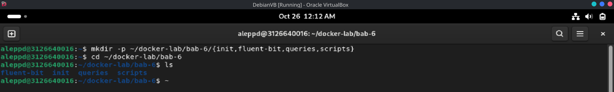

*Gambar 1. Struktur direktori `bab-6` yang memisahkan `init`, `fluent-bit`, `queries`, dan `scripts`.*

### 4.2 File `.env.example`

Berkas ini memusatkan parameter laboratorium sehingga credential tidak ditulis langsung di `compose.yaml`. Nilai di dalamnya hanya credential sintetis untuk laptop laboratorium. Setelah disalin menjadi `.env`, izin berkas dibatasi dengan `chmod 600` agar hanya pemilik yang dapat membacanya.

```dotenv
POSTGRES_DB=labdb
POSTGRES_USER=labadmin
POSTGRES_PASSWORD=labadminpass123
FLUENTBIT_DB_USER=fluentbit_user
FLUENTBIT_DB_PASSWORD=fluentbitpass123
```

```bash
nano .env.example
cp .env.example .env
chmod 600 .env
```

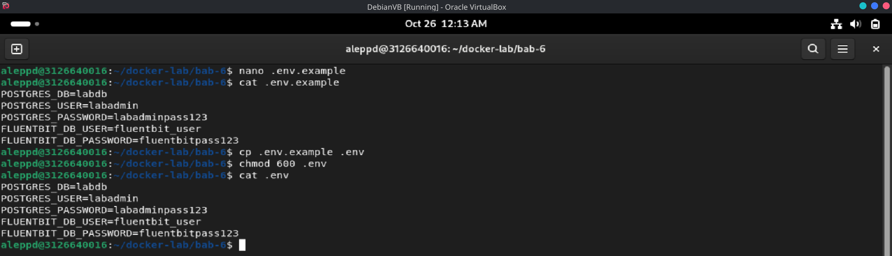

*Gambar 2. Pembuatan `.env.example`, penyalinan menjadi `.env`, penerapan `chmod 600`, serta isi `.env` dengan lima variabel laboratorium.*

### 4.3 File `.gitignore`

Berkas ini mencegah `.env`, berkas log, dan direktori laporan masuk ke repository. Tanpa `.gitignore`, credential laboratorium dan artefak lokal berpotensi ter-commit dan bocor melalui riwayat Git.

```gitignore
.env
*.log
reports/
```

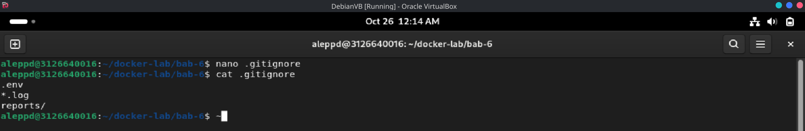

*Gambar 3. Isi `.gitignore` yang mengecualikan `.env`, `*.log`, dan `reports/`.*

### 4.4 File `compose.yaml`

Berkas ini mendefinisikan lima service: `postgres-db`, `fluent-bit`, dan tiga generator (`generator-auth`, `generator-api`, `generator-worker`). PostgreSQL tidak dipublikasikan ke host; Fluent Bit mengaksesnya melalui jaringan internal `logging-net`. Hanya port Forward `24224` dan monitoring `2020` yang dibuka, dan keduanya diikat ke loopback.

```yaml
services:
  postgres-db:
    image: postgres:16-alpine
    environment:
      POSTGRES_DB: ${POSTGRES_DB}
      POSTGRES_USER: ${POSTGRES_USER}
      POSTGRES_PASSWORD: ${POSTGRES_PASSWORD}
      FLUENTBIT_DB_USER: ${FLUENTBIT_DB_USER}
      FLUENTBIT_DB_PASSWORD: ${FLUENTBIT_DB_PASSWORD}
    volumes:
      - pg-data:/var/lib/postgresql/data
      - ./init:/docker-entrypoint-initdb.d:ro
    networks:
      - logging-net
    healthcheck:
      test:
        - CMD-SHELL
        - "pg_isready -U $${POSTGRES_USER} -d $${POSTGRES_DB}"
      interval: 5s
      timeout: 5s
      retries: 12
      start_period: 10s
    restart: unless-stopped

  fluent-bit:
    image: fluent/fluent-bit:4.2.8
    environment:
      POSTGRES_DB: ${POSTGRES_DB}
      FLUENTBIT_DB_USER: ${FLUENTBIT_DB_USER}
      FLUENTBIT_DB_PASSWORD: ${FLUENTBIT_DB_PASSWORD}
    volumes:
      - ./fluent-bit/fluent-bit.conf:/fluent-bit/etc/fluent-bit.conf:ro
      - flb-storage:/var/log/flb-storage
    ports:
      - "127.0.0.1:24224:24224"
      - "127.0.0.1:2020:2020"
    networks:
      - logging-net
    depends_on:
      postgres-db:
        condition: service_healthy
    security_opt:
      - no-new-privileges:true
    restart: unless-stopped

  generator-auth:
    image: alpine:3.20
    command:
      - /bin/sh
      - -c
      - |
        i=1
        while [ "$$i" -le 20 ]; do
          printf '{"service":"auth","severity":"INFO","event":"login_test","sequence":%s}\n' "$$i"
          i=$$((i + 1))
          sleep 1
        done
    logging:
      driver: fluentd
      options:
        fluentd-address: "127.0.0.1:24224"
        fluentd-async: "true"
        tag: "docker.{{.Name}}"
    depends_on:
      - fluent-bit

  generator-api:
    image: alpine:3.20
    command:
      - /bin/sh
      - -c
      - |
        i=1
        while [ "$$i" -le 20 ]; do
          printf '{"service":"api","severity":"WARN","event":"latency_test","duration_ms":%s}\n' "$$((i * 10))"
          i=$$((i + 1))
          sleep 1
        done
    logging:
      driver: fluentd
      options:
        fluentd-address: "127.0.0.1:24224"
        fluentd-async: "true"
        tag: "docker.{{.Name}}"
    depends_on:
      - fluent-bit

  generator-worker:
    image: alpine:3.20
    command:
      - /bin/sh
      - -c
      - |
        i=1
        while [ "$$i" -le 20 ]; do
          printf '{"service":"worker","severity":"ERROR","event":"retry_test","attempt":%s}\n' "$$i"
          i=$$((i + 1))
          sleep 1
        done
    logging:
      driver: fluentd
      options:
        fluentd-address: "127.0.0.1:24224"
        fluentd-async: "true"
        tag: "docker.{{.Name}}"
    depends_on:
      - fluent-bit

volumes:
  pg-data:
  flb-storage:

networks:
  logging-net:
    driver: bridge
```

Nilai `fluentd-address` menunjuk `127.0.0.1:24224`, bukan nama service Compose. Alasannya, Docker Engine yang menjalankan logging driver berada di host, sehingga alamat collector harus berupa alamat yang dipublikasikan host. Opsi `fluentd-async: "true"` membuat Docker mencoba tersambung di latar belakang sehingga kegagalan collector tidak langsung menggagalkan startup container.

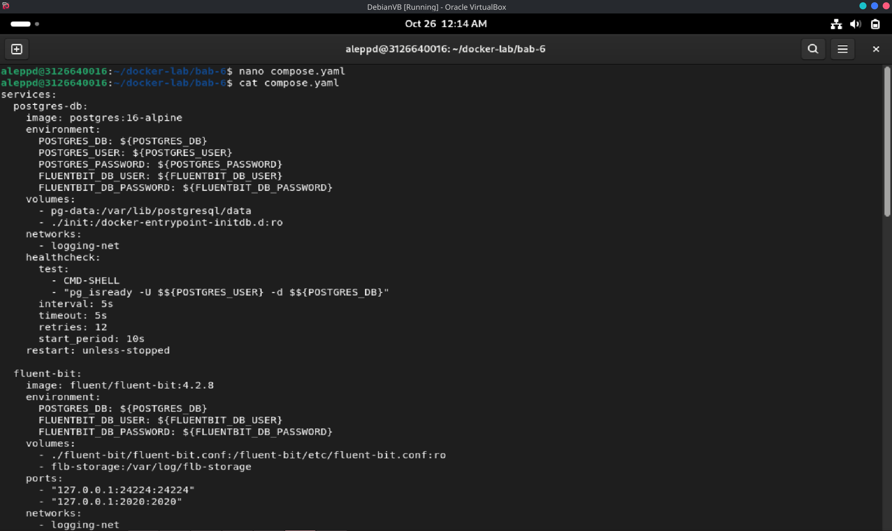

*Gambar 4. Penulisan `compose.yaml` yang mendefinisikan `postgres-db`, `fluent-bit`, dan tiga generator beserta blok `logging`.*

### 4.5 File `init/01-init-logging.sh`

Berkas ini dijalankan otomatis oleh entrypoint PostgreSQL ketika volume data masih kosong. Fungsinya membuat role ingest Fluent Bit, schema `logs`, tabel `logs.fluentbit`, tiga indeks, view `logs.recent_logs`, serta privilege yang diperlukan. Nama dan tipe kolom harus sesuai kontrak plugin PostgreSQL Fluent Bit, yaitu `tag`, `time`, dan `data`.

```bash
#!/usr/bin/env bash
set -Eeuo pipefail

: "${POSTGRES_USER:?POSTGRES_USER belum diatur}"
: "${POSTGRES_DB:?POSTGRES_DB belum diatur}"
: "${FLUENTBIT_DB_USER:?FLUENTBIT_DB_USER belum diatur}"
: "${FLUENTBIT_DB_PASSWORD:?FLUENTBIT_DB_PASSWORD belum diatur}"

psql \
  --set=ON_ERROR_STOP=1 \
  --username "$POSTGRES_USER" \
  --dbname "$POSTGRES_DB" \
  --set=fb_user="$FLUENTBIT_DB_USER" \
  --set=fb_password="$FLUENTBIT_DB_PASSWORD" <<'SQL'
SELECT format(
    'CREATE ROLE %I LOGIN PASSWORD %L',
    :'fb_user',
    :'fb_password'
)
WHERE NOT EXISTS (
    SELECT 1 FROM pg_roles WHERE rolname = :'fb_user'
)
\gexec

CREATE SCHEMA IF NOT EXISTS logs;

CREATE TABLE IF NOT EXISTS logs.fluentbit (
    tag  TEXT NOT NULL,
    time TIMESTAMP WITHOUT TIME ZONE NOT NULL,
    data JSONB NOT NULL
);

CREATE INDEX IF NOT EXISTS idx_fluentbit_time
    ON logs.fluentbit (time DESC);

CREATE INDEX IF NOT EXISTS idx_fluentbit_tag
    ON logs.fluentbit (tag);

CREATE INDEX IF NOT EXISTS idx_fluentbit_data_gin
    ON logs.fluentbit USING GIN (data);

CREATE OR REPLACE VIEW logs.recent_logs AS
SELECT
    time,
    tag,
    replace(data ->> 'container_name', '/', '') AS container_name,
    data ->> 'source' AS source,
    left(data ->> 'log', 200) AS log_preview
FROM logs.fluentbit
ORDER BY time DESC
LIMIT 100;

SELECT format(
    'ALTER ROLE %I IN DATABASE %I SET search_path TO logs, public',
    :'fb_user',
    current_database()
)
\gexec

SELECT format('GRANT USAGE, CREATE ON SCHEMA logs TO %I', :'fb_user')
\gexec

SELECT format(
    'GRANT SELECT, INSERT ON TABLE logs.fluentbit TO %I',
    :'fb_user'
)
\gexec

SELECT format('GRANT SELECT ON TABLE logs.recent_logs TO %I', :'fb_user')
\gexec
SQL
```

Hak `CREATE` pada schema diperlukan karena plugin PostgreSQL dapat melakukan bootstrap tabel. Untuk produksi, proses bootstrap sebaiknya dipisahkan dari akun ingest; setelah schema stabil, evaluasi pencabutan hak DDL dan uji kembali kompatibilitas plugin.

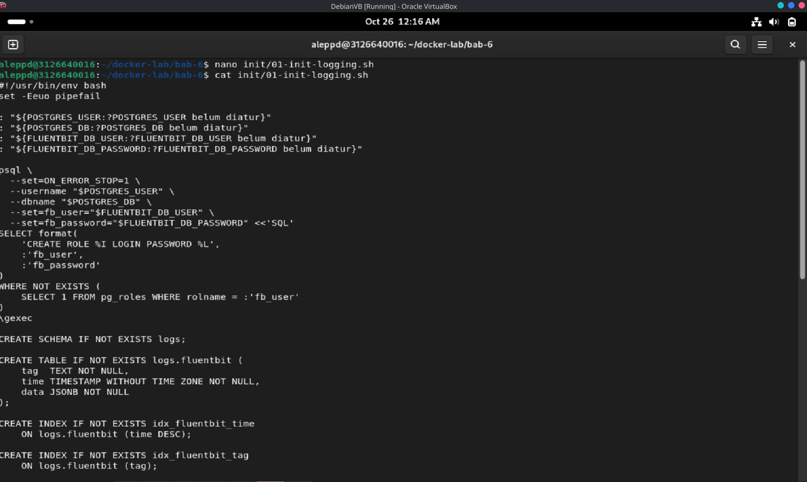

*Gambar 5. Penulisan `init/01-init-logging.sh` yang memuat pembuatan role, schema `logs`, tabel `fluentbit`, indeks, dan view `recent_logs`.*

### 4.6 File `fluent-bit/fluent-bit.conf`

Berkas ini mengatur input Forward pada port `24224`, buffer filesystem pada volume `flb-storage`, HTTP server untuk monitoring, serta dua output: PostgreSQL dan `stdout`. Output `stdout` berfungsi sebagai jalur observasi tambahan selama praktikum, sedangkan output `pgsql` menyimpan record ke tabel `fluentbit` melalui `search_path` role ingest.

```ini
[SERVICE]
    Flush                     1
    Daemon                    Off
    Log_Level                 info
    storage.path              /var/log/flb-storage
    storage.sync              normal
    storage.checksum          on
    storage.backlog.mem_limit 10M
    HTTP_Server               On
    HTTP_Listen               0.0.0.0
    HTTP_Port                 2020

[INPUT]
    Name          forward
    Listen        0.0.0.0
    Port          24224
    Mem_Buf_Limit 10M
    storage.type  filesystem

[OUTPUT]
    Name                     pgsql
    Match                    *
    Host                     postgres-db
    Port                     5432
    User                     ${FLUENTBIT_DB_USER}
    Password                 ${FLUENTBIT_DB_PASSWORD}
    Database                 ${POSTGRES_DB}
    Table                    fluentbit
    storage.total_limit_size 256M

[OUTPUT]
    Name   stdout
    Match  *
    Format json_lines
```

Konfigurasi ini tidak memakai opsi `Schema` maupun `Timestamp_Key` karena plugin PostgreSQL Fluent Bit menyimpan record pada kolom `tag`, `time`, dan `data`. Schema `logs` dipilih melalui `search_path` akun PostgreSQL, bukan melalui opsi output.

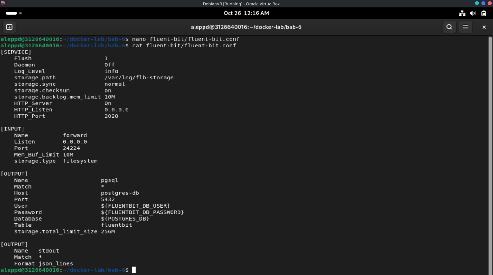

*Gambar 6. Penulisan `fluent-bit/fluent-bit.conf` yang menampilkan blok `[SERVICE]`, `[INPUT]`, dan dua `[OUTPUT]`.*

### 4.7 File `queries/analysis.sql`

Berkas ini menyediakan query verifikasi dan analisis: jumlah event, distribusi per tag, metadata record, pencarian severity, agregasi per menit, dan contoh retention. Query retention sengaja dikomentari agar tidak menghapus data secara tidak sengaja.

```sql
\pset pager off
\timing on

-- 1. Jumlah event dan rentang waktu.
SELECT
    count(*) AS total_event,
    min(time) AS event_pertama,
    max(time) AS event_terakhir
FROM logs.fluentbit;

-- 2. Distribusi berdasarkan tag Docker.
SELECT
    tag,
    count(*) AS total
FROM logs.fluentbit
GROUP BY tag
ORDER BY total DESC, tag;

-- 3. Metadata terstruktur dari Docker logging driver.
SELECT
    time,
    tag,
    replace(data ->> 'container_name', '/', '') AS container_name,
    data ->> 'source' AS source,
    left(data ->> 'log', 160) AS log_preview
FROM logs.fluentbit
ORDER BY time DESC
LIMIT 15;

-- 4. Pencarian severity pada JSON yang masih berada di field log.
SELECT
    time,
    tag,
    data ->> 'log' AS log_message
FROM logs.fluentbit
WHERE data ->> 'log' ILIKE '%"severity":"ERROR"%'
ORDER BY time DESC;

-- 5. Ringkasan per menit untuk mengamati laju ingest.
SELECT
    date_trunc('minute', time) AS minute_bucket,
    count(*) AS total
FROM logs.fluentbit
GROUP BY minute_bucket
ORDER BY minute_bucket DESC
LIMIT 10;

-- Contoh retensi; tinjau dahulu sebelum menghapus data.
-- DELETE FROM logs.fluentbit
-- WHERE time < CURRENT_TIMESTAMP - INTERVAL '7 days';
```

Pesan aplikasi berbentuk JSON masih disimpan sebagai string pada `data.log`, sedangkan metadata Docker berada pada objek `data`. Praktikum lanjutan dapat menambahkan parser Fluent Bit agar isi `data.log` diangkat menjadi field terstruktur tersendiri.

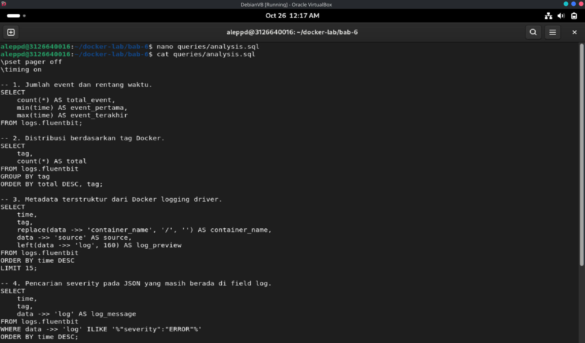

*Gambar 7. Penulisan `queries/analysis.sql` yang memuat lima query analisis dan contoh retention.*

### 4.8 File `scripts/generate-logs.sh`

Script ini menyalakan PostgreSQL dan Fluent Bit terlebih dahulu, menunggu endpoint kesehatan collector siap, lalu membuat ulang tiga generator. Pemisahan urutan ini mencegah generator berjalan sebelum collector dapat menerima log.

```bash
#!/usr/bin/env bash
set -Eeuo pipefail

cd "$(dirname "$0")/.."

if [[ ! -f .env ]]; then
    echo "[FAIL] File .env tidak ditemukan." >&2
    exit 1
fi

docker compose up -d postgres-db fluent-bit

for attempt in {1..30}; do
    if curl -fsS http://127.0.0.1:2020/api/v1/health >/dev/null; then
        break
    fi

    if [[ "$attempt" -eq 30 ]]; then
        echo "[FAIL] Endpoint kesehatan Fluent Bit belum siap." >&2
        exit 1
    fi
    sleep 2
done

docker compose up -d --force-recreate \
    generator-auth \
    generator-api \
    generator-worker

echo "[PASS] Tiga generator telah dijalankan. Tunggu sekitar 25 detik."
echo "[INFO] Pantau dengan: docker compose ps"
```

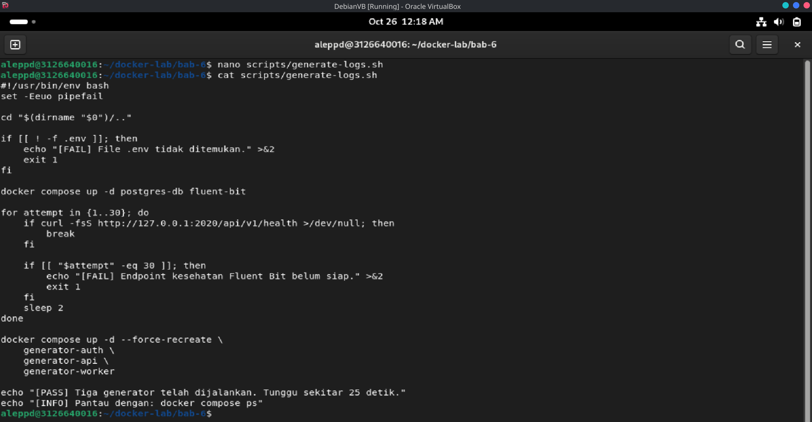

*Gambar 8. Penulisan `scripts/generate-logs.sh` yang menunggu health collector sebelum menjalankan tiga generator.*

### 4.9 File `scripts/test-buffering.sh`

Script ini membuktikan bahwa Fluent Bit menahan event ketika PostgreSQL dihentikan sementara, lalu mengirimkannya setelah backend pulih. Script menghitung jumlah row sebelum dan sesudah gangguan, kemudian menunggu hingga terjadi kenaikan jumlah record.

```bash
#!/usr/bin/env bash
set -Eeuo pipefail

cd "$(dirname "$0")/.."

if [[ ! -f .env ]]; then
    echo "[FAIL] File .env tidak ditemukan." >&2
    exit 1
fi

set -a
source .env
set +a

count_rows() {
    docker compose exec -T postgres-db \
        psql \
        --username "$POSTGRES_USER" \
        --dbname "$POSTGRES_DB" \
        --tuples-only \
        --no-align \
        --command 'SELECT count(*) FROM logs.fluentbit;'
}

before="$(count_rows)"
echo "[INFO] Jumlah awal: $before"

docker compose stop postgres-db

docker compose up -d --force-recreate \
    generator-auth \
    generator-api \
    generator-worker

echo "[INFO] PostgreSQL berhenti; generator berjalan selama 25 detik."
sleep 25

docker compose start postgres-db

for attempt in {1..30}; do
    if docker compose exec -T postgres-db \
        pg_isready -U "$POSTGRES_USER" -d "$POSTGRES_DB" >/dev/null 2>&1; then
        break
    fi

    if [[ "$attempt" -eq 30 ]]; then
        echo "[FAIL] PostgreSQL tidak kembali sehat." >&2
        exit 1
    fi
    sleep 2
done

for attempt in {1..60}; do
    after="$(count_rows)"
    if (( after > before )); then
        echo "[PASS] Jumlah sesudah pemulihan: $after"
        echo "[INFO] Kenaikan record: $((after - before))"
        exit 0
    fi
    sleep 2
done

echo "[FAIL] Tidak ada record baru setelah PostgreSQL pulih." >&2
echo "[INFO] Periksa: docker compose logs --tail 200 fluent-bit" >&2
exit 1
```

Pengujian ini membuktikan pemulihan pada skala lab, bukan jaminan *exactly-once*. Retry dapat menghasilkan duplikasi, sedangkan buffer penuh, disk gagal, atau proses dihentikan secara paksa tetap dapat menyebabkan kehilangan event.

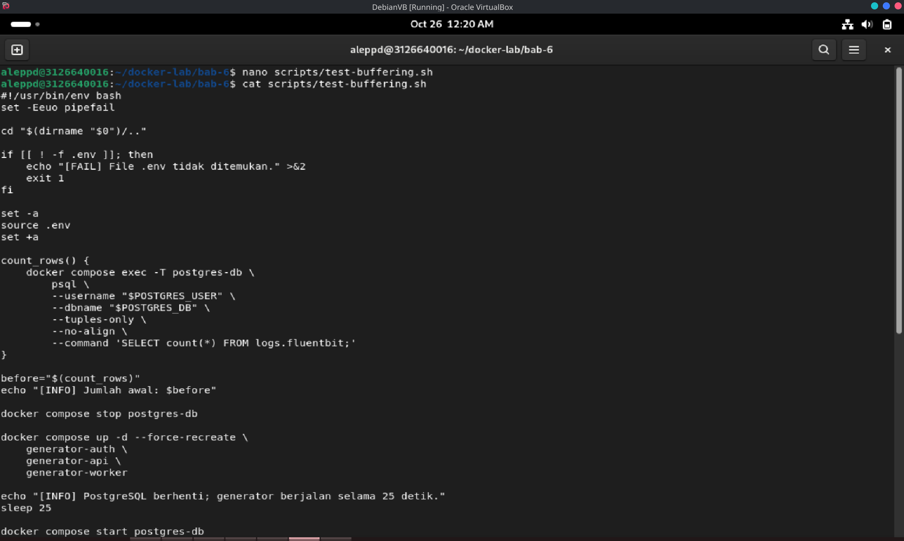

*Gambar 9. Penulisan `scripts/test-buffering.sh` yang memuat fungsi `count_rows`, penghentian PostgreSQL, dan verifikasi kenaikan record.*

### 4.10 Permission dan Validasi

Memberikan izin eksekusi pada script, memeriksa sintaks Bash, dan memvalidasi model Compose. Langkah ini menangkap kesalahan ketik atau interpolasi sebelum stack dijalankan, sehingga kegagalan tidak baru terlihat saat runtime.

```bash
chmod +x init/01-init-logging.sh
chmod +x scripts/generate-logs.sh scripts/test-buffering.sh

bash -n init/01-init-logging.sh
bash -n scripts/generate-logs.sh
bash -n scripts/test-buffering.sh
docker compose config --quiet
```

Validasi konfigurasi Fluent Bit tanpa menjalankan seluruh stack:

```bash
docker compose run --rm --no-deps fluent-bit \
  --dry-run \
  --config=/fluent-bit/etc/fluent-bit.conf
```

Jika versi image tidak mengenali `--dry-run`, validasi dilakukan dengan menjalankan service dan memeriksa log startup:

```bash
docker compose up -d postgres-db fluent-bit
docker compose logs --tail 100 fluent-bit
```

| | |
| --- | --- |
| 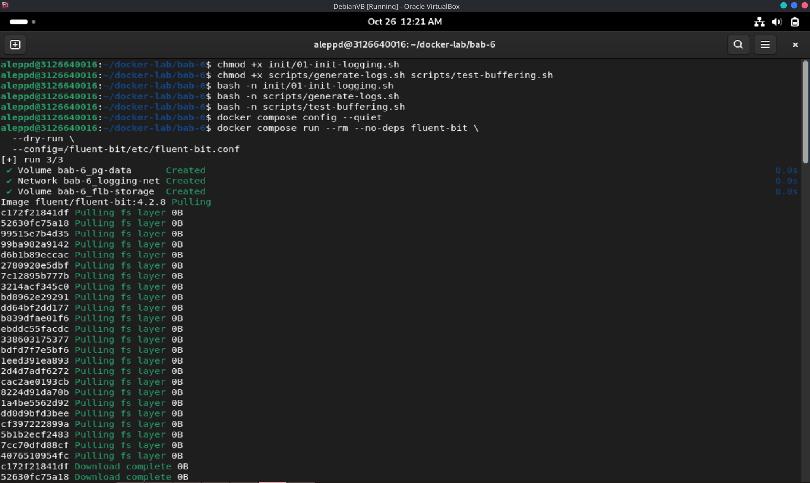 | 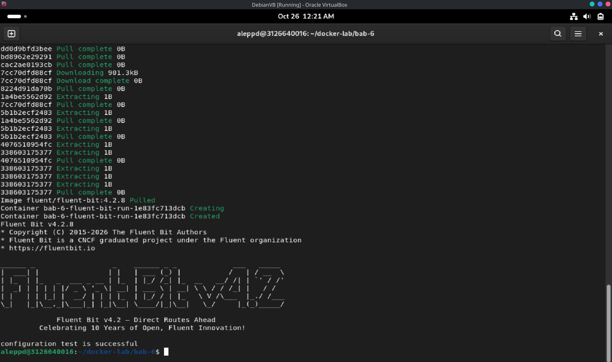 |
| *Gambar 10a. Pemberian izin eksekusi, pemeriksaan sintaks Bash, dan validasi `compose.yaml` dengan `docker compose config --quiet`.* | *Gambar 10b. Validasi konfigurasi Fluent Bit melalui `--dry-run` atau pemeriksaan log startup service.* |

### 4.11 Menjalankan Pipeline dan Menghasilkan Log

Script generator dijalankan untuk membuat tiga container yang masing-masing menghasilkan 20 event. Setelah sekitar 25 detik, ketiga generator akan berstatus `Exited (0)` karena prosesnya memang selesai, sedangkan PostgreSQL dan Fluent Bit harus tetap `Up`.

```bash
./scripts/generate-logs.sh
sleep 25
docker compose ps --all
```

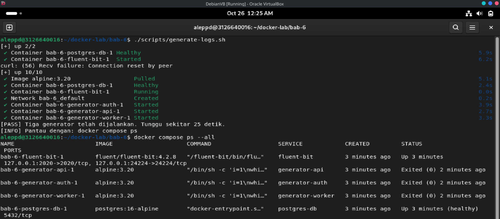

*Gambar 11. Keluaran `./scripts/generate-logs.sh` dan `docker compose ps --all` yang menunjukkan PostgreSQL serta Fluent Bit `Up`, sedangkan tiga generator `Exited (0)`.*

### 4.12 Monitoring Fluent Bit

Fluent Bit mengekspos HTTP server pada port `2020`. Endpoint `/api/v1/health` menunjukkan collector siap, sedangkan `/api/v1/metrics` memperlihatkan jumlah record masuk, retry, dan kondisi buffer. Endpoint ini hanya diikat ke `127.0.0.1` dan tidak boleh dibuka ke jaringan publik tanpa autentikasi.

```bash
curl -fsS http://127.0.0.1:2020/api/v1/health
curl -fsS http://127.0.0.1:2020/api/v1/metrics
```

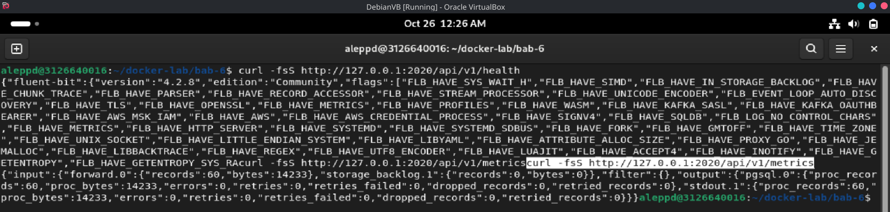

*Gambar 12. Respons endpoint `/api/v1/health` dan cuplikan `/api/v1/metrics` yang menunjukkan aktivitas input serta output.*

### 4.13 Verifikasi Record PostgreSQL

Query analisis dijalankan langsung di dalam container PostgreSQL menggunakan berkas SQL yang di-mount dari host. Verifikasi dilengkapi dengan pemeriksaan view `logs.recent_logs` untuk memastikan metadata Docker benar-benar tersimpan.

```bash
set -a
source .env
set +a

docker compose exec -T postgres-db \
  psql \
  --username "$POSTGRES_USER" \
  --dbname "$POSTGRES_DB" \
  --file /dev/stdin \
  < queries/analysis.sql
```

```bash
docker compose exec -T postgres-db \
  psql \
  --username "$POSTGRES_USER" \
  --dbname "$POSTGRES_DB" \
  --command 'TABLE logs.recent_logs;'
```

Selain itu, tipe kolom `data` diverifikasi secara eksplisit:

```bash
docker compose exec -T postgres-db \
  psql \
  --username "$POSTGRES_USER" \
  --dbname "$POSTGRES_DB" \
  --command 'SELECT pg_typeof(data), count(*) FROM logs.fluentbit GROUP BY pg_typeof(data);'
```

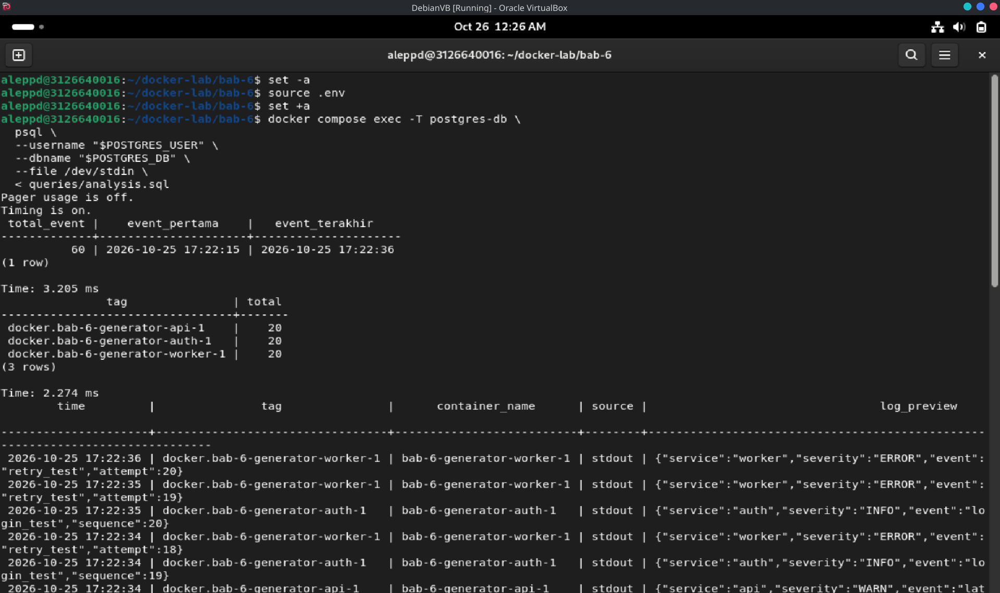

*Gambar 13. Hasil eksekusi `analysis.sql` serta verifikasi record dan tipe kolom `data` pada tabel `logs.fluentbit`.*

### 4.14 Uji Buffering dan Pemulihan

Pengujian ini menghentikan PostgreSQL sementara generator berjalan, lalu menyalakannya kembali. Kriteria utama bukan tidak adanya pesan galat, melainkan bahwa kegagalan output terlihat dan jumlah record bertambah setelah backend pulih.

```bash
./scripts/test-buffering.sh
```

Selama PostgreSQL berhenti, retry dan kondisi buffer dapat diamati melalui log collector serta daftar volume:

```bash
docker compose logs --tail 200 fluent-bit
docker volume ls
```

| | |
| --- | --- |
| 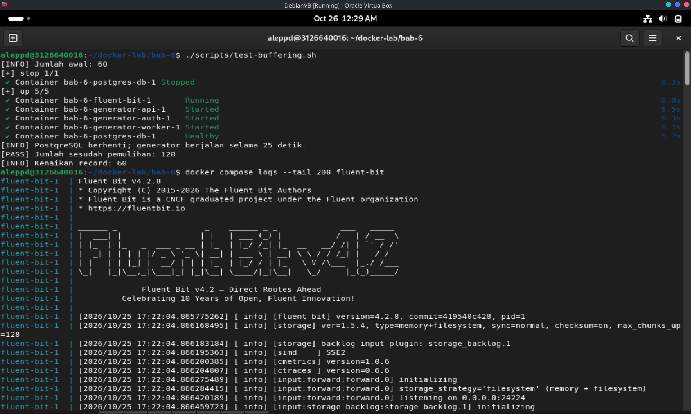 | 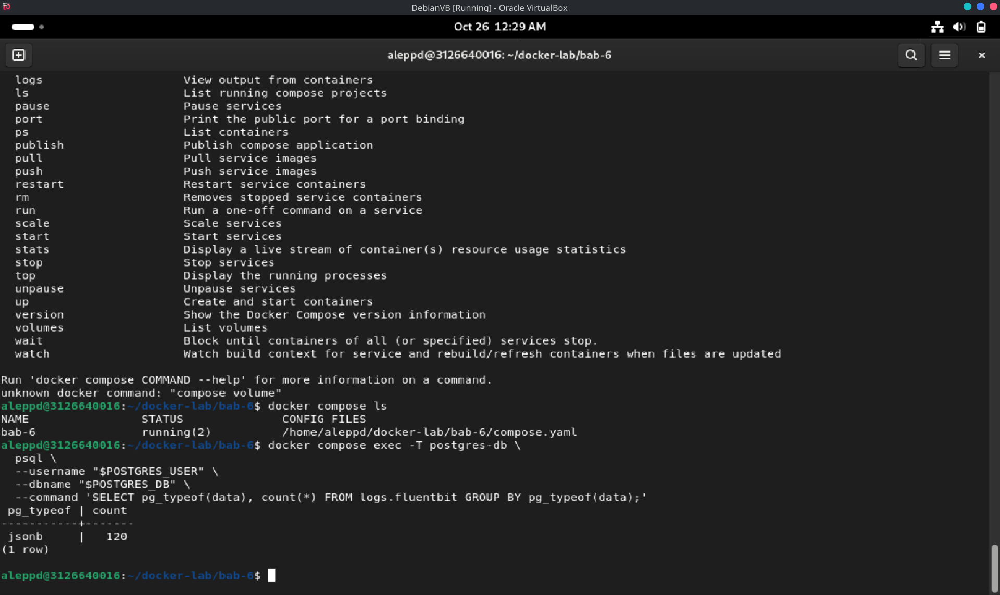 |
| *Gambar 14a. Keluaran `test-buffering.sh` yang berakhir dengan `[PASS]` dan menunjukkan kenaikan jumlah record.* | *Gambar 14b. Kondisi log Fluent Bit dan buffer selama PostgreSQL tidak tersedia.* |

### 4.15 Cleanup

Menghentikan container tanpa menghapus data, lalu menghapus seluruh container dan volume lab. Perintah kedua bersifat destruktif terhadap data praktikum dan hanya dijalankan setelah evidence yang diperlukan disimpan.

```bash
docker compose down --remove-orphans
docker compose down --volumes --remove-orphans
```

## 5. Hasil Pengujian

### 5.1 Status Service dan Kesiapan Collector

```bash
./scripts/generate-logs.sh
sleep 25
docker compose ps --all
curl -fsS http://127.0.0.1:2020/api/v1/health
```

Hasil: `postgres-db` berstatus `Up (healthy)`, `fluent-bit` berstatus `Up`, dan ketiga generator berstatus `Exited (0)` setelah menyelesaikan 20 event. Endpoint kesehatan collector merespons sukses. Rincian terlihat pada Gambar 11 dan Gambar 12.

### 5.2 Hasil Ingest dan Struktur Record

```bash
docker compose exec -T postgres-db \
  psql \
  --username "$POSTGRES_USER" \
  --dbname "$POSTGRES_DB" \
  --command 'SELECT pg_typeof(data), count(*) FROM logs.fluentbit GROUP BY pg_typeof(data);'

docker compose exec -T postgres-db \
  psql \
  --username "$POSTGRES_USER" \
  --dbname "$POSTGRES_DB" \
  --command 'SELECT tag, count(*) FROM logs.fluentbit GROUP BY tag ORDER BY tag;'
```

| Pemeriksaan | Hasil | Bukti |
| --- | --- | --- |
| Tiga sumber log | Query `GROUP BY tag` menampilkan tiga tag generator | Gambar 13 |
| Struktur record | `container_name`, `source`, dan `log` terisi | Gambar 13 |
| Penyimpanan JSONB | `pg_typeof(data)` bernilai `jsonb` | Gambar 13 |
| View analisis | `logs.recent_logs` menampilkan log terbaru | Gambar 13 |

### 5.3 Hasil Query Analisis

```bash
docker compose exec -T postgres-db \
  psql \
  --username "$POSTGRES_USER" \
  --dbname "$POSTGRES_DB" \
  --file /dev/stdin \
  < queries/analysis.sql
```

Query pertama menunjukkan total event beserta rentang waktu, query kedua menunjukkan distribusi per tag, query keempat menemukan pesan dengan `severity` `ERROR`, dan query kelima menunjukkan laju ingest per menit. Angka aktual dapat berbeda karena waktu startup dan retry. Rincian pada Gambar 13.

### 5.4 Hasil Uji Buffering dan Pemulihan

```bash
./scripts/test-buffering.sh
```

Hasil: jumlah record sebelum gangguan tercatat, PostgreSQL dihentikan sementara, generator tetap berjalan, lalu setelah PostgreSQL dipulihkan jumlah record bertambah dan script berakhir dengan `[PASS]`. Rincian pada Gambar 14a dan Gambar 14b.

### 5.5 Checklist Hasil

- [x] Fluent Bit menerima log dari minimal tiga container.
- [x] Tabel `logs.fluentbit` berisi data dengan kolom `tag`, `time`, dan `data` bertipe `JSONB`.
- [x] View `logs.recent_logs` menampilkan log terbaru beserta metadata container.
- [x] Query distribusi per tag dan pencarian keyword berjalan.
- [x] `test-buffering.sh` menunjukkan kenaikan jumlah record setelah PostgreSQL pulih.
- [x] PostgreSQL tidak memiliki *published port* ke host.
- [x] Saya memahami apa yang terjadi jika collector mati sementara.

### 5.6 Prinsip Troubleshooting

Mulai dari status container, baca logs, cek network, cek volume, lalu validasi konfigurasi. Jangan langsung menghapus volume sebelum memahami apakah data masih dibutuhkan.

```bash
docker compose ps
docker compose logs --tail 100
curl -v http://127.0.0.1:2020/api/v1/health
docker network ls
docker volume ls
docker inspect <container-name>
```

## 6. Threat Statement

| Unsur | Isi |
| --- | --- |
| Aset | Record log pada tabel `logs.fluentbit` dan volume `pg-data`, buffer `flb-storage`, credential PostgreSQL pada `.env`, konfigurasi `fluent-bit.conf` dan `compose.yaml`, serta endpoint monitoring `:2020` |
| Aktor ancaman | Penyerang eksternal yang menjangkau port host, pengguna lokal tidak berwenang pada host atau repository, proses lain di host yang dapat menjangkau loopback, serta pihak yang memperoleh akses ke `.env` atau volume buffer |
| Jalur serangan | Protokol Forward tanpa TLS pada port `24224`; endpoint monitoring tanpa autentikasi; credential plaintext pada `.env`; log aplikasi yang mungkin memuat token, password, atau data pribadi; log injection melalui field bebas; retensi tanpa batas; serta koneksi Fluent Bit ke PostgreSQL tanpa TLS |
| Dampak | Kebocoran informasi sensitif melalui log, pemalsuan atau penyisipan event palsu yang mengacaukan audit, penyadapan trafik log, kehilangan evidence karena buffer penuh atau volume dihapus, pembengkakan storage dan biaya, serta sulitnya investigasi insiden |

**Threat statement:** Aset yang dilindungi adalah record log pada tabel `logs.fluentbit`, volume `pg-data`, buffer `flb-storage`, credential PostgreSQL pada `.env`, serta konfigurasi pipeline logging. Aktor ancaman dapat berupa penyerang eksternal yang menjangkau port host, pengguna lokal yang tidak berwenang, proses lain di host yang dapat menjangkau loopback, maupun pihak yang memperoleh akses ke berkas konfigurasi atau volume. Jalur serangan meliputi protokol Forward tanpa TLS pada port `24224`, endpoint monitoring tanpa autentikasi, credential plaintext, pencatatan data sensitif, log injection, retensi tanpa batas, dan koneksi ke PostgreSQL tanpa TLS. Dampak yang mungkin terjadi adalah kebocoran informasi sensitif, pemalsuan event audit, penyadapan trafik, kehilangan evidence, pembengkakan storage, serta buruknya ketelusuran insiden.

## 7. Analisis

### 7.1 Masalah yang Muncul dan Cara Mendiagnosisnya

Selama praktikum Bab 6 tidak ada kendala yang menghambat proses. Pipeline berjalan sesuai rancangan sejak konfigurasi awal, sehingga tidak ada perbaikan darurat yang perlu dilakukan. Dua hal yang sempat saya perhatikan justru merupakan perilaku normal dan perlu dibedakan dari kegagalan.

Pertama, ketiga container generator berakhir dengan status `Exited (0)` setelah sekitar 20 detik. Status ini bukan indikasi crash, melainkan karena perintah generator berupa loop terbatas 20 iterasi yang memang selesai. Saya memastikannya melalui `docker compose ps --all` dan membaca log container: tidak ada pesan galat, serta service `postgres-db` dan `fluent-bit` tetap `Up`.

Kedua, record tidak langsung muncul tepat setelah generator selesai. Fluent Bit memakai interval flush dan buffer, sehingga ada jeda singkat sebelum data terlihat di PostgreSQL. Saya menunggu beberapa saat, lalu memverifikasi melalui `curl` ke `/api/v1/health` dan `/api/v1/metrics`, query `count(*)`, serta view `logs.recent_logs`. Pendekatan diagnosis yang saya pegang adalah status container hanya menunjukkan proses hidup; keberhasilan pipeline dibuktikan oleh record yang dapat di-query, metrik input/output, dan tipe `data` yang benar.

### 7.2 Risiko Keamanan atau Operasional yang Relevan

Pertama, protokol Forward pada port `24224` tidak menyediakan enkripsi maupun autentikasi. Walaupun port hanya diikat ke loopback, proses lokal mana pun di host dapat mengirim event palsu ke collector, sehingga integritas evidence tidak terjamin. Pada deployment lintas host, trafik ini harus melewati jaringan tepercaya atau TLS, dan endpoint collector sebaiknya dibatasi dengan firewall serta autentikasi.

Kedua, endpoint monitoring `:2020` tidak memiliki autentikasi. Endpoint ini membocorkan metric operasional dan berpotensi membantu penyerang memetakan beban serta kondisi pipeline. Membukanya ke jaringan publik tanpa pembatasan merupakan kesalahan konfigurasi yang serius.

Ketiga, credential PostgreSQL ditulis pada `.env` dan diinjeksikan sebagai environment variable. Nilai tersebut dapat terlihat melalui `docker inspect`, `docker compose config`, atau proses lain yang memiliki akses ke container. Akun ingest juga masih memiliki hak `CREATE` pada schema `logs`, sehingga kompromi akun tersebut dapat mengubah objek database, bukan hanya menyisipkan record.

Keempat, log berpotensi memuat data sensitif. Pada praktikum ini generator hanya mengirim field sintetis, tetapi aplikasi nyata sering mencatat token, password, session identifier, atau data pribadi tanpa disadari. Tanpa redaction di sisi producer dan verifikasi di collector, centralized logging justru memperbesar dampak kebocoran karena data sensitif terkonsentrasi di satu tempat.

Kelima, tidak ada kebijakan retensi yang berjalan otomatis. Tabel akan tumbuh terus dan memenuhi volume `pg-data`, sementara buffer `flb-storage` juga dapat menghabiskan disk host ketika output tertahan. Sebaliknya, menghapus volume secara tidak sengaja melalui `down --volumes` akan menghilangkan seluruh evidence. Karena itu retensi, backup, dan prosedur cleanup harus eksplisit.

Keenam, pipeline bersifat *at-least-once*. Retry dapat menghasilkan record ganda, sedangkan buffer penuh, kegagalan disk, atau penghentian paksa tetap dapat menyebabkan kehilangan event. PostgreSQL juga bukan backend ideal untuk volume telemetry yang sangat besar; query analitik berat dapat mengganggu ingest, dan belum ada partisi berbasis waktu maupun resource limit pada container.

### 7.3 Rekomendasi Perbaikan untuk Production-like Environment

1. **Amankan transport:** aktifkan TLS pada input Forward dan koneksi Fluent Bit ke PostgreSQL, lalu batasi port collector hanya untuk sumber yang dikenal.
2. **Autentikasi dan segmentasi:** lindungi endpoint monitoring dengan autentikasi atau network policy, tempatkan collector pada network internal, dan hindari publikasi port ke seluruh interface.
3. **Secret management:** pindahkan credential PostgreSQL dari `.env` ke Docker secret, Vault, atau secret manager; rotasi berkala dan pisahkan credential ingest, read-only analyst, serta admin.
4. **Least privilege:** setelah schema stabil, cabut hak `CREATE` dari akun ingest dan berikan hanya `INSERT` pada tabel tujuan serta `USAGE` pada schema.
5. **Redaction dan minimisasi data:** terapkan filter redaction di producer dan collector untuk token, password, cookie, serta data pribadi; dokumentasikan field yang wajib dan dilarang dicatat.
6. **Retensi dan partisi:** gunakan partisi tabel berbasis waktu, job penghapusan terjadwal, serta archive ke object storage dengan checksum untuk kebutuhan forensik.
7. **Deduplikasi dan event ID:** tambahkan `event_id` yang unik pada generator atau aplikasi, lalu terapkan strategi deduplikasi untuk kebutuhan yang tidak menerima duplikasi.
8. **Observability pipeline:** pantau jumlah record masuk, gagal parse, retry, dropped record, penggunaan buffer, dan latency output; buat alert ketika backlog melewati ambang.
9. **Resource limit dan reliability:** tetapkan `mem_limit`, `cpus`, dan batas ukuran buffer; uji perilaku saat PostgreSQL tidak tersedia, disk penuh, dan collector dihentikan paksa.
10. **Tata kelola schema dan evidence:** versikan schema log, uji perubahan field seperti perubahan API, audit akses analyst, dan sertakan rentang waktu, query, zona waktu, serta checksum saat mengekspor log untuk investigasi.

### 7.4 Evaluasi dan Latihan Mandiri

**1. Apa risiko kehilangan log ketika Fluent Bit tidak tersedia?**
Event dapat tertahan di buffer Docker atau Fluent Bit lalu hilang ketika buffer penuh, proses dihentikan paksa, atau disk gagal. Karena itu kehilangan log harus diukur melalui metric dan tidak diasumsikan tidak terjadi.

**2. Mengapa structured logging lebih mudah dianalisis dibanding plain text logging?**
Field yang konsisten memungkinkan filter, agregasi, dan korelasi tanpa parsing teks yang rapuh. Structured logging juga memudahkan validasi tipe serta pembuatan dashboard dan alert.

**3. Kapan PostgreSQL tidak lagi cocok sebagai log storage utama?**
Ketika volume ingest sangat tinggi, retensi panjang, dan query pencarian kompleks membuat beban database mengganggu workload lain. Pada skala tersebut, sistem khusus seperti Loki, OpenSearch, atau ClickHouse lebih tepat.

**4. Apa perbedaan log untuk observability dan log untuk forensik?**
Log observability berfokus pada kesehatan sistem dan debugging cepat, sedangkan log forensik menekankan integritas, ketelusuran akses, retensi terkendali, dan kemampuan mereproduksi analisis. Keduanya dapat memakai pipeline yang sama, tetapi kontrak data dan kontrol aksesnya berbeda.

**5. Buat query SQL untuk menampilkan jumlah log per menit dalam 10 menit terakhir.**

```sql
SELECT
    date_trunc('minute', time) AS minute_bucket,
    count(*) AS total
FROM logs.fluentbit
WHERE time >= CURRENT_TIMESTAMP - INTERVAL '10 minutes'
GROUP BY minute_bucket
ORDER BY minute_bucket DESC;
```

## 8. Tindak Lanjut

1. Menambahkan parser Fluent Bit agar isi JSON pada `data.log` diangkat menjadi field terstruktur, lalu menulis pengujian negatif untuk log yang bukan JSON valid.
2. Menyisipkan nilai canary yang menyerupai token sintetis dan membuktikan filter redaction mencegah nilai tersebut mencapai PostgreSQL.
3. Membandingkan jumlah event yang dihasilkan generator, diterima input Fluent Bit, dan tersimpan di PostgreSQL, lalu menjelaskan setiap selisih berdasarkan evidence.
4. Merancang retensi tujuh hari yang berjalan terjadwal tanpa mengunci tabel secara berlebihan, termasuk partisi dan archive.
5. Memindahkan credential ke secret manager, mencabut hak `CREATE` dari akun ingest, dan mengaktifkan TLS pada jalur collector serta database.
6. Melanjutkan ke bab berikutnya dengan menambahkan monitoring metrics menggunakan Prometheus, cAdvisor, Node Exporter, dan Grafana.

## 9. Kesimpulan

1. Centralized logging berhasil dibangun dengan Fluent Bit sebagai collector yang menerima log dari Docker `fluentd` driver dan meneruskannya ke PostgreSQL dalam kolom `JSONB`.
2. Tiga generator berhasil menghasilkan event dari sumber berbeda, dan record dapat diverifikasi melalui kolom `tag`, `time`, serta metadata `container_name`, `source`, dan `log`.
3. View `logs.recent_logs`, indeks waktu, indeks tag, dan indeks GIN mempermudah pencarian serta analisis log terbaru.
4. Uji buffering membuktikan Fluent Bit dapat menahan event ketika PostgreSQL tidak tersedia sementara dan mengirimkannya setelah backend pulih, dengan catatan pipeline bersifat *at-least-once* dan tidak menjamin *exactly-once*.
5. Praktikum ini masih memiliki celah berupa transport tanpa TLS, endpoint monitoring tanpa autentikasi, credential pada `.env`, potensi data sensitif dalam log, retensi yang belum otomatis, serta belum adanya resource limit; untuk production-like diperlukan secret terkelola, redaction, partisi dan retensi terjadwal, TLS, least privilege, serta pemantauan pipeline.

## 10. Referensi

1. Ferry Astika Saputra, "Bab 6 — Centralized Logging dengan Fluent Bit dan PostgreSQL," repository DevSecOps PENS, `bab-06.md`: https://github.com/ferryas-pens/devsecops/blob/main/bab-06.md
2. Fluent Bit Documentation, *PostgreSQL output*: https://docs.fluentbit.io/manual/data-pipeline/outputs/postgresql
3. Fluent Bit Documentation, *Buffering*: https://docs.fluentbit.io/manual/data-pipeline/buffering
4. Fluent Bit Documentation, *Monitoring*: https://docs.fluentbit.io/manual/administration/monitoring
5. Docker Documentation, *Fluentd logging driver*: https://docs.docker.com/engine/logging/drivers/fluentd/
6. Docker Documentation, *Configure logging drivers*: https://docs.docker.com/engine/logging/configure/
7. PostgreSQL Documentation, *JSON Types*: https://www.postgresql.org/docs/current/datatype-json.html
