# LAPORAN PRAKTIKUM BAB 7
## Monitoring Resource dengan Prometheus, cAdvisor, Node Exporter, dan Grafana

**Nama**: Ale Perdana Putra Darmawan  
**NIM**: 3126640016  
**Kelas**: STr LJ Teknik Informatika A  
**Tanggal pelaksanaan**: 26 Oktober 2026

> **Disclaimer penggunaan AI.** Laporan praktikum ini disusun dengan bantuan kecerdasan buatan (AI) yang difungsikan sebagai alat dokumentasi. AI digunakan untuk merapikan catatan praktikum, menyusun struktur dan alur penulisan laporan, serta menyunting tata bahasa. Seluruh pelaksanaan praktikum, pengambilan bukti berupa screenshot, verifikasi keluaran perintah, dan pengambilan kesimpulan tetap dilakukan secara mandiri oleh saya.

## 1. Tujuan Praktikum

1. Membedakan monitoring berbasis metric time-series dengan logging berbasis event, serta menjelaskan peran keduanya dalam observability.
2. Menjalankan Prometheus sebagai scraper sekaligus time-series database dengan konfigurasi target, recording rule, dan alert rule.
3. Mengumpulkan metric host melalui Node Exporter dan metric container melalui cAdvisor.
4. Menyusun query PromQL yang benar, termasuk penggunaan `rate()` pada counter dan agregasi per label.
5. Membuat dashboard Grafana yang terprovisi otomatis untuk CPU, memori, disk, network, dan penggunaan container.
6. Menguji alert melalui load generator dan negative test target down, lalu memverifikasi pemulihannya.
7. Mengintegrasikan data log PostgreSQL dari Bab 6 ke Grafana menggunakan role baca khusus.

## 2. Dasar Teori Singkat

### 2.1 Monitoring, Logging, dan Observability

Monitoring menjawab pertanyaan “apa yang sedang terjadi pada sistem” melalui angka time-series yang dicatat berkala. Logging menjawab “mengapa hal itu terjadi” melalui event dan pesan detail. Keduanya saling melengkapi: metric efisien untuk melihat tren dan memicu alert, sedangkan log menyimpan konteks yang dibutuhkan saat investigasi. Observability adalah kemampuan menalar keadaan internal sistem berdasarkan keluaran yang tersedia, sehingga metric, log, dan trace tidak boleh diperlakukan sebagai tiga proyek terpisah tanpa keterkaitan.

Pada praktikum ini, Prometheus mengumpulkan metric, Grafana menyajikan visualisasi, dan data log Bab 6 dipakai sebagai konteks tambahan. Dashboard yang baik harus menjawab pertanyaan operasional yang jelas: apakah pengguna terdampak, service mana yang menjadi bottleneck, sejak kapan gejala muncul, dan perubahan apa yang bertepatan dengan gejala tersebut.

### 2.2 Model Pull, Time Series, dan Cardinality

Prometheus memakai model pull: server melakukan scrape endpoint `/metrics` dari target secara berkala. Setiap time series dibentuk oleh nama metric dan kombinasi label, misalnya `instance`, `job`, `mode`, atau `name`. Label membantu segmentasi, tetapi label dengan nilai berdimensi tinggi seperti user ID, request ID, atau pesan error menciptakan cardinality tinggi. Cardinality meningkatkan penggunaan memori dan storage serta membuat query menjadi mahal. Nilai berdimensi tinggi sebaiknya disimpan pada log atau trace, bukan pada metric.

Status `up=1` hanya membuktikan bahwa endpoint metric berhasil dikunjungi. Status tersebut tidak membuktikan bahwa aplikasi memenuhi fungsi bisnis. Karena itu, dashboard dan alert harus tetap membaca metric aplikasi, error rate, dan latency, bukan hanya ketersediaan exporter.

### 2.3 Jenis Metric dan Semantik

Counter hanya bertambah dan sesuai untuk jumlah request, error, atau byte total. Counter dianalisis sebagai rate, bukan nilai absolut, karena proses dapat restart dan nilai counter akan kembali ke nol. Gauge dapat naik dan turun, misalnya penggunaan memori, panjang antrean, atau jumlah koneksi. Histogram mengelompokkan observasi pada bucket dan memungkinkan estimasi quantile pada agregasi, sedangkan summary menghitung quantile di sisi client dengan trade-off agregasi yang berbeda.

Pemilihan tipe harus mengikuti semantik fenomena, bukan tampilan dashboard yang diinginkan. Metric resource juga perlu dibaca bersama konteks: CPU tinggi dapat berarti beban produktif atau loop, sedangkan CPU throttling menunjukkan limit cgroup menahan workload. Memori working set berbeda dari cache, dan mendekati limit belum tentu error sampai muncul OOM event atau restart.

### 2.4 PromQL dan Penggunaan `rate()`

PromQL menyediakan agregasi temporal seperti `rate`, `avg`, `sum`, dan `histogram_quantile`. Kesalahan umum pemula adalah membaca counter mentah tanpa `rate`, sehingga grafik terlihat naik terus dan tidak merepresentasikan throughput aktual. Untuk dashboard dan alert yang relatif stabil, `rate()` lebih tepat daripada `irate()` karena `rate()` memakai seluruh sampel dalam jendela waktu, sedangkan `irate()` hanya memakai dua sampel terakhir dan lebih sensitif terhadap lonjakan.

Jendela waktu pada `rate()` harus lebih besar dari interval scrape. Jika `scrape_interval` 15 detik, jendela 5 menit menyediakan sekitar 20 sampel sehingga hasilnya stabil. Jendela yang terlalu pendek dapat menghasilkan series kosong atau nilai yang melonjak.

### 2.5 Node Exporter dan cAdvisor

Node Exporter mengekspos metric host: CPU, memori, filesystem, network, dan beban sistem. cAdvisor mengekspos metric container, termasuk penggunaan CPU, working set memori, dan aktivitas filesystem per container. Keduanya menjawab level pertanyaan yang berbeda, sehingga label target dan nama metric harus dibedakan dengan jelas. cAdvisor membutuhkan akses cukup luas ke runtime container dan pada praktikum ini dijalankan dengan `privileged: true`, yang merupakan pengecualian berisiko dan hanya layak untuk laptop lab terisolasi.

Pada Docker Desktop Windows/WSL 2, Node Exporter dan cAdvisor terutama mengamati mesin virtual Linux tempat Docker Engine berjalan, bukan seluruh resource native Windows. Perbedaan ini wajib dicatat agar kesimpulan tidak melebih-lebihkan cakupan pengamatan.

### 2.6 Grafana, Provisioning, dan Data Source

Grafana tidak menyimpan metric utama, tetapi meng-query data source seperti Prometheus atau PostgreSQL untuk visualisasi dan alerting. Provisioning memungkinkan data source dan dashboard didefinisikan sebagai berkas konfigurasi, sehingga lingkungan dapat direproduksi dan perubahan dapat direview melalui version control. Pada praktikum ini dashboard dibuat tidak dapat diedit melalui UI agar sumber konfigurasi tetap jelas.

Data source PostgreSQL Bab 6 memakai role baca khusus. Pendekatan ini lebih aman daripada memberikan credential administrator kepada Grafana, tetapi trafik database pada lab ini masih berjalan tanpa TLS.

### 2.7 Golden Signals, SLI/SLO, dan Alerting

Empat golden signals—latency, traffic, errors, dan saturation—membantu memilih pengukuran yang berorientasi layanan. Service level indicator (SLI) adalah ukuran, misalnya proporsi request berhasil di bawah batas latency. Service level objective (SLO) menetapkan target pada periode tertentu. Alert yang bermakna menghubungkan gejala dengan risiko terhadap SLO, bukan hanya threshold resource sesaat. CPU 85 persen selama satu menit bisa normal pada batch job, sedangkan error rate kecil pada endpoint pembayaran bisa kritis.

Alert harus actionable: penerima memahami dampak, urgensi, konteks, dan langkah awal. Kondisi `for` membantu menahan spike singkat. Alert juga perlu diuji melalui failure injection yang aman, misalnya menghentikan service laboratorium atau memberikan beban terkontrol. Keberhasilan alert dibuktikan oleh perubahan state, notifikasi, dan recovery, bukan hanya keberadaan rule.

### 2.8 Keamanan Endpoint Metric

Endpoint metric dapat membocorkan versi, nama host, route, pola beban, atau identifier. Aksesnya harus dibatasi oleh network, autentikasi, TLS, atau proxy sesuai risiko. Pada praktikum ini endpoint exporter tidak dipublikasikan ke host dan hanya diakses Prometheus melalui jaringan internal Compose. Hanya antarmuka Prometheus dan Grafana yang diikat ke `127.0.0.1`.

Grafana juga memerlukan kontrol akses. Akun anonim dinonaktifkan dan sign-up ditutup, tetapi password laboratorium tetap harus diganti bila lingkungan dapat diakses pihak lain. Data source credential harus dikelola sebagai secret, bukan ditanam pada repository.

### 2.9 Field dan Variabel yang Dipakai

Metric PromQL utama yang dipakai pada praktikum ini:

| Metric / Ekspresi | Makna |
| --- | --- |
| `up` | Status scrape target Prometheus (`1` berhasil, `0` gagal) |
| `instance:node_cpu_utilisation:ratio_rate5m` | Rasio utilisasi CPU host dari recording rule |
| `instance:node_memory_utilisation:ratio` | Rasio utilisasi memori host |
| `instance:node_filesystem_avail:ratio` | Rasio ruang filesystem tersedia |
| `container:cpu_usage_cores:rate1m` | Pemakaian CPU container dalam satuan core |
| `container:memory_working_set_bytes:sum` | Working set memori container |
| `rate(node_cpu_seconds_total[5m])` | Laju perubahan counter CPU per 5 menit |

Variabel lingkungan yang dipakai:

| Variabel | Fungsi |
| --- | --- |
| `GRAFANA_ADMIN_USER` | Username administrator Grafana laboratorium (`admin`) |
| `GRAFANA_ADMIN_PASSWORD` | Password administrator Grafana laboratorium |
| `GRAFANA_DB_USER` | Role read-only untuk data source PostgreSQL Bab 6 (`grafana_reader`) |
| `GRAFANA_DB_PASSWORD` | Password role read-only Grafana |
| `POSTGRES_DB` | Nama database laboratorium Bab 6 (`labdb`) |

## 3. Alat dan Lingkungan

| Komponen | Hasil identifikasi |
| --- | --- |
| Host | Linux / WSL 2 pada Windows (lingkungan khusus laboratorium) |
| Runtime dan orkestrasi | Docker Engine dan Docker Compose (plugin v2) |
| Image praktikum | `prom/prometheus:v3.14.0`, `grafana/grafana:13.1.4`, `prom/node-exporter:v1.12.1`, `ghcr.io/google/cadvisor:v0.60.5`, `alpine:3.20` |
| Volume | Named volume `prom-data` (time-series Prometheus) dan `grafana-data` (konfigurasi Grafana) |
| Berkas konfigurasi | `.env.example`, `.env`, `.gitignore`, `compose.yaml` |
| Berkas Prometheus | `prometheus/prometheus.yml`, `prometheus/rules/recording-rules.yml`, `prometheus/rules/alert-rules.yml`, `prometheus/tests/rules.test.yml` |
| Berkas Grafana | `grafana/provisioning/datasources/datasources.yml`, `grafana/provisioning/dashboards/provider.yml`, `grafana/dashboards/bab-7-overview.json` |
| Script pendukung | `scripts/verify-stack.sh`, `scripts/connect-bab6.sh` |
| Network | `bab7-monitoring-net` (bridge) menghubungkan Prometheus, Grafana, Node Exporter, cAdvisor, dan load generator |
| Publikasi port | `127.0.0.1:9090` (Prometheus) dan `127.0.0.1:3000` (Grafana), dibatasi ke loopback |
| Alat verifikasi | `docker compose`, `curl`, `promtool`, `python3 -m json.tool`, dan browser |
| Direktori kerja | `~/docker-lab/bab-7` |

> **Batas interpretasi.** Pada Linux, Node Exporter dan cAdvisor dapat mengamati resource host Linux dan container Docker. Pada Docker Desktop Windows/WSL 2, keduanya terutama mengamati mesin virtual Linux tempat Docker Engine berjalan, bukan seluruh resource native Windows. Perbedaan ini dicatat pada bagian analisis.

## 4. Langkah Praktikum

Seluruh langkah pada bagian ini mengikuti urutan cheatsheet Bab 7. Setiap langkah dilengkapi tangkapan layar sebagai bukti pelaksanaan.

### 4.1 Menyiapkan Direktori Kerja

Langkah ini membuat struktur direktori `bab-7` yang memisahkan konfigurasi Prometheus, provisioning Grafana, dashboard, script verifikasi, dan direktori laporan. Pemisahan ini penting agar bind mount mudah ditelusuri dan setiap berkas memiliki tanggung jawab yang jelas.

```bash
mkdir -p ~/docker-lab/bab-7/{prometheus/rules,prometheus/tests,grafana/provisioning/datasources,grafana/provisioning/dashboards,grafana/dashboards,scripts,reports}
cd ~/docker-lab/bab-7
tree -L 2
```

Struktur yang diharapkan:

```text
bab-7/
├── .env.example
├── .env
├── .gitignore
├── compose.yaml
├── prometheus/
│   ├── prometheus.yml
│   ├── rules/
│   │   ├── recording-rules.yml
│   │   └── alert-rules.yml
│   └── tests/
│       └── rules.test.yml
├── grafana/
│   ├── provisioning/
│   │   ├── datasources/datasources.yml
│   │   └── dashboards/provider.yml
│   └── dashboards/
│       └── bab-7-overview.json
├── scripts/
│   ├── verify-stack.sh
│   └── connect-bab6.sh
└── reports/
```

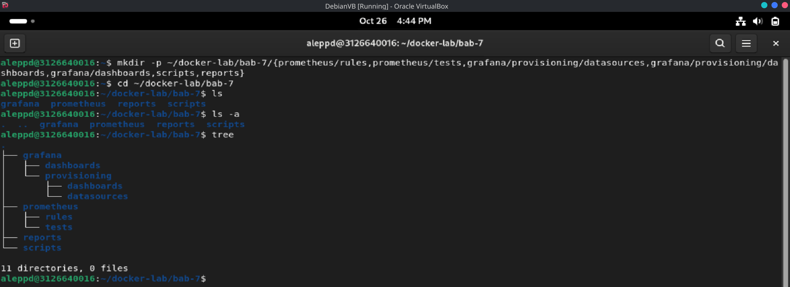

*Gambar 1. Struktur direktori `bab-7` yang memisahkan `prometheus`, `grafana`, `scripts`, dan `reports`.*

### 4.2 File `.env.example`

Berkas ini memusatkan parameter laboratorium sehingga credential tidak ditulis langsung di `compose.yaml`. Nilai di dalamnya hanya credential sintetis untuk laptop laboratorium. Setelah disalin menjadi `.env`, izin berkas dibatasi dengan `chmod 600` agar hanya pemilik yang dapat membacanya.

```dotenv
GRAFANA_ADMIN_USER=admin
GRAFANA_ADMIN_PASSWORD=grafanaadmin123
GRAFANA_DB_USER=grafana_reader
GRAFANA_DB_PASSWORD=grafanareaderpass123
POSTGRES_DB=labdb
```

```bash
nano .env.example
cp .env.example .env
chmod 600 .env
cat .env
```

Credential tersebut bersifat sintetis. Pada lingkungan produksi, gunakan secret manager, TLS, rotasi credential, dan kontrol akses berdasarkan peran.

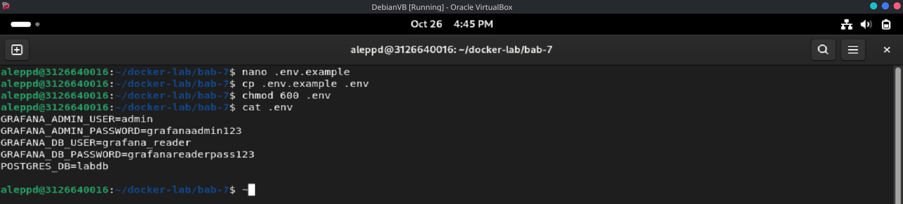

*Gambar 2. Pembuatan `.env.example`, penyalinan menjadi `.env`, penerapan `chmod 600`, serta isi `.env` dengan lima variabel laboratorium.*

### 4.3 File `.gitignore`

Berkas ini mencegah `.env`, berkas log, dan artefak laporan masuk ke repository. Tanpa `.gitignore`, credential laboratorium dan evidence lokal berpotensi ter-commit dan bocor melalui riwayat Git.

```gitignore
.env
reports/*
!reports/.gitkeep
*.log
```

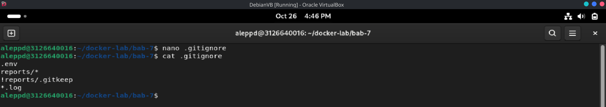

*Gambar 3. Isi `.gitignore` yang mengecualikan `.env`, artefak `reports/`, dan berkas `*.log`.*

### 4.4 File `compose.yaml`

Berkas ini mendefinisikan lima service: `prometheus`, `grafana`, `node-exporter`, `cadvisor`, dan `load-generator` yang hanya aktif melalui profile `load`. Hanya Prometheus dan Grafana yang dipublikasikan, dan keduanya diikat ke loopback. Endpoint exporter tetap berada di jaringan internal `bab7-monitoring-net`.

```yaml
services:
  prometheus:
    image: prom/prometheus:v3.14.0
    command:
      - --config.file=/etc/prometheus/prometheus.yml
      - --storage.tsdb.path=/prometheus
      - --storage.tsdb.retention.time=7d
      - --web.console.libraries=/usr/share/prometheus/console_libraries
      - --web.console.templates=/usr/share/prometheus/consoles
    ports:
      - "127.0.0.1:9090:9090"
    volumes:
      - ./prometheus:/etc/prometheus:ro
      - prom-data:/prometheus
    networks:
      - monitoring-net
    security_opt:
      - no-new-privileges:true
    restart: unless-stopped

  grafana:
    image: grafana/grafana:13.1.4
    environment:
      GF_SECURITY_ADMIN_USER: ${GRAFANA_ADMIN_USER}
      GF_SECURITY_ADMIN_PASSWORD: ${GRAFANA_ADMIN_PASSWORD}
      GF_USERS_ALLOW_SIGN_UP: "false"
      GF_AUTH_ANONYMOUS_ENABLED: "false"
      GRAFANA_DB_USER: ${GRAFANA_DB_USER}
      GRAFANA_DB_PASSWORD: ${GRAFANA_DB_PASSWORD}
      POSTGRES_DB: ${POSTGRES_DB}
    ports:
      - "127.0.0.1:3000:3000"
    volumes:
      - grafana-data:/var/lib/grafana
      - ./grafana/provisioning:/etc/grafana/provisioning:ro
      - ./grafana/dashboards:/var/lib/grafana/dashboards:ro
    networks:
      - monitoring-net
    depends_on:
      - prometheus
    security_opt:
      - no-new-privileges:true
    restart: unless-stopped

  node-exporter:
    image: prom/node-exporter:v1.12.1
    command:
      - --path.rootfs=/host
      - --collector.filesystem.mount-points-exclude=^/(dev|proc|sys|var/lib/docker/.+|var/lib/containers/storage/.+)($|/)
    pid: host
    volumes:
      - /:/host:ro,rslave
    networks:
      - monitoring-net
    read_only: true
    security_opt:
      - no-new-privileges:true
    restart: unless-stopped

  cadvisor:
    image: ghcr.io/google/cadvisor:v0.60.5
    privileged: true
    volumes:
      - /:/rootfs:ro
      - /var/run:/var/run:ro
      - /sys:/sys:ro
      - /var/lib/docker:/var/lib/docker:ro
    networks:
      - monitoring-net
    restart: unless-stopped

  load-generator:
    image: alpine:3.20
    command:
      - /bin/sh
      - -c
      - while :; do :; done
    cpus: 0.50
    mem_limit: 64m
    profiles:
      - load
    networks:
      - monitoring-net
    read_only: true
    security_opt:
      - no-new-privileges:true

volumes:
  prom-data:
  grafana-data:

networks:
  monitoring-net:
    name: bab7-monitoring-net
    driver: bridge
```

`privileged: true` pada cAdvisor merupakan pengecualian berisiko karena collector membaca metadata host dan runtime container. Konfigurasi ini hanya untuk laptop lab terisolasi. Pada lingkungan produksi, digunakan integrasi monitoring yang sesuai platform dan privilege dikurangi berdasarkan hasil pengujian nyata.

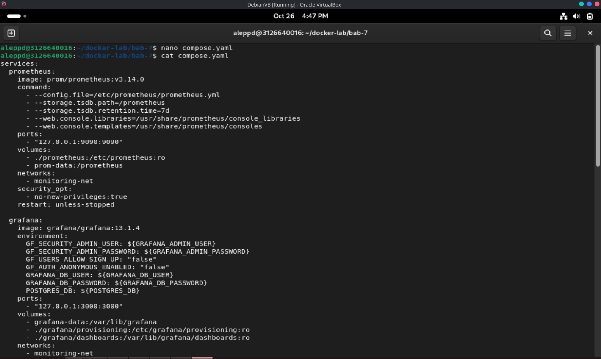

*Gambar 4. Penulisan `compose.yaml` dengan `prometheus`, `grafana`, `node-exporter`, `cadvisor`, dan `load-generator`.*

### 4.5 File `prometheus/prometheus.yml`

Berkas ini mendefinisikan interval scrape, timeout, evaluation interval, external label, rule files, dan tiga target scrape: Prometheus sendiri, Node Exporter, dan cAdvisor. Timeout dibuat lebih pendek daripada interval scrape agar scrape yang menggantung tidak menumpuk.

```yaml
global:
  scrape_interval: 15s
  scrape_timeout: 10s
  evaluation_interval: 15s
  external_labels:
    environment: lab
    chapter: "7"

rule_files:
  - /etc/prometheus/rules/recording-rules.yml
  - /etc/prometheus/rules/alert-rules.yml

scrape_configs:
  - job_name: prometheus
    static_configs:
      - targets:
          - prometheus:9090

  - job_name: node-exporter
    static_configs:
      - targets:
          - node-exporter:9100

  - job_name: cadvisor
    static_configs:
      - targets:
          - cadvisor:8080
```

Nilai 15 detik sesuai untuk observasi laboratorium, tetapi bukan angka universal untuk lingkungan produksi karena resolusi yang lebih rapat meningkatkan trafik, CPU, dan kebutuhan storage.

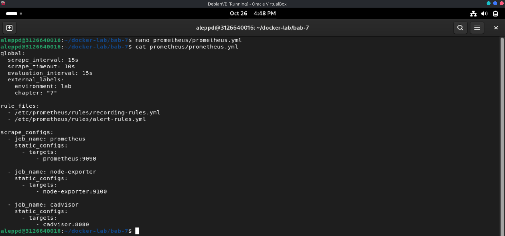

*Gambar 5. Penulisan `prometheus/prometheus.yml` yang memuat `global`, `rule_files`, dan tiga `scrape_configs`.*

### 4.6 File `prometheus/rules/recording-rules.yml`

Recording rule membuat time series turunan yang dipakai dashboard. Hal ini mengurangi pengulangan ekspresi PromQL yang kompleks dan menjaga nama agregasi tetap konsisten.

```yaml
groups:
  - name: bab7-resource-recording
    interval: 15s
    rules:
      - record: instance:node_cpu_utilisation:ratio_rate5m
        expr: |
          1 - avg by (instance) (
            rate(node_cpu_seconds_total{mode="idle"}[5m])
          )

      - record: instance:node_memory_utilisation:ratio
        expr: |
          1 - (
            node_memory_MemAvailable_bytes
            /
            node_memory_MemTotal_bytes
          )

      - record: instance:node_filesystem_avail:ratio
        expr: |
          node_filesystem_avail_bytes{
            fstype!~"tmpfs|overlay|squashfs|nsfs"
          }
          /
          node_filesystem_size_bytes{
            fstype!~"tmpfs|overlay|squashfs|nsfs"
          }

      - record: container:cpu_usage_cores:rate1m
        expr: |
          sum by (name) (
            rate(container_cpu_usage_seconds_total{name!=""}[1m])
          )

      - record: container:memory_working_set_bytes:sum
        expr: |
          sum by (name) (
            container_memory_working_set_bytes{name!=""}
          )
```

Nama rule menyatakan agregasi, rasio, dan jendela waktu agar semantiknya tidak ambigu.

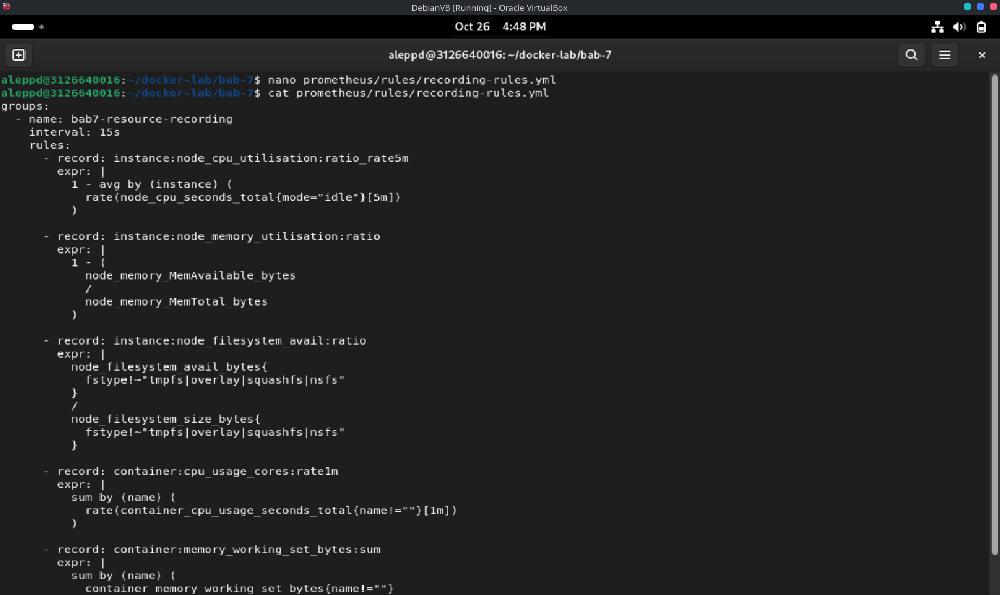

*Gambar 6. Penulisan `recording-rules.yml` untuk CPU host, memori host, filesystem, CPU container, dan memori container.*

### 4.7 File `prometheus/rules/alert-rules.yml`

Berkas ini mendefinisikan lima alert: `TargetDown`, `HostHighCPU`, `HostLowAvailableMemory`, `ContainerHighCPU`, dan `PrometheusRuleEvaluationFailure`. Setiap alert memiliki `severity`, `category`, dan anotasi yang menjelaskan dampak serta langkah awal.

```yaml
groups:
  - name: bab7-resource-alerts
    interval: 15s
    rules:
      - alert: TargetDown
        expr: up == 0
        for: 1m
        labels:
          severity: warning
          category: availability
        annotations:
          summary: "Target {{ $labels.instance }} tidak dapat discrape"
          description: "Job {{ $labels.job }} gagal discrape selama sedikitnya satu menit."

      - alert: HostHighCPU
        expr: instance:node_cpu_utilisation:ratio_rate5m > 0.90
        for: 5m
        labels:
          severity: warning
          category: saturation
        annotations:
          summary: "Utilisasi CPU host melampaui 90 persen"
          description: "Nilai saat ini adalah {{ $value | humanizePercentage }}."

      - alert: HostLowAvailableMemory
        expr: instance:node_memory_utilisation:ratio > 0.90
        for: 5m
        labels:
          severity: warning
          category: saturation
        annotations:
          summary: "Memori host yang digunakan melampaui 90 persen"
          description: "Nilai saat ini adalah {{ $value | humanizePercentage }}."

      - alert: ContainerHighCPU
        expr: container:cpu_usage_cores:rate1m > 0.30
        for: 1m
        labels:
          severity: info
          category: saturation
        annotations:
          summary: "Container {{ $labels.name }} memakai CPU tinggi"
          description: "Rata-rata satu menit adalah {{ $value }} core CPU."

      - alert: PrometheusRuleEvaluationFailure
        expr: increase(prometheus_rule_evaluation_failures_total[5m]) > 0
        for: 1m
        labels:
          severity: warning
          category: monitoring
        annotations:
          summary: "Evaluasi rule Prometheus mengalami kegagalan"
          description: "Periksa status rule, ekspresi PromQL, dan log Prometheus."
```

Threshold merupakan parameter eksperimen, bukan standar lingkungan produksi. Baseline, kapasitas host, karakter workload, dan SLO harus menentukan nilai operasional yang sebenarnya.

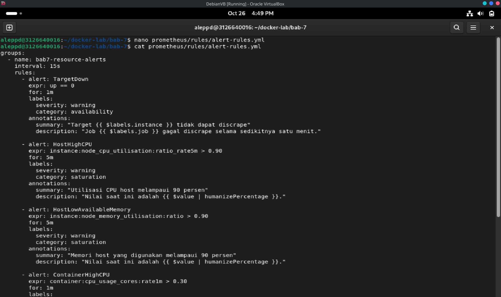

*Gambar 7. Penulisan `alert-rules.yml` untuk target down, CPU host, memori host, CPU container, dan kegagalan evaluasi rule.*

### 4.8 File `prometheus/tests/rules.test.yml`

Unit test memeriksa logika alert `TargetDown` secara deterministik tanpa menunggu kegagalan nyata. Dengan input series `up` yang berubah dari `1` menjadi `0`, test memastikan alert benar-benar firing pada waktu evaluasi yang ditentukan.

```yaml
rule_files:
  - /etc/prometheus/rules/alert-rules.yml

evaluation_interval: 1m

tests:
  - interval: 1m
    input_series:
      - series: 'up{job="node-exporter",instance="node-exporter:9100"}'
        values: '1 0 0 0'

    alert_rule_test:
      - eval_time: 2m
        alertname: TargetDown
        exp_alerts:
          - exp_labels:
              job: node-exporter
              instance: node-exporter:9100
              severity: warning
              category: availability
            exp_annotations:
              summary: "Target node-exporter:9100 tidak dapat discrape"
              description: "Job node-exporter gagal discrape selama sedikitnya satu menit."
```

Unit test tidak membuktikan target, jaringan, atau notifikasi berfungsi. Karena itu runtime test tetap diperlukan.

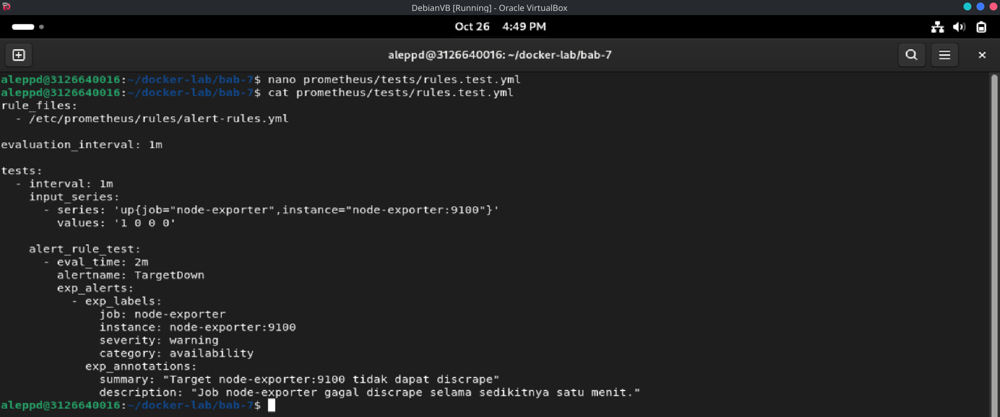

*Gambar 8. Penulisan `rules.test.yml` dengan input series dan ekspektasi label serta anotasi untuk `TargetDown`.*

### 4.9 File `grafana/provisioning/datasources/datasources.yml`

Berkas ini memprovisikan dua data source: Prometheus sebagai data source default dan PostgreSQL Bab 6 sebagai data source opsional. `deleteDatasources` memastikan konfigurasi lama dengan nama yang sama dihapus lebih dulu agar tidak terjadi duplikasi.

```yaml
apiVersion: 1

deleteDatasources:
  - name: Prometheus Bab 7
    orgId: 1
  - name: PostgreSQL Logs Bab 6
    orgId: 1

datasources:
  - name: Prometheus Bab 7
    uid: prometheus-bab7
    type: prometheus
    access: proxy
    url: http://prometheus:9090
    isDefault: true
    editable: false
    jsonData:
      httpMethod: POST
      timeInterval: 15s

  - name: PostgreSQL Logs Bab 6
    uid: postgres-logs-bab6
    type: postgres
    access: proxy
    url: postgres-db:5432
    user: ${GRAFANA_DB_USER}
    editable: false
    secureJsonData:
      password: ${GRAFANA_DB_PASSWORD}
    jsonData:
      database: ${POSTGRES_DB}
      sslmode: disable
      postgresVersion: 1600
      timescaledb: false
```

Data source PostgreSQL akan berstatus gagal sampai prosedur integrasi opsional Bab 6 dijalankan. `sslmode: disable` hanya dapat diterima pada jaringan lab lokal; koneksi lingkungan produksi memerlukan verifikasi TLS.

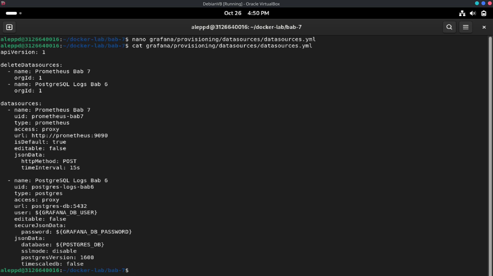

*Gambar 9. Penulisan `datasources.yml` untuk data source Prometheus dan PostgreSQL Bab 6.*

### 4.10 File `grafana/provisioning/dashboards/provider.yml`

Berkas ini memberi tahu Grafana untuk memuat dashboard dari direktori tertentu. `allowUiUpdates: false` menjaga agar sumber konfigurasi tetap pada berkas JSON yang terversi, bukan pada perubahan manual di UI.

```yaml
apiVersion: 1

providers:
  - name: DevSecOps Lab
    orgId: 1
    folder: DevSecOps Lab
    type: file
    disableDeletion: false
    allowUiUpdates: false
    updateIntervalSeconds: 30
    options:
      path: /var/lib/grafana/dashboards
      foldersFromFilesStructure: false
```

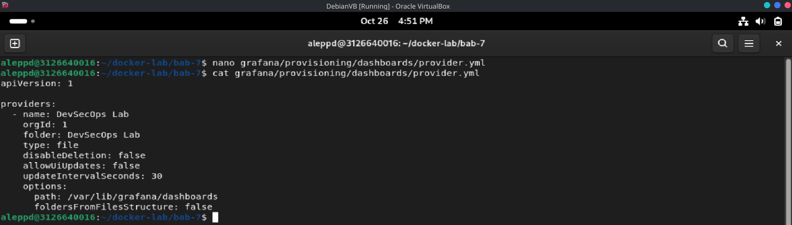

*Gambar 10. Penulisan dashboard provider yang memuat dashboard dari `/var/lib/grafana/dashboards`.*

### 4.11 File `grafana/dashboards/bab-7-overview.json`

Dashboard ini memuat lima panel: jumlah target up, utilisasi CPU host, utilisasi memori host, top 5 CPU container, dan top 5 memori container. Panel memakai recording rule agar ekspresi tetap ringkas dan konsisten.

```json
{
  "annotations": {
    "list": []
  },
  "editable": false,
  "graphTooltip": 1,
  "id": null,
  "links": [],
  "panels": [
    {
      "datasource": {
        "type": "prometheus",
        "uid": "prometheus-bab7"
      },
      "fieldConfig": {
        "defaults": {
          "color": {
            "mode": "thresholds"
          },
          "mappings": [],
          "thresholds": {
            "mode": "absolute",
            "steps": [
              {
                "color": "red",
                "value": null
              },
              {
                "color": "green",
                "value": 3
              }
            ]
          }
        },
        "overrides": []
      },
      "gridPos": {
        "h": 5,
        "w": 6,
        "x": 0,
        "y": 0
      },
      "id": 1,
      "options": {
        "colorMode": "value",
        "graphMode": "area",
        "justifyMode": "auto",
        "orientation": "auto",
        "reduceOptions": {
          "calcs": [
            "lastNotNull"
          ],
          "fields": "",
          "values": false
        },
        "textMode": "auto"
      },
      "targets": [
        {
          "expr": "sum(up)",
          "legendFormat": "target up",
          "refId": "A"
        }
      ],
      "title": "Jumlah Target Up",
      "type": "stat"
    },
    {
      "datasource": {
        "type": "prometheus",
        "uid": "prometheus-bab7"
      },
      "fieldConfig": {
        "defaults": {
          "max": 100,
          "min": 0,
          "unit": "percent"
        },
        "overrides": []
      },
      "gridPos": {
        "h": 8,
        "w": 9,
        "x": 6,
        "y": 0
      },
      "id": 2,
      "options": {
        "legend": {
          "displayMode": "list",
          "placement": "bottom",
          "showLegend": true
        },
        "tooltip": {
          "mode": "multi",
          "sort": "desc"
        }
      },
      "targets": [
        {
          "expr": "instance:node_cpu_utilisation:ratio_rate5m * 100",
          "legendFormat": "{{instance}}",
          "refId": "A"
        }
      ],
      "title": "Utilisasi CPU Host",
      "type": "timeseries"
    },
    {
      "datasource": {
        "type": "prometheus",
        "uid": "prometheus-bab7"
      },
      "fieldConfig": {
        "defaults": {
          "max": 100,
          "min": 0,
          "unit": "percent"
        },
        "overrides": []
      },
      "gridPos": {
        "h": 8,
        "w": 9,
        "x": 15,
        "y": 0
      },
      "id": 3,
      "options": {
        "legend": {
          "displayMode": "list",
          "placement": "bottom",
          "showLegend": true
        },
        "tooltip": {
          "mode": "multi",
          "sort": "desc"
        }
      },
      "targets": [
        {
          "expr": "instance:node_memory_utilisation:ratio * 100",
          "legendFormat": "{{instance}}",
          "refId": "A"
        }
      ],
      "title": "Utilisasi Memori Host",
      "type": "timeseries"
    },
    {
      "datasource": {
        "type": "prometheus",
        "uid": "prometheus-bab7"
      },
      "fieldConfig": {
        "defaults": {
          "min": 0,
          "unit": "cores"
        },
        "overrides": []
      },
      "gridPos": {
        "h": 9,
        "w": 12,
        "x": 0,
        "y": 8
      },
      "id": 4,
      "options": {
        "legend": {
          "displayMode": "table",
          "placement": "bottom",
          "showLegend": true
        },
        "tooltip": {
          "mode": "multi",
          "sort": "desc"
        }
      },
      "targets": [
        {
          "expr": "topk(5, container:cpu_usage_cores:rate1m)",
          "legendFormat": "{{name}}",
          "refId": "A"
        }
      ],
      "title": "Top 5 CPU Container",
      "type": "timeseries"
    },
    {
      "datasource": {
        "type": "prometheus",
        "uid": "prometheus-bab7"
      },
      "fieldConfig": {
        "defaults": {
          "min": 0,
          "unit": "bytes"
        },
        "overrides": []
      },
      "gridPos": {
        "h": 9,
        "w": 12,
        "x": 12,
        "y": 8
      },
      "id": 5,
      "options": {
        "legend": {
          "displayMode": "table",
          "placement": "bottom",
          "showLegend": true
        },
        "tooltip": {
          "mode": "multi",
          "sort": "desc"
        }
      },
      "targets": [
        {
          "expr": "topk(5, container:memory_working_set_bytes:sum)",
          "legendFormat": "{{name}}",
          "refId": "A"
        }
      ],
      "title": "Top 5 Memori Container",
      "type": "timeseries"
    }
  ],
  "refresh": "15s",
  "schemaVersion": 42,
  "tags": [
    "devsecops",
    "bab-7",
    "monitoring"
  ],
  "templating": {
    "list": []
  },
  "time": {
    "from": "now-30m",
    "to": "now"
  },
  "timepicker": {},
  "timezone": "browser",
  "title": "Bab 7 — Resource Monitoring",
  "uid": "bab7-resource-monitoring",
  "version": 1
}
```

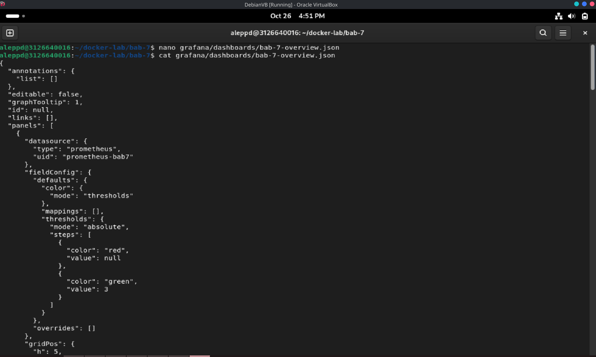

*Gambar 11. Penulisan `bab-7-overview.json` yang memuat lima panel resource monitoring.*

### 4.12 File `scripts/verify-stack.sh`

Script ini menunggu Prometheus dan Grafana siap, memeriksa jumlah target `up`, menguji query PromQL dasar, lalu memvalidasi konfigurasi dan rule dengan `promtool`. Script berhenti dengan kode non-nol jika salah satu pemeriksaan gagal.

```bash
#!/usr/bin/env bash
set -Eeuo pipefail

cd "$(dirname "$0")/.."

wait_http() {
    local name="$1"
    local url="$2"

    for attempt in {1..30}; do
        if curl -fsS "$url" >/dev/null; then
            echo "[PASS] $name siap: $url"
            return 0
        fi
        sleep 2
    done

    echo "[FAIL] $name tidak siap: $url" >&2
    return 1
}

wait_http "Prometheus" "http://127.0.0.1:9090/-/ready"
wait_http "Grafana" "http://127.0.0.1:3000/api/health"

targets="$(curl -fsS http://127.0.0.1:9090/api/v1/targets)"
up_count="$(grep -o '"health":"up"' <<<"$targets" | wc -l | tr -d ' ' || true)"
down_count="$(grep -o '"health":"down"' <<<"$targets" | wc -l | tr -d ' ' || true)"

if (( up_count >= 3 && down_count == 0 )); then
    echo "[PASS] Sedikitnya tiga target berstatus up."
else
    echo "[FAIL] Target up=$up_count, down=$down_count." >&2
    exit 1
fi

for expression in \
    'up' \
    'instance:node_cpu_utilisation:ratio_rate5m' \
    'instance:node_memory_utilisation:ratio' \
    'container_memory_working_set_bytes'; do
    response="$(
        curl -fsS --get \
            --data-urlencode "query=$expression" \
            http://127.0.0.1:9090/api/v1/query
    )"

    if [[ "$response" == *'"status":"success"'* ]]; then
        echo "[PASS] PromQL valid: $expression"
    else
        echo "[FAIL] PromQL gagal: $expression" >&2
        exit 1
    fi
done

docker compose exec -T prometheus \
    promtool check config /etc/prometheus/prometheus.yml

docker compose exec -T prometheus \
    promtool check rules \
    /etc/prometheus/rules/recording-rules.yml \
    /etc/prometheus/rules/alert-rules.yml

echo "[PASS] Verifikasi dasar stack selesai."
```

Status sukses query belum membuktikan result vector berisi data. Karena itu nilai dan label tetap harus diperiksa melalui Prometheus atau Grafana.

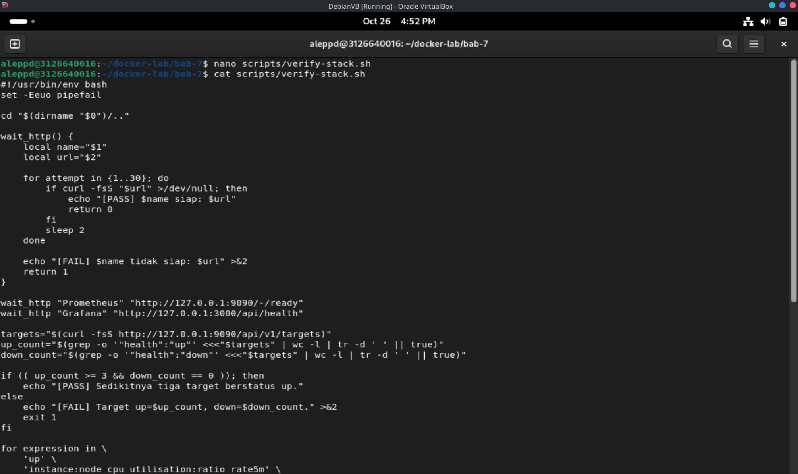

*Gambar 12. Penulisan `verify-stack.sh` yang memeriksa kesiapan, target, PromQL, dan rule Prometheus.*

### 4.13 File `scripts/connect-bab6.sh`

Script ini menghubungkan container PostgreSQL Bab 6 ke network Bab 7 dengan alias `postgres-db`, membuat role read-only, lalu memberikan hak `CONNECT`, `USAGE`, dan `SELECT` pada schema `logs`. Setelah itu Grafana di-restart agar data source dibaca ulang.

```bash
#!/usr/bin/env bash
set -Eeuo pipefail

cd "$(dirname "$0")/.."

bab6_dir="${BAB6_DIR:-../bab-6}"

if [[ ! -f .env || ! -f "$bab6_dir/.env" ]]; then
    echo "[FAIL] File .env Bab 7 atau Bab 6 tidak ditemukan." >&2
    exit 1
fi

set -a
source .env
set +a

reader_user="$GRAFANA_DB_USER"
reader_password="$GRAFANA_DB_PASSWORD"

set -a
source "$bab6_dir/.env"
set +a

db_container="$(
    docker compose --project-directory "$bab6_dir" ps -q postgres-db
)"

if [[ -z "$db_container" ]]; then
    echo "[FAIL] Container PostgreSQL Bab 6 tidak berjalan." >&2
    exit 1
fi

if ! docker network inspect bab7-monitoring-net >/dev/null 2>&1; then
    echo "[FAIL] Network Bab 7 belum tersedia. Jalankan stack Bab 7 dahulu." >&2
    exit 1
fi

if ! docker inspect "$db_container" \
    --format '{{json .NetworkSettings.Networks}}' \
    | grep -q 'bab7-monitoring-net'; then
    docker network connect \
        --alias postgres-db \
        bab7-monitoring-net \
        "$db_container"
fi

docker compose --project-directory "$bab6_dir" exec -T postgres-db \
    psql \
    --set=ON_ERROR_STOP=1 \
    --username "$POSTGRES_USER" \
    --dbname "$POSTGRES_DB" \
    --set=reader_user="$reader_user" \
    --set=reader_password="$reader_password" <<'SQL'
SELECT format(
    'CREATE ROLE %I LOGIN PASSWORD %L',
    :'reader_user',
    :'reader_password'
)
WHERE NOT EXISTS (
    SELECT 1 FROM pg_roles WHERE rolname = :'reader_user'
)
\gexec

SELECT format(
    'ALTER ROLE %I PASSWORD %L',
    :'reader_user',
    :'reader_password'
)
\gexec

SELECT format(
    'GRANT CONNECT ON DATABASE %I TO %I',
    current_database(),
    :'reader_user'
)
\gexec

SELECT format('GRANT USAGE ON SCHEMA logs TO %I', :'reader_user')
\gexec

SELECT format(
    'GRANT SELECT ON ALL TABLES IN SCHEMA logs TO %I',
    :'reader_user'
)
\gexec

SELECT format(
    'ALTER DEFAULT PRIVILEGES IN SCHEMA logs GRANT SELECT ON TABLES TO %I',
    :'reader_user'
)
\gexec
SQL

docker compose restart grafana
echo "[PASS] PostgreSQL Bab 6 terhubung dengan role read-only."
```

Script memakai network tambahan dan role baca khusus. Hal ini lebih aman daripada memublikasikan port PostgreSQL atau memberikan credential admin kepada Grafana, tetapi trafik database pada lab ini masih tanpa TLS.

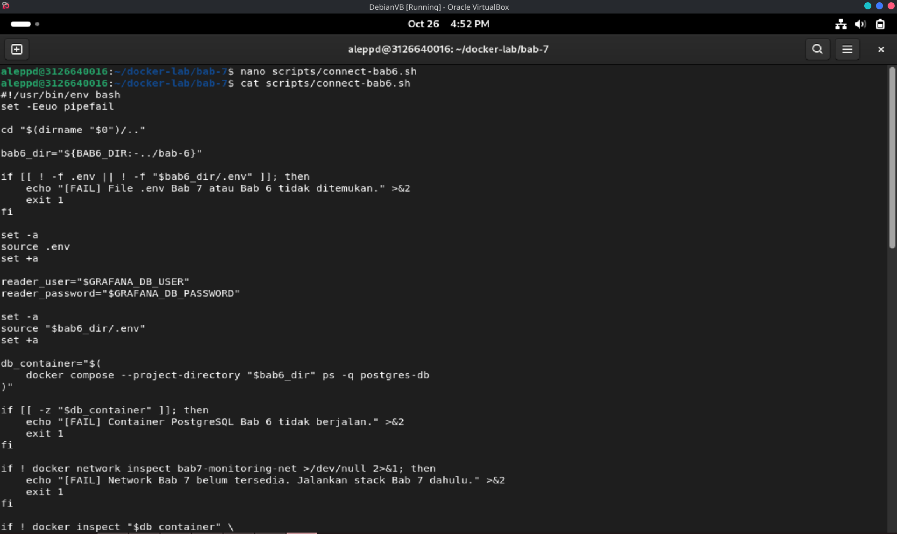

*Gambar 13. Penulisan `connect-bab6.sh` yang membuat role read-only dan menghubungkan network monitoring.*

### 4.14 Memberi Izin dan Memvalidasi Konfigurasi

Langkah ini memberikan izin eksekusi, memeriksa sintaks Bash, memvalidasi model Compose, memvalidasi JSON dashboard, serta menguji konfigurasi dan rule Prometheus dengan `promtool`. Validasi dilakukan sebelum stack dinyalakan agar kesalahan konfigurasi tidak baru terlihat saat runtime.

```bash
chmod +x scripts/verify-stack.sh scripts/connect-bab6.sh

bash -n scripts/verify-stack.sh
bash -n scripts/connect-bab6.sh
docker compose config --quiet
```

Validasi JSON dashboard:

```bash
python3 -m json.tool \
  grafana/dashboards/bab-7-overview.json \
  >/dev/null
```

Validasi konfigurasi dan rule Prometheus:

```bash
docker compose run --rm --no-deps \
  --entrypoint /bin/promtool \
  prometheus \
  check config /etc/prometheus/prometheus.yml

docker compose run --rm --no-deps \
  --entrypoint /bin/promtool \
  prometheus \
  test rules /etc/prometheus/tests/rules.test.yml
```

| | |
| --- | --- |
| 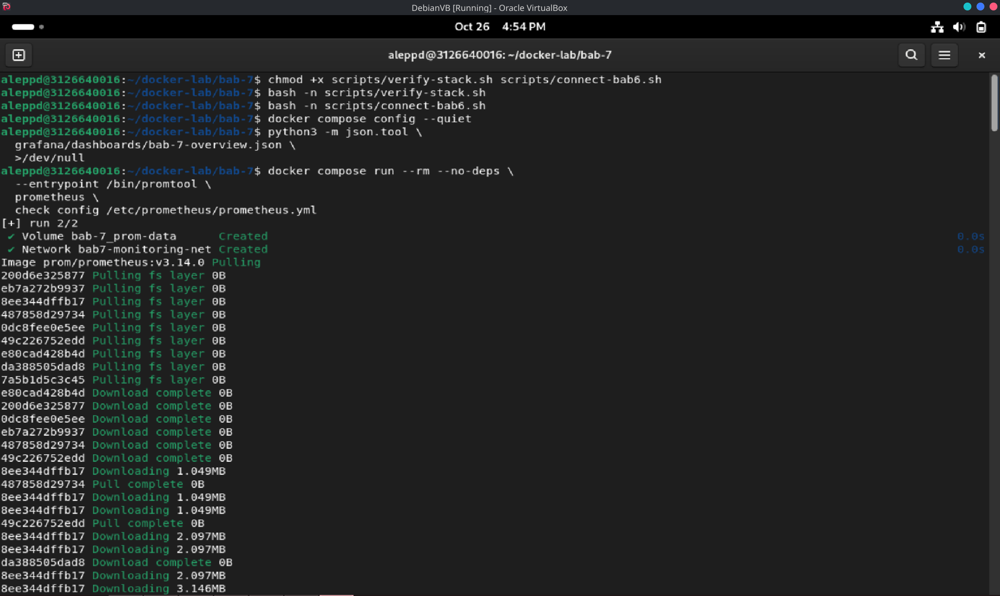 | 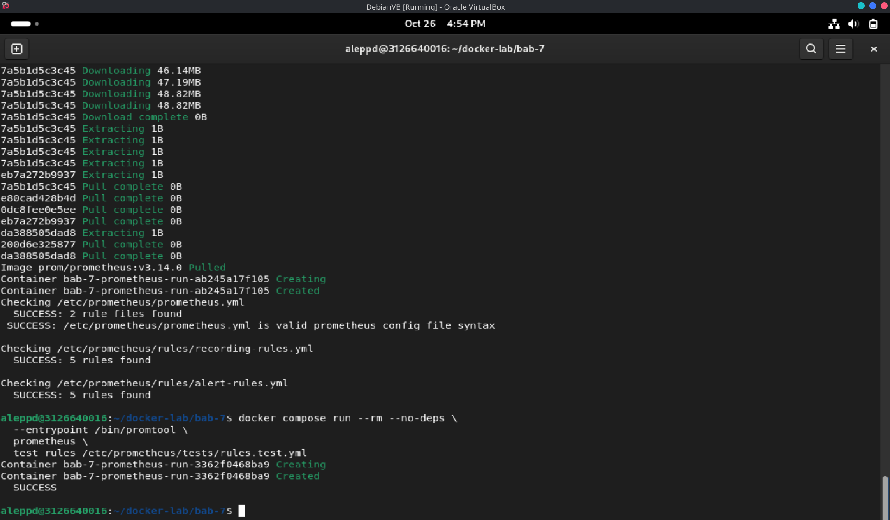 |
| *Gambar 14a. Pemberian izin eksekusi, pemeriksaan sintaks Bash, validasi Compose, dan validasi JSON dashboard.* | *Gambar 14b. Validasi konfigurasi dan unit test rule Prometheus dengan `promtool` yang berakhir `SUCCESS`.* |

### 4.15 Menjalankan Stack Monitoring

Stack dinyalakan, lalu kesiapan serta target diverifikasi dengan script. Antarmuka Prometheus dan Grafana hanya dapat diakses melalui loopback.

```bash
docker compose pull
docker compose up -d
docker compose ps
./scripts/verify-stack.sh
```

Antarmuka lokal:

- Prometheus: `http://127.0.0.1:9090`
- Grafana: `http://127.0.0.1:3000`
- Dashboard Grafana: folder **DevSecOps Lab**, dashboard **Bab 7 — Resource Monitoring**

Masuk ke Grafana menggunakan nilai `GRAFANA_ADMIN_USER` dan `GRAFANA_ADMIN_PASSWORD` dari `.env`.

| | |
| --- | --- |
| 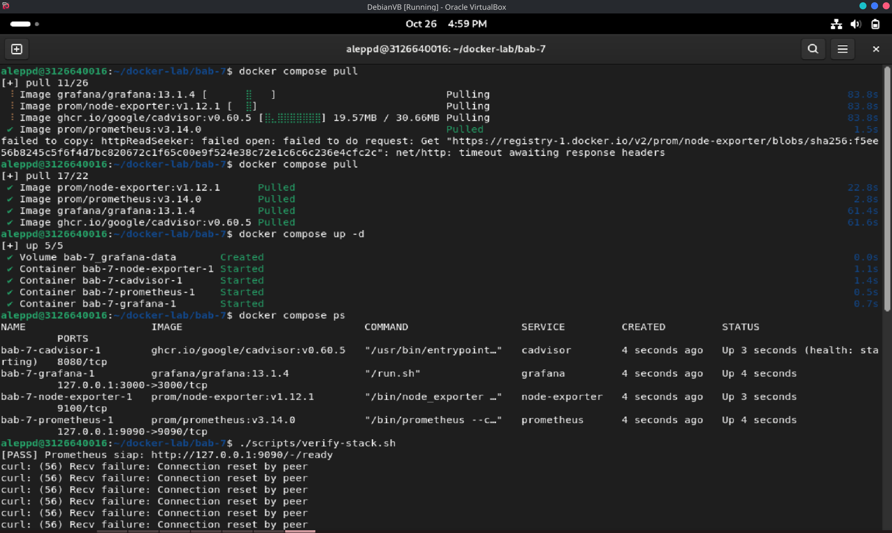 | 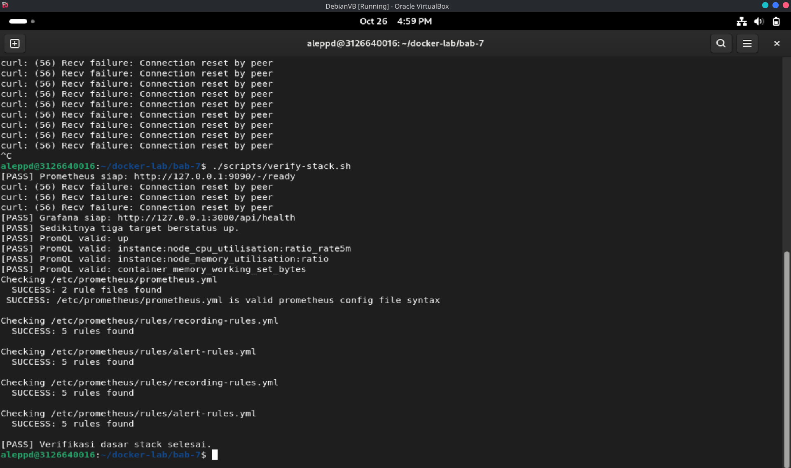 |
| *Gambar 15a. `docker compose pull`, `docker compose up -d`, `docker compose ps`, dan percobaan pertama `verify-stack.sh` yang sempat gagal karena koneksi di-reset.* | *Gambar 15b. `verify-stack.sh` berhasil dengan seluruh pemeriksaan berstatus `[PASS]` dan tiga target up.* |

### 4.16 Query PromQL Dasar

Query dijalankan melalui menu **Prometheus → Graph** atau Grafana Explore. Query dimulai dari status target, lalu berlanjut ke metric host dan container.

```promql
up
```

```promql
instance:node_cpu_utilisation:ratio_rate5m * 100
```

```promql
instance:node_memory_utilisation:ratio * 100
```

```promql
topk(5, container:cpu_usage_cores:rate1m)
```

```promql
topk(5, container:memory_working_set_bytes:sum)
```

`rate()` digunakan pada counter CPU karena nilai counter mentah terus bertambah. Untuk dashboard dan alert yang relatif stabil, `rate()` lebih tepat daripada `irate()`.

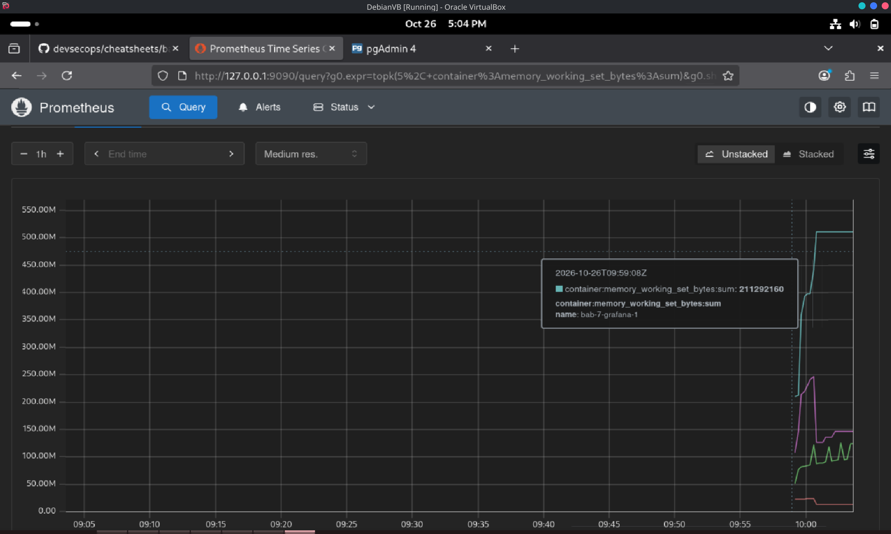

*Gambar 16. Hasil query PromQL di Prometheus untuk metric host dan container.*

### 4.17 Menguji Beban Container

Generator beban dijalankan dengan batas setengah core CPU dan memori 64 MB. Setelah dua menit, metric CPU container serta alert `ContainerHighCPU` seharusnya berubah. Generator dihentikan setelah evidence diperoleh agar tidak membebani host.

```bash
docker compose --profile load up -d load-generator
```

Amati query berikut selama sedikitnya dua menit:

```promql
container:cpu_usage_cores:rate1m{name=~".*load-generator.*"}
```

```promql
ALERTS{alertname="ContainerHighCPU"}
```

Hentikan generator setelah evidence diperoleh:

```bash
docker compose --profile load stop load-generator
docker compose --profile load rm -f load-generator
```

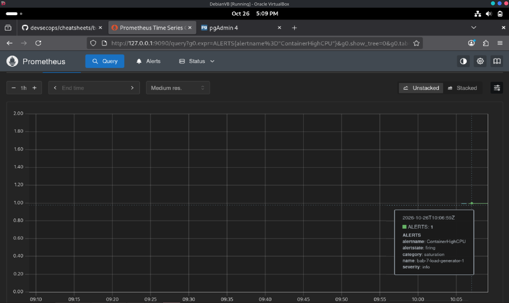

*Gambar 17. Query `ALERTS{alertname="ContainerHighCPU"}` yang menunjukkan alert berstatus firing pada container `bab-7-load-generator-1`.*

### 4.18 Negative Test Target Down

Node Exporter dihentikan untuk membuktikan alert bekerja. Setelah sedikitnya 75 detik (kondisi `for: 1m` ditambah satu interval scrape), `up` harus bernilai `0` dan alert `TargetDown` masuk state `firing`. Setelah service dinyalakan kembali, `up` harus kembali `1` dalam satu atau dua interval scrape.

```bash
docker compose stop node-exporter
```

```promql
up{job="node-exporter"}
```

```promql
ALERTS{alertname="TargetDown",alertstate="firing"}
```

```bash
docker compose start node-exporter
```

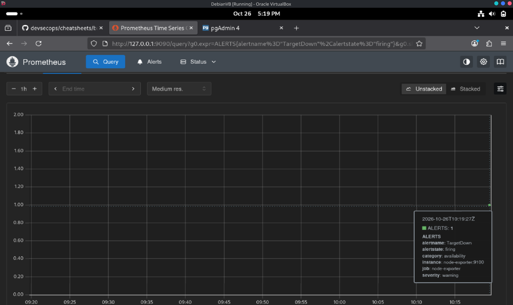

*Gambar 18. Query `ALERTS{alertname="TargetDown",alertstate="firing"}` yang menunjukkan Node Exporter tidak dapat discrape.*

Setelah Node Exporter dinyalakan kembali, pemulihan diverifikasi melalui query `up{job="node-exporter"}` yang kembali bernilai `1`.

### 4.19 Integrasi Opsional Log Bab 6

Jika Bab 6 dan Bab 7 berjalan, script integrasi dijalankan dari direktori Bab 7. Script akan menghubungkan container PostgreSQL Bab 6 ke `bab7-monitoring-net` dengan alias `postgres-db`, membuat role read-only, lalu me-restart Grafana.

```bash
./scripts/connect-bab6.sh
```

Pada Grafana Explore, pilih data source **PostgreSQL Logs Bab 6**. Secara default editor berada pada mode **Builder** yang menampilkan dropdown *Dataset*, *Table*, *Column*, dan *Alias*; mode ini akan menampilkan `No data` selama tabel belum dipilih. Ubah toggle editor ke **Code**, tempelkan query berikut, lalu klik **Run query** (atau `Ctrl+Enter`). Pastikan pula rentang waktu di kanan atas mencakup waktu data log dibuat.

```sql
SELECT
    time AS "time",
    tag,
    replace(data ->> 'container_name', '/', '') AS container_name,
    data ->> 'source' AS source,
    data ->> 'log' AS log_message
FROM logs.fluentbit
WHERE $__timeFilter(time)
ORDER BY time DESC
LIMIT 200;
```

Macro `$__timeFilter(time)` membuat query mengikuti rentang waktu Grafana. Untuk data besar, query harus tetap didukung indeks waktu dan pembatasan baris.

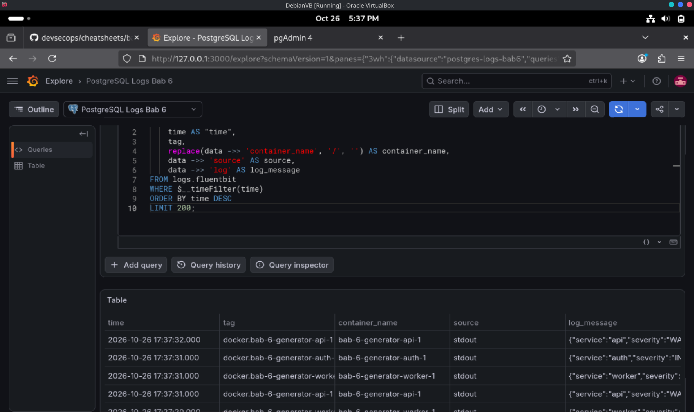

*Gambar 19. Grafana Explore menampilkan record log Bab 6 dari data source PostgreSQL melalui role read-only.*

### 4.20 Cleanup

Menghentikan stack sambil mempertahankan data Prometheus dan Grafana, lalu menghapus stack beserta seluruh time series dan konfigurasi lokal Grafana yang tersimpan dalam volume. Perintah kedua bersifat destruktif terhadap evidence dan hanya dijalankan setelah data yang diperlukan diekspor.

```bash
docker compose --profile load down --remove-orphans
docker compose --profile load down --volumes --remove-orphans
```

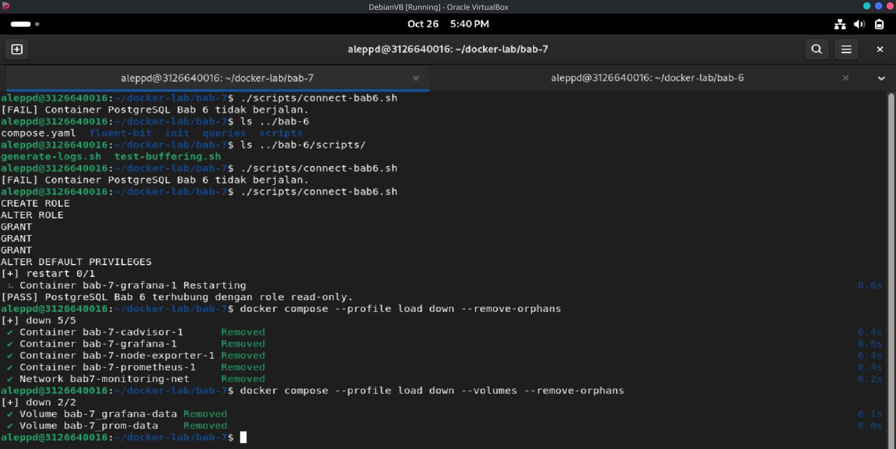

*Gambar 20. Keluaran `connect-bab6.sh` yang berhasil membuat role read-only, dilanjutkan cleanup stack beserta volume lab.*

## 5. Hasil Pengujian

### 5.1 Status Service dan Kesiapan

```bash
docker compose ps
./scripts/verify-stack.sh
```

Hasil: `prometheus`, `grafana`, `node-exporter`, dan `cadvisor` berstatus `Up`; Prometheus merespons `/-/ready`, Grafana merespons `/api/health` dengan database `ok`, dan `verify-stack.sh` berakhir dengan `[PASS]`. Rincian terlihat pada Gambar 15a dan Gambar 15b.

### 5.2 Verifikasi Target Scrape

```bash
curl -fsS http://127.0.0.1:9090/api/v1/targets
```

Melalui halaman **Status → Targets** di Prometheus, ketiga job (`prometheus`, `node-exporter`, `cadvisor`) harus berstatus `UP` dengan `health: up`. Jika salah satu target `DOWN`, pemeriksaan diarahkan ke nama service, port, dan log container yang bersangkutan.

| Pemeriksaan | Hasil | Bukti |
| --- | --- | --- |
| Target Prometheus | `up=1` | Gambar 15b |
| Target Node Exporter | `up=1` | Gambar 15b |
| Target cAdvisor | `up=1` | Gambar 15b |
| Rule termuat | Recording dan alert rule aktif tanpa error | Gambar 14b |

### 5.3 Hasil Query Host Metrics

```promql
instance:node_cpu_utilisation:ratio_rate5m * 100
instance:node_memory_utilisation:ratio * 100
instance:node_filesystem_avail:ratio
```

Result vector berisi nilai untuk instance `node-exporter:9100`. CPU host ditampilkan sebagai persentase, memori sebagai rasio utilisasi, dan filesystem sebagai rasio ruang tersedia. Rincian pada Gambar 16.

### 5.4 Hasil Query Container Metrics

```promql
topk(5, container:cpu_usage_cores:rate1m)
topk(5, container:memory_working_set_bytes:sum)
```

Result vector menampilkan nama container beserta nilai CPU dalam satuan core dan memori dalam satuan byte. Jika cAdvisor tidak dapat membaca runtime container, result akan kosong meskipun query berstatus sukses; hal ini dibedakan dari nilai nol. Rincian pada Gambar 16.

### 5.5 Hasil Dashboard Grafana

Dashboard **Bab 7 — Resource Monitoring** pada folder **DevSecOps Lab** memuat lima panel. Panel **Jumlah Target Up** menampilkan nilai tiga, panel CPU dan memori host menampilkan persentase, sedangkan panel container menampilkan top 5 berdasarkan CPU dan memori. Unit, rentang waktu, dan legenda diperiksa agar tidak menyesatkan. Dashboard tidak disertakan sebagai tangkapan layar terpisah; verifikasinya didasarkan pada konfigurasi provisioning (Gambar 10 dan Gambar 11) serta data yang menjadi sumber panel (Gambar 16).

| Pemeriksaan | Hasil | Bukti |
| --- | --- | --- |
| Dashboard terprovisi | Muncul di folder DevSecOps Lab | Gambar 10 dan Gambar 11 |
| Panel target | Menampilkan jumlah target up | Gambar 16 |
| Panel CPU host | Unit `percent`, nilai wajar | Gambar 16 |
| Panel memori host | Unit `percent`, nilai wajar | Gambar 16 |
| Panel container | Menampilkan nama container dan nilai | Gambar 16 |

### 5.6 Hasil Uji Beban Container

```bash
docker compose --profile load up -d load-generator
```

Setelah sekitar dua menit, query CPU container menunjukkan kenaikan yang terukur dan alert `ContainerHighCPU` berubah state. Setelah generator dihentikan, pemakaian CPU kembali mendekati nol dan alert kembali nonaktif. Rincian pada Gambar 17.

### 5.7 Hasil Negative Test dan Recovery

```bash
docker compose stop node-exporter
docker compose start node-exporter
```

Hasil: setelah Node Exporter dihentikan, `up{job="node-exporter"}` bernilai `0` dan alert `TargetDown` firing. Setelah service dinyalakan kembali, `up` kembali `1` dalam satu atau dua interval scrape dan alert berangsur nonaktif. Rincian pada Gambar 18, sedangkan pemulihan diverifikasi melalui query tanpa tangkapan layar terpisah.

### 5.8 Hasil Integrasi Log Bab 6

```bash
./scripts/connect-bab6.sh
```

Hasil: container PostgreSQL Bab 6 terhubung ke `bab7-monitoring-net` dengan alias `postgres-db`, role `grafana_reader` memiliki hak baca pada schema `logs`, dan Grafana dapat menampilkan record log Bab 6 melalui macro `$__timeFilter(time)`. Rincian pada Gambar 19 dan Gambar 20.

### 5.9 Tabel Verifikasi PASS/FAIL

| No. | Skenario | Evidence yang sahih | PASS | FAIL |
|---:|---|---|---|---|
| 1 | Validasi Compose | `docker compose config --quiet` | Exit code 0 | Galat YAML atau interpolasi |
| 2 | Unit test rule | Output `promtool test rules` | `SUCCESS` | Test gagal atau rule tidak termuat |
| 3 | Kesiapan Prometheus | `/-/ready` | HTTP 200 | Timeout atau non-2xx |
| 4 | Kesiapan Grafana | `/api/health` | HTTP 200 dan database `ok` | Service belum sehat |
| 5 | Target scrape | Halaman Targets atau API | 3 target `UP` | Salah satu target `DOWN` |
| 6 | Host metrics | Query CPU dan memori | Result vector berisi nilai | Query sukses tetapi result kosong |
| 7 | Container metrics | Query cAdvisor | Nama container dan nilai muncul | cAdvisor kosong/tidak dapat membaca runtime |
| 8 | Dashboard | Dashboard terprovisi | Lima panel berisi data sesuai unit | Panel `No data` atau unit salah |
| 9 | Load test | Query CPU load generator | Pemakaian naik secara terukur | Tidak ada perubahan/limit tidak berlaku |
| 10 | Negative test | `TargetDown` | Pending lalu firing | Alert tidak berubah state |
| 11 | Recovery | `up{job="node-exporter"}` | Kembali `1` | Tetap `0`/series hilang |
| 12 | Integrasi Bab 6 | Query Grafana PostgreSQL | Log tampil dengan role read-only | Koneksi atau privilege gagal |

### 5.10 Checklist Hasil

- [ ] Prometheus, Grafana, Node Exporter, dan cAdvisor berjalan.
- [ ] Ketiga target scrape berstatus `UP`.
- [ ] Recording rule dan alert rule termuat tanpa error.
- [ ] Unit test `TargetDown` lulus.
- [ ] Dashboard Grafana menampilkan CPU, memori, dan container metrics.
- [ ] Load generator memicu `ContainerHighCPU`.
- [ ] Negative test `TargetDown` firing lalu pulih.
- [ ] Data source PostgreSQL Bab 6 dapat menampilkan log.
- [ ] Prometheus dan Grafana hanya diakses melalui loopback.

### 5.11 Prinsip Troubleshooting

Mulai dari status container, baca logs, cek network, cek volume, lalu validasi konfigurasi. Jangan langsung menghapus volume sebelum memahami apakah data masih dibutuhkan.

```bash
docker compose ps
docker compose logs --tail 100
curl -v http://127.0.0.1:9090/-/ready
curl -v http://127.0.0.1:3000/api/health
docker network ls
docker volume ls
docker inspect <container-name>
```

## 6. Threat Statement

| Unsur | Isi |
| --- | --- |
| Aset | Time-series pada volume `prom-data`, konfigurasi dashboard dan data source pada `grafana-data`, credential Grafana pada `.env`, seluruh berkas rule dan provisioning, serta endpoint metric Node Exporter (`:9100`), cAdvisor (`:8080`), Prometheus (`:9090`), dan Grafana (`:3000`) |
| Aktor ancaman | Penyerang eksternal yang menjangkau port host, pengguna lokal tidak berwenang pada host atau repository, proses lain di host yang dapat menjangkau loopback, pihak yang memperoleh akses ke `.env` atau volume, serta container lain dalam network monitoring |
| Jalur serangan | Metric endpoint tanpa autentikasi di jaringan internal; cAdvisor `privileged` dengan mount host; credential plaintext pada `.env`; password Grafana laboratorium; data source PostgreSQL dengan `sslmode: disable`; dashboard atau query yang membocorkan topologi; cardinality tinggi yang menghabiskan storage; serta tidak adanya TLS pada trafik monitoring |
| Dampak | Kebocoran informasi topologi, nama host, dan pola beban; eskalasi hak melalui cAdvisor privileged; penyadapan atau pemalsuan data monitoring; alert fatigue akibat threshold yang tidak dikalibrasi; kehilangan evidence karena retensi atau penghapusan volume; serta keputusan operasional yang salah karena data hilang disamakan dengan nilai nol |

**Threat statement:** Aset yang dilindungi adalah time-series Prometheus, konfigurasi dashboard dan data source Grafana, credential laboratorium pada `.env`, berkas rule dan provisioning, serta endpoint metric Prometheus, Grafana, Node Exporter, dan cAdvisor. Aktor ancaman dapat berupa penyerang eksternal yang menjangkau port host, pengguna lokal tidak berwenang, proses lain di host, maupun pihak yang memperoleh akses ke berkas konfigurasi atau volume. Jalur serangan meliputi endpoint metric tanpa autentikasi, cAdvisor privileged dengan akses host, credential plaintext, password Grafana laboratorium, koneksi PostgreSQL tanpa TLS, cardinality tinggi, serta tidak adanya TLS pada trafik monitoring. Dampak yang mungkin terjadi adalah kebocoran topologi dan pola beban, eskalasi hak melalui container privileged, penyadapan atau pemalsuan data monitoring, alert fatigue, kehilangan evidence, serta pengambilan keputusan yang salah akibat data hilang diperlakukan sebagai nilai nol.

## 7. Analisis

### 7.1 Masalah yang Muncul dan Cara Mendiagnosisnya

Kendala pertama muncul saat pengambilan image. `docker compose pull` gagal pada layer `node-exporter` dengan pesan `failed to copy: ... timeout awaiting response headers`, lalu `verify-stack.sh` berkali-kali mencatat `Recv failure: Connection reset by peer`. Saya tidak langsung mengubah konfigurasi karena pesan tersebut menunjuk ke jaringan/registry dan kesiapan service, bukan ke kesalahan YAML. Saya menjalankan ulang `docker compose pull`, memastikan container sudah `Up`, lalu mengulang `verify-stack.sh`; percobaan kedua berhasil dengan seluruh pemeriksaan `[PASS]` seperti pada Gambar 15b. Pelajarannya, kegagalan unduh image dan koneksi yang di-reset harus dibedakan dari kegagalan konfigurasi, dan bukti percobaan pertama tetap disimpan (Gambar 15a) agar proses diagnosis terlihat.

Kendala kedua terjadi pada integrasi Bab 6. `connect-bab6.sh` dua kali berhenti dengan pesan `[FAIL] Container PostgreSQL Bab 6 tidak berjalan.` Penyebabnya adalah stack Bab 6 belum dinyalakan, sehingga `docker compose --project-directory ../bab-6 ps -q postgres-db` tidak menghasilkan container ID dan script berhenti sebelum menyentuh network atau role. Saya memeriksa isi `../bab-6` dan `../bab-6/scripts`, menyalakan stack Bab 6, lalu menjalankan script kembali. Percobaan ketiga berhasil membuat role, memberikan GRANT, me-restart Grafana, dan berakhir `[PASS]` seperti pada Gambar 20. Kesimpulannya, script integrasi bergantung pada dua prasyarat: stack Bab 6 berjalan dan `.env` Bab 6 tersedia.

Kendala ketiga adalah Grafana Explore yang menampilkan `No data` atau `0 series returned`. Ternyata editor berada pada mode **Builder** yang meminta pemilihan *Dataset*, *Table*, *Column*, dan *Alias*; selama tabel belum dipilih, query tidak dijalankan sebagaimana SQL mentah. Setelah toggle diubah ke **Code**, query ditempel, dan rentang waktu disesuaikan, record log Bab 6 tampil seperti pada Gambar 19. Saya juga memastikan bahwa query tanpa filter mengembalikan baris sebelum menyimpulkan ada masalah timezone. Data kosong tidak boleh langsung dianggap nol, karena makna keduanya berbeda.

### 7.2 Risiko Keamanan atau Operasional yang Relevan

Pertama, cAdvisor dijalankan dengan `privileged: true` dan memasang direktori host seperti `/`, `/var/run`, `/sys`, dan `/var/lib/docker`. Kombinasi ini memberikan visibilitas luas terhadap host dan runtime container. Jika image atau konfigurasinya dikompromikan, dampaknya jauh lebih besar daripada container biasa. Pada produksi, integrasi monitoring platform harus dipakai dan privilege dikurangi berdasarkan pengujian nyata.

Kedua, endpoint metric tidak memiliki autentikasi. Walaupun tidak dipublikasikan ke host dan hanya dapat diakses melalui network internal, container lain dalam network yang sama tetap dapat membaca metric dan memetakan topologi. Endpoint metric harus dibatasi dengan network policy, autentikasi, atau proxy sesuai risiko.

Ketiga, credential Grafana dan PostgreSQL ditulis pada `.env` dan diinjeksikan sebagai environment variable. Nilai tersebut dapat terlihat melalui `docker inspect`, `docker compose config`, atau proses lain yang memiliki akses ke container. Password Grafana laboratorium juga masih berupa nilai default yang mudah ditebak. Data source PostgreSQL memakai `sslmode: disable`, sehingga trafik database dapat disadap pada jaringan yang tidak tepercaya.

Keempat, retensi Prometheus ditetapkan tujuh hari dan jumlah series dapat tumbuh tanpa kendali. Label container yang berubah setiap recreate menciptakan cardinality tinggi, memperbesar storage, dan memperlambat query. Sebaliknya, `down --volumes` menghapus seluruh time-series dan konfigurasi Grafana, sehingga evidence hilang jika tidak diekspor terlebih dahulu.

Kelima, `up = 1` hanya membuktikan scrape berhasil. Dashboard bisa terlihat hijau walaupun aplikasi bisnis gagal, karena tidak ada metric aplikasi, error rate, atau latency pengguna. Threshold alert juga belum dikalibrasi terhadap baseline dan SLO, sehingga berisiko menghasilkan alert fatigue atau justru terlambat memberi peringatan.

Keenam, dashboard yang menampilkan data lama saat query gagal dapat menyesatkan. Perbedaan antara series hilang dan nilai nol harus ditangani secara eksplisit, misalnya melalui panel yang menampilkan status `no data` dan alert yang memeriksa ketersediaan series, bukan hanya nilainya.

### 7.3 Rekomendasi Perbaikan untuk Production-like Environment

1. **Kurangi privilege cAdvisor:** gunakan integrasi monitoring platform atau collector dengan kapabilitas minimum, bukan `privileged: true`, dan batasi mount hanya pada path yang benar-benar diperlukan.
2. **Amankan transport:** aktifkan TLS pada Prometheus, Grafana, dan koneksi PostgreSQL; hindari `sslmode: disable` di luar jaringan lab.
3. **Autentikasi dan segmentasi:** lindungi endpoint metric dengan autentikasi atau network policy, tempatkan exporter pada network terpisah, dan batasi akses Grafana berdasarkan peran.
4. **Secret management:** pindahkan credential dari `.env` ke Docker secret, Vault, atau secret manager; rotasi berkala dan pisahkan credential admin, operator, serta reader.
5. **Least privilege:** pertahankan role read-only untuk Grafana, cabut hak yang tidak diperlukan, dan audit akses ke data source.
6. **Kendalikan cardinality:** gunakan label service yang stabil, hindari label berdimensi tinggi pada metric, dan sesuaikan retensi serta interval scrape berdasarkan kapasitas nyata.
7. **Kalibrasi alert:** tetapkan threshold berdasarkan baseline dan SLO, gunakan kondisi `for`, dan uji alert melalui failure injection yang aman serta terdokumentasi.
8. **Lengkapi golden signals:** tambahkan metric latency, traffic, error rate, dan saturation di level aplikasi agar dashboard tidak berhenti pada resource host.
9. **Tangani missing data:** bedakan series hilang dari nilai nol, tampilkan status `no data`, dan buat alert yang memeriksa ketersediaan data.
10. **Version control dan backup evidence:** simpan rule, dashboard, dan provisioning sebagai configuration-as-code, review perubahannya, serta ekspor evidence sebelum menghapus volume.

### 7.4 Evaluasi dan Latihan Mandiri

**1. Mengapa Prometheus menggunakan scrape model dan bukan hanya push model?**
Model pull membuat Prometheus mengendalikan jadwal, timeout, dan deteksi target mati melalui `up`. Target tidak perlu menyimpan konfigurasi pengiriman, dan server dapat membatasi beban serta menyeragamkan interval. Pull juga memudahkan service discovery dan audit endpoint. Push tetap berguna untuk batch job singkat melalui Pushgateway, tetapi tidak menggantikan model pull untuk monitoring berkelanjutan.

**2. Apa dampak `scrape_interval` terlalu kecil terhadap storage dan network?**
Interval yang terlalu kecil meningkatkan jumlah sampel, trafik jaringan, CPU untuk scraping, dan kebutuhan storage. Biaya ini tumbuh sebanding dengan jumlah series. Interval harus dipilih berdasarkan kebutuhan resolusi dan kapasitas, bukan sekadar ingin grafik terlihat rapat.

**3. Mengapa `rate()` diperlukan untuk counter seperti `node_cpu_seconds_total`?**
Counter hanya bertambah dan dapat kembali ke nol saat proses restart, sehingga nilai absolutnya tidak merepresentasikan laju. `rate()` menghitung perubahan per detik dalam jendela waktu dan menghasilkan throughput yang dapat dibandingkan. Tanpa `rate()`, grafik akan terlihat naik terus dan menyesatkan.

**4. Apa indikator awal container mengalami memory pressure?**
Indikator awal meliputi working set yang mendekati limit, pertumbuhan memori yang terus-menerus, page fault atau aktivitas reclaim yang meningkat, dan munculnya OOM event atau restart. Mendekati limit belum tentu error, sehingga perlu dibaca bersama event dan status restart.

**5. Bagaimana menghubungkan alert metrics dengan pencarian log?**
Gunakan label yang konsisten antara metric dan log, misalnya `service`, `instance`, atau `container_name`, lalu korelasikan rentang waktu alert dengan query log pada data source PostgreSQL Bab 6. Pemetaan ini membantu menemukan penyebab, tetapi korelasi waktu belum membuktikan sebab-akibat. Evidence harus mencakup ekspresi PromQL, waktu observasi, label target, dan event pemicu.

## 8. Tindak Lanjut

1. Menambahkan panel network receive/transmit menggunakan `rate(node_network_receive_bytes_total[5m])` dan `rate(node_network_transmit_bytes_total[5m])`.
2. Mengubah `scrape_interval` menjadi 5 detik dan 30 detik, lalu mengukur dampaknya terhadap jumlah sampel dan kemampuan melihat spike singkat.
3. Membuat alert filesystem tersisa di bawah 10 persen beserta unit test dengan `promtool`.
4. Mengidentifikasi label cAdvisor dengan cardinality tertinggi dan menentukan label yang layak dipertahankan.
5. Menghubungkan kenaikan CPU container dengan log Bab 6 pada rentang waktu yang sama dan menilai apakah korelasi tersebut cukup untuk menyatakan sebab-akibat.
6. Merancang SLI dan SLO sederhana untuk service aplikasi, lalu menjelaskan mengapa CPU bukan pengganti langsung availability pengguna.
7. Mengurangi privilege cAdvisor, memindahkan credential ke secret manager, dan mengaktifkan TLS pada jalur monitoring serta database.

## 9. Kesimpulan

1. Prometheus berhasil dijalankan sebagai scraper sekaligus time-series database dengan tiga target: Prometheus sendiri, Node Exporter, dan cAdvisor.
2. Recording rule dan alert rule berhasil dibuat serta divalidasi dengan `promtool`, termasuk unit test `TargetDown` yang lulus secara deterministik.
3. Node Exporter menyediakan metric host dan cAdvisor menyediakan metric container; keduanya dapat divisualisasikan melalui dashboard Grafana yang terprovisi otomatis.
4. Uji beban dan negative test membuktikan alert `ContainerHighCPU` dan `TargetDown` berubah state sesuai kondisi, lalu pulih setelah beban dihentikan atau service dinyalakan kembali.
5. Integrasi log Bab 6 berhasil dilakukan melalui network tambahan dan role read-only, sehingga Grafana dapat menampilkan log sebagai konteks tambahan bagi metric.
6. Praktikum ini masih memiliki celah berupa cAdvisor privileged, endpoint metric tanpa autentikasi, credential pada `.env`, password Grafana laboratorium, koneksi PostgreSQL tanpa TLS, cardinality yang belum dikendalikan, serta threshold alert yang belum dikalibrasi; untuk production-like diperlukan least privilege, TLS, secret terkelola, kalibrasi alert, dan penanganan missing data yang eksplisit.

## 10. Referensi

1. Ferry Astika Saputra, "Bab 7 — Monitoring Resource dengan Prometheus, cAdvisor, Node Exporter, dan Grafana," repository DevSecOps PENS, `bab-07.md`: https://github.com/ferryas-pens/devsecops/blob/main/bab-07.md
2. Prometheus Documentation, *Configuration*: https://prometheus.io/docs/prometheus/latest/configuration/configuration/
3. Prometheus Documentation, *Query functions*: https://prometheus.io/docs/prometheus/latest/querying/functions/
4. Prometheus Documentation, *Recording rules*: https://prometheus.io/docs/prometheus/latest/configuration/recording_rules/
5. Prometheus Documentation, *Alerting rules*: https://prometheus.io/docs/prometheus/latest/configuration/alerting_rules/
6. Grafana Documentation, *Provisioning*: https://grafana.com/docs/grafana/latest/administration/provisioning/
7. Grafana Documentation, *Data sources*: https://grafana.com/docs/grafana/latest/datasources/
8. Prometheus Node Exporter releases: https://github.com/prometheus/node_exporter/releases
9. Google cAdvisor releases: https://github.com/google/cadvisor/releases
